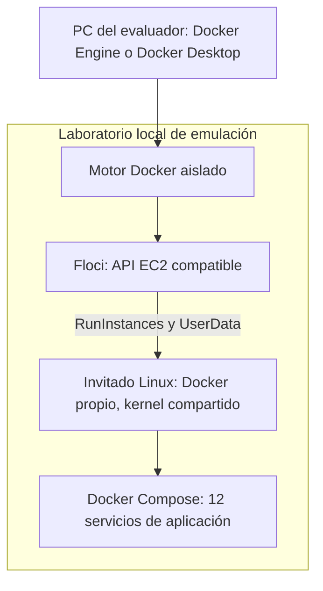
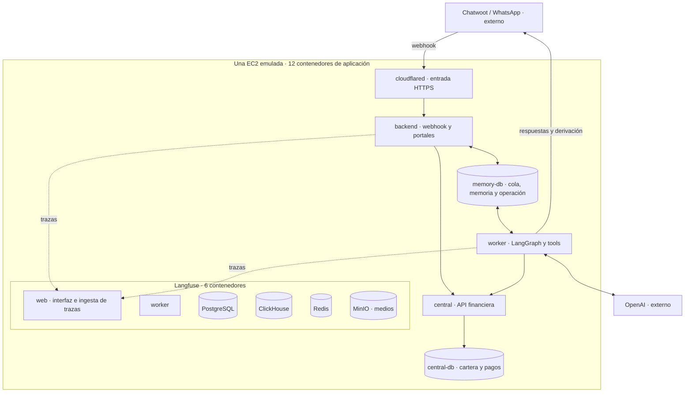
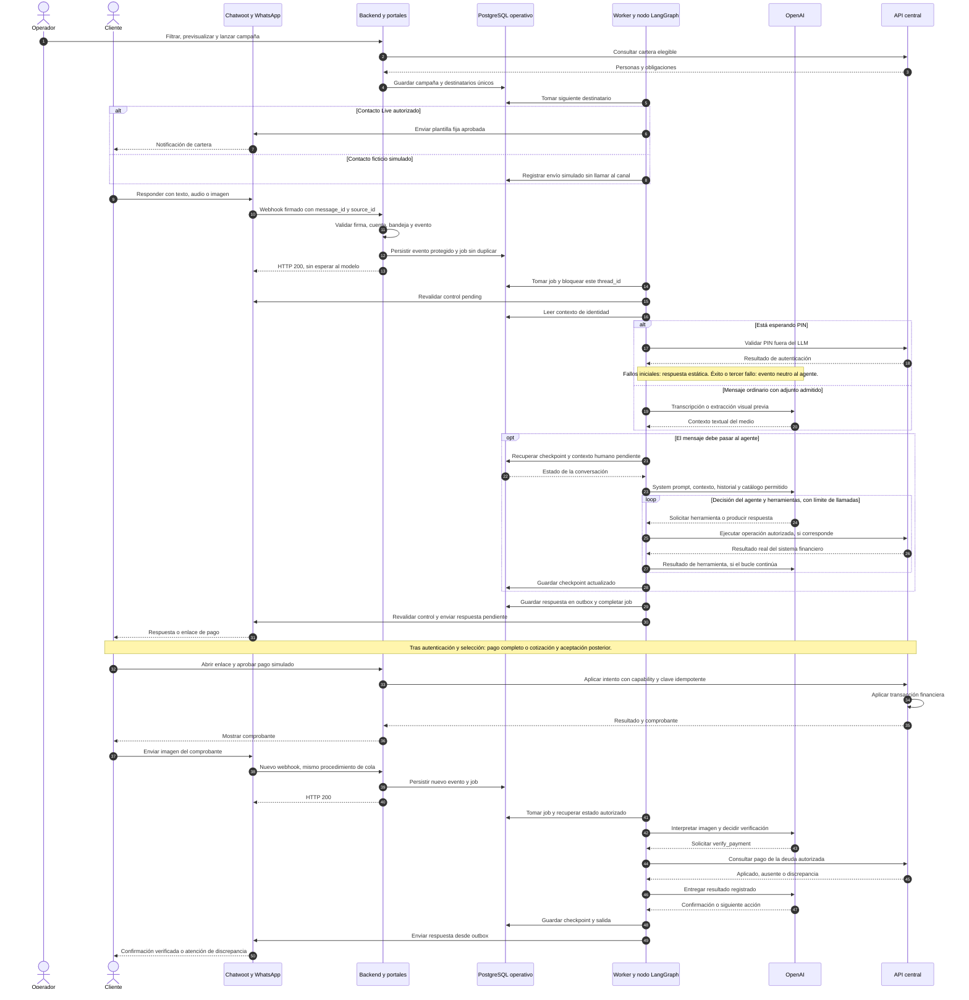
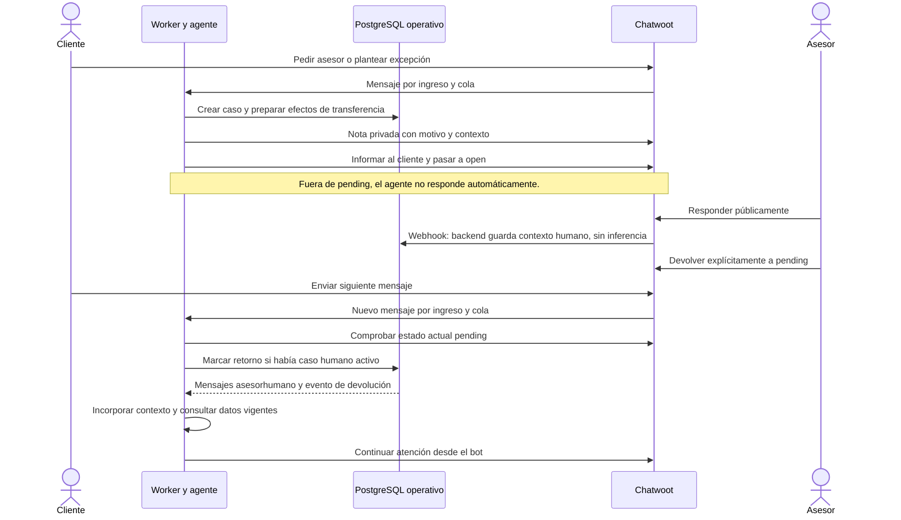
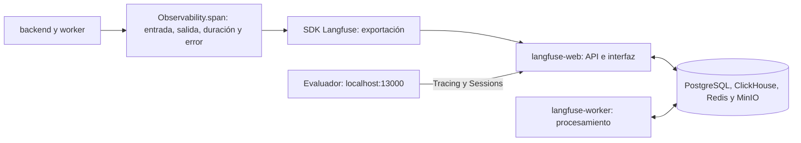
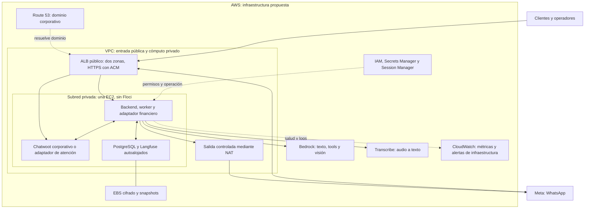

# Proyecto Ágil: documento técnico de arquitectura

**Autor:** Cristian Rangel · **Revisión:** 2 de noviembre de 2026.

Este documento presenta la solución, sus decisiones y sus límites para la
evaluación técnica. El [README](../README.md) permite instalar y recorrer el
prototipo; aquí se explica cómo funciona y cómo se propone llevarlo a AWS.

## 1. Problema y alcance

Proyecto Ágil apoya la gestión de cartera de telecomunicaciones mediante WhatsApp.
El operador segmenta clientes, inicia el contacto y revisa resultados. El cliente
consulta obligaciones, paga o negocia; un asesor atiende los casos que exceden la
autoridad del agente. Se busca aumentar la capacidad de atención y medir el
recaudo neto por persona gestionada, sin confundir respuestas con dinero recibido.

El prototipo usa datos ficticios, USD como única moneda, una deuda activa por
conversación y pagos simulados. El PIN de demostración es `2468`; no es un OTP ni
una autenticación de producción. La central simula el contrato de integración con
un ERP o sistema financiero; no pretende reemplazarlo.

| Área | Implementado en el prototipo | Propuesta o trabajo posterior |
|---|---|---|
| Cómputo | Stack Docker en invitado Linux creado por Floci | Una EC2 real como primer despliegue, sin Floci |
| Canal | Meta y Chatwoot reales; solo bandeja TEST autorizada | Canal empresarial y atención humana operados en AWS |
| Entrada pública | Dominio fijo mediante Cloudflare Tunnel | Entrada y DNS de AWS, descritos en sección 8 |
| Inferencia | API de OpenAI para agente, imágenes y audio | Adaptadores Bedrock y Transcribe para la propuesta AWS |
| Finanzas | API propia, datos ficticios y pasarela simulada | Adaptadores a cartera y pasarela corporativas |
| Observabilidad | Langfuse autoalojado y trazas reales | Operación AWS, alertas, retención y accesos corporativos |

**No se ha desplegado en AWS.** La guía permite ejecución local del prototipo,
pero exige que la infraestructura propuesta sea AWS. Las dependencias actuales
de Cloudflare, OpenAI directo y el servidor personal de Chatwoot pertenecen a la
demo; no se presentan como cumplimiento de esa infraestructura objetivo.

## 2. Infraestructura que ejecuta la demo

Floci implementa operaciones compatibles con EC2 y crea un invitado Linux en un
contenedor. El invitado dispone de su propio motor Docker, donde Compose levanta
la aplicación. Comparte kernel con el entorno contenedor; no es una máquina
virtual EC2 ni emula sus características físicas, IAM, red VPC o EBS.



Los doce servicios se agrupan en seis del producto y seis de Langfuse. Los
contenedores del laboratorio y los auxiliares de control se cuentan aparte.
El perfil sin entrada pública tiene once; `cloudflared` completa los doce.



| Servicio Compose | Responsabilidad | Persistencia que utiliza |
|---|---|---|
| `backend` | FastAPI, webhook, login de operador, cartera, campañas y portal de pago | `memory-db`; finanzas por API central |
| `worker` | Trabajos durables, medios, nodo LangGraph, tools y outbox | `memory-db`; finanzas por API central |
| `central` | Identidad de cartera, deudas, cotizaciones, órdenes y aplicación del pago | `central-db`, su único escritor de aplicación |
| `central-db` | PostgreSQL de clientes y operaciones financieras | Volumen `central_data` |
| `memory-db` | PostgreSQL de operación, checkpoints, autenticación local y presupuesto | Volumen `memory_data` |
| `cloudflared` | Conecta el dominio con `backend:8000` | Token privado, sin base propia |
| `langfuse-web` | Interfaz y API de observabilidad | Almacenes de Langfuse |
| `langfuse-worker` | Procesamiento de eventos de observabilidad | Almacenes de Langfuse |
| `langfuse-db` | Usuarios, proyectos y configuración | PostgreSQL propio |
| `langfuse-clickhouse` | Consulta analítica de observaciones | Volúmenes ClickHouse |
| `langfuse-redis` | Coordinación y colas internas de Langfuse | Volumen Redis |
| `langfuse-minio` | Objetos de eventos y medios | Volumen MinIO |

El agente no tiene un contenedor exclusivo: su código lo ejecuta `worker`, y la
inferencia se solicita a OpenAI. Ambos frontends se sirven desde `backend`, sin
un contenedor por web. El Redis de Langfuse no es la cola de nuestra aplicación.
La composición ejecutable es [infra/compose.yaml](../infra/compose.yaml).

## 3. Secuencia completa: campaña, conversación y pago

El diagrama sigue una obligación. El preprocesamiento de medios y el brazo de
PIN son alternativas anteriores al agente; el modelo no recibe el PIN que se
introduce durante la fase de autenticación.



Las llamadas del worker a Chatwoot utilizan el adaptador y, en la demo, un relay
externo restringido a TEST; el relay no aparece como contenedor de la aplicación.
Una tool puede cambiar contexto local o pedir un handoff sin consultar central;
el bucle del dibujo resume las herramientas financieras. Confirmar identidad
termina el bucle y solicita el PIN de forma estática. El tratamiento completo por
ramas está en el [mapa del agente](../README.md#flujo-técnico-del-webhook-a-la-respuesta-como-un-ai-agent-de-n8n).

La aprobación del portal actualiza la deuda antes de recibir la captura. La
imagen provoca una consulta, nunca autoriza un pago. El mensaje puede confirmar
el registro financiero, no certificar que una imagen sea auténtica.

## 4. Agente, estado y fronteras de autoridad

Un grafo `START → agent → END` contiene un único nodo y un ciclo interno de
inferencia y herramientas. El LLM interpreta la intención y decide la siguiente
acción. Python valida esquemas, permisos y efectos. La autenticación por PIN es
el brazo determinista deliberado; no es una clasificación global de números.

| Herramienta | Responsabilidad |
|---|---|
| `locate_customer` | Buscar candidato por teléfono o documento; no concede acceso financiero |
| `manage_identity` | Confirmar/rechazar candidato o cambiar titular; confirmar activa el PIN |
| `list_debts` | Consultar obligaciones del cliente autenticado y acuerdos vigentes |
| `select_debt` | Fijar una deuda autorizada y recuperar acuerdo/orden reutilizable |
| `create_full_payment` | Solicitar una orden por el saldo íntegro vigente |
| `quote_agreement` | Cotizar un pago con descuento, sujeto al mínimo de central |
| `accept_agreement` | Aceptar cotización en un mensaje posterior y obtener orden |
| `verify_payment` | Consultar el pago registrado para la deuda autorizada |
| `handoff_human` | Registrar motivo, nota y transferencia, suspendiendo automatización |

La memoria usa exactamente `source_id` como `thread_id`. Identifica al contacto
del canal, no al titular financiero. `conversation_id` identifica el destino de
respuesta en Chatwoot; `customer_id` identifica al cliente de cartera.

El estado define mensajes, fase, referencias y metadatos. El checkpointer
PostgreSQL persiste y recupera checkpoints para reconstruirlo. El prompt recibe
la ventana de veinte mensajes, con techo de entrada de 70.000 tokens y salida de
4.096; máximo cinco llamadas del agente por turno. El checkpoint no sustituye
la autorización: `VerifiedContext` y el grant validado por central la gobiernan.

Cambiar de titular o cerrar sesión revoca acceso, incrementa la revisión y limpia
referencias financieras; mantiene la llave conversacional. Los acuerdos de
central persisten. Al reautenticar, se recuperan si siguen vigentes y compatibles
con la versión y saldo de la deuda. Reutilizar una orden no extiende su vigencia.

La negociación intenta 95 % y después 80 % cuando corresponde, una propuesta
por turno. Una oferta válida superior al mínimo no se reduce innecesariamente.
Central rechaza descuentos por debajo de su mínimo del 80 % aunque el modelo lo
solicite. Cotizar, aceptar y pagar son hechos distintos: la condonación se aplica
con el pago aprobado, no por una promesa del LLM.

Contratos y detalle: [tools](../specs/001-cobranza-whatsapp/contracts/agent-tools.md),
[estado](../specs/001-cobranza-whatsapp/agent-state.md),
[modelo de datos y diagramas ER](../specs/001-cobranza-whatsapp/data-model.md).

## 5. Atención humana y devolución del control



El dibujo abrevia el backend en los webhooks. Las notas privadas no son mensajes
ordinarios del cliente. El retorno se detecta al siguiente mensaje mediante el
estado actual del canal y el caso humano persistido; no se supone que un webhook
de cambio de estado haya actualizado el grafo por sí solo. Una afirmación del
asesor tampoco sustituye la consulta a central sobre saldo o pago.

## 6. Datos, consistencia y fallos

| Riesgo | Control implementado | Límite o trabajo pendiente |
|---|---|---|
| Webhook falsificado | Firma, límites de payload, cuenta y bandeja permitidas | Custodia/rotación del secreto |
| Reenvío del mismo evento | Unicidad `account_id + message_id`; evento y job en una transacción | No equivale a ejecución exactamente una vez de toda la red |
| Dos turnos del mismo contacto | FIFO y bloqueo PostgreSQL por `thread_id` | Otros contactos pueden procesarse en paralelo |
| Reinicio de worker | Cola persistida, leases, reintentos limitados y claves idempotentes | Inspeccionar trabajos fallidos; una cola no resuelve toda incertidumbre |
| Pago duplicado o deuda modificada | Centavos enteros, versión, bloqueos, transacción y restricciones únicas | La pasarela real necesita conciliación y sus propios eventos |
| Otro titular o deuda ajena | Grant por cliente y comprobación de pertenencia en central | Sustituir PIN fijo por autenticación corporativa |
| Prompt injection | Reglas del prompt, catálogo acotado y autorización en Python/central | El prompt reduce riesgo; no garantiza obediencia universal |
| Adjunto malicioso | Tipo/tamaño/duración, allowlist y controles de descarga/SSRF | La interpretación visual puede equivocarse |
| Resultado de envío ambiguo | Outbox con estado `uncertain`, sin reenvío automático ciego | Reconciliar por ID de canal cuando exista evidencia |
| Humano toma control mientras se envía | Revalidar canal y revisión de identidad antes del envío | No existe transacción atómica con Chatwoot externo |
| Gasto excesivo de inferencia | Reservas atómicas y ledger compartido; límite local conservador | No es un tope contractual del proveedor ni cubre consumo ajeno |
| Caída de la máquina | Volúmenes persistentes y reinicio comprobado en emulación | Punto único de fallo; backup/restauración AWS aún no ensayados |

La API central es la frontera de datos. El backend no consulta directamente su
SQL para servir al agente. Una persona tiene varias obligaciones, agrupadas por
cliente; el documento y su tipo identifican al titular. La campaña deduplica por
persona y conserva las deudas elegibles, evitando una plantilla por servicio.

## 7. Observabilidad y operación comercial

### 7.1. Langfuse: ubicación y conexión

**Langfuse es la plataforma de observabilidad del agente.** Permite inspeccionar
lo que recibió una operación, sus resultados, herramientas, llamadas al modelo,
duraciones, errores y consumo. Está autoalojado dentro de la misma EC2 emulada:
no usamos Langfuse Cloud. Sus seis contenedores se muestran en la sección 2.

`backend` y `worker` utilizan el SDK de Langfuse a través de nuestra clase
`Observability`. `LANGFUSE_BASE_URL` configura el destino interno de ingesta,
`langfuse-web:3000` con esquema HTTP, y las claves privadas autentican el proyecto.
`langfuse-worker` procesa eventos; PostgreSQL, ClickHouse, Redis y MinIO aportan
los almacenes y la coordinación de ese stack. Estas bases están separadas de
cartera y memoria conversacional.

La interfaz para el evaluador se abre en `LANGFUSE_PUBLIC_URL`, actualmente
`http://localhost:13000`. Sus credenciales están al final del entorno privado
exportado. No se publica por el túnel de cobranza. En la propuesta AWS, Langfuse
seguiría autoalojado en EC2 y con acceso operativo restringido; CloudWatch
complementaría la salud de infraestructura y las alertas, sin reemplazar el
detalle de las llamadas del agente.



### 7.2. Instrumentación y organización de una ejecución

El código abre una observación con `observability.span(...)` antes de la
operación, registra su `input`, ejecuta el trabajo y actualiza su `output`.
Al salir del bloque se registra la duración y se cierra la observación. Si la
operación falla se registra el error. El SDK gestiona la exportación, que puede
ser asíncrona; una actualización no equivale necesariamente a un HTTP inmediato.
Langfuse muestra los puntos instrumentados, no todas las variables del proceso.

| Punto instrumentado | Entrada y salida relevantes | Código |
|---|---|---|
| `conversation` | Identificadores del evento, resultado del procesamiento y respuesta | [worker.py](../apps/backend/src/backend/worker.py#L57) |
| `identity_gate` | Contexto de autenticación y resultado seguro del filtro de PIN | [worker.py](../apps/backend/src/backend/worker.py) |
| `media_normalize`, `audio` y visión | Adjunto admitido, transcripción o extracción y consumo | [media.py](../apps/backend/src/backend/agent/media.py), [openai.py](../apps/backend/src/backend/integrations/openai.py) |
| `agent` | Mensaje, identidad y snapshots `state_before` / `state_after` | [worker.py](../apps/backend/src/backend/worker.py#L145) |
| `llm` | Prompt, contexto y catálogo enviados; texto o llamadas propuestas; tokens y coste calculado | [openai.py](../apps/backend/src/backend/integrations/openai.py#L221) |
| `tool.*` | Argumentos, identidad y fase anterior; resultado y fase posterior | [tools.py](../apps/backend/src/backend/agent/tools.py#L147) |
| `response_enqueue` y `delivery` | Respuesta preparada, referencia de outbox e intento de envío al canal | [worker.py](../apps/backend/src/backend/worker.py) |

La conexión con el SDK y la creación de observaciones se implementan en
[observability.py](../apps/backend/src/backend/integrations/observability.py#L441).
Su organización tiene tres niveles:

- **Sesión:** agrupa trazas del contacto. En Langfuse usamos una huella del
  `source_id`; LangGraph conserva el `source_id` literal como llave de memoria.
- **Traza:** agrupa observaciones de una ejecución. La raíz `conversation` se
  abre cuando el worker procesa el job; no incluye la espera previa en cola.
  Un reintento puede generar otra ejecución del mismo evento.
- **Observación:** representa una operación, con ID propio y referencia al
  padre. El anidamiento produce el árbol de agente, modelos y herramientas.

Un turno ordinario puede mostrar:

```text
conversation
├── identity_gate
├── media_normalize       si hay un adjunto
├── agent
│   ├── llm
│   ├── tool.verify_payment
│   └── llm
└── response_enqueue
    └── delivery
```

La outbox conserva el contexto padre para registrar `delivery` aun después de
reiniciar. El envío puede ocurrir después de cerrar la raíz; su espera no queda
incluida en la duración de esa raíz. Algunas trazas históricas de envío quedaron
separadas y se relacionan por sesión y evento. Durante un rechazo estático de
PIN no se espera una generación del modelo. Los mensajes pasivos del asesor se
incorporan al historial de un turno posterior, sin ejecutar un LLM al guardarlos.

### 7.3. Cómo verificar una traza y sus límites

En Langfuse, abrir el proyecto **Cobranza-Demo**, entrar en **Tracing** y localizar
el turno por hora, evento o sesión. Comparar el mensaje recibido, argumentos y
resultado de tools, entrada/salida del LLM y salida preparada/enviada. Los casos
guiados y la navegación están en [README, sección 7](../README.md#7-revisar-cada-turno-completo-en-langfuse).

Un `completed` técnico no significa que la respuesta sea semánticamente correcta.
`sent` indica aceptación del envío por la API, no lectura o entrega de WhatsApp.
La instrumentación registra fallos de telemetría como advertencias: una operación
de negocio completada o una respuesta HTTP saludable de Langfuse no demuestran
que su traza haya llegado. La comprobación exige abrir la ejecución y verificar
sus observaciones, como se registra en [evaluación](evaluacion.md).

### 7.4. Captura privada de contenido

`LANGFUSE_CAPTURE_CONTENT=true` permite depurar entradas y salidas; con `false`
se conservan metadatos operativos sin ese contenido. Aplicamos exclusión de secretos
conocidos y del PIN procesado en autenticación. Los adjuntos autorizados pueden
contener información visible o hablada: no hay promesa de redacción automática
de su contenido. Antes de producción se deben definir retención, borrado,
acceso, consentimiento y clasificación de trazas con seguridad y jurídico.

Langfuse no es el origen del saldo, de los checkpoints ni del presupuesto. La
verdad financiera pertenece a central, la memoria al checkpointer PostgreSQL y
el control de gasto al ledger `inference_reservation`; las trazas ayudan a
inspeccionar lo ocurrido, sin sustituir esos registros.

### 7.5. Métricas de negocio y responsabilidades

El negocio observa personas con envío real, entregas conocidas, personas que
responden al menos una vez, pagos íntegros, acuerdos, condonación, recaudo,
solicitudes de asesor y casos sin resultado al corte. Los simulados se muestran
aparte. La contactabilidad usa la población con envío real según la definición
de la demo; se debe acompañar de cobertura y fallos para no ocultar exclusiones.
Estos indicadores se calculan en el backend a partir de eventos de operación y
central, y se muestran en la interfaz de campañas; no se deducen del número de
trazas de Langfuse.
Para un piloto, comparar recaudo neto por persona asignada y cartera comparable
por riesgo, monto y mora; incluir coste operativo y condonación, no solo respuestas.

El operador administra segmentos y campaña. El asesor resuelve excepciones. La
operación técnica supervisa colas, fallos, presupuesto, salud, almacenamiento y
accesos. Políticas comerciales, consentimiento de contacto, horarios y
restricciones aplicables en Panamá requieren validación empresarial y jurídica;
no están automatizadas como cumplimiento normativo en el prototipo.

## 8. Propuesta de infraestructura AWS

**Propuesta para evaluación, no infraestructura aprovisionada ni una ampliación
obligatoria del prototipo.** Se conserva una EC2 para iterar rápido sobre la
aplicación. La entrada, gestión e inferencia se adaptarían a servicios AWS.
Meta/WhatsApp sigue siendo el canal externo necesario; el proveedor real de pagos
y el sistema corporativo de cartera se integran según sus contratos.



El ALB se distribuiría en subredes públicas de dos zonas, con la EC2 en una
subred privada. El grupo de seguridad del host aceptaría tráfico de aplicación
solo desde el ALB; PostgreSQL y observabilidad permanecerían internos. La salida
a Meta requiere NAT o una ruta corporativa equivalente. Las dependencias de AWS
requieren conectividad por esa salida o endpoints privados configurados. Esto
tiene coste adicional y **no elimina el punto único de fallo de una sola EC2**.

| Decisión | Motivo y adaptación necesaria |
|---|---|
| EC2 + Docker Compose | Flexibilidad y menor cambio inicial del código. Requiere parches, dimensionamiento y operación del host; no aporta alta disponibilidad por sí sola. [EC2](https://docs.aws.amazon.com/AWSEC2/latest/UserGuide/concepts.html) |
| EBS cifrado | Separar datos de imágenes y conservarlos al sustituir procesos. Definir copias consistentes, retención y probar restauración; Stop/Start no demuestra recuperación de desastre. |
| Route 53 + ALB/ACM | Sustituir la dependencia de Cloudflare por entrada HTTPS AWS con certificados y comprobación de targets. Requiere adaptar puertos/binds del perfil actual y configurar DNS. [ALB](https://docs.aws.amazon.com/elasticloadbalancing/latest/application/introduction.html) |
| VPC, grupos de seguridad y NAT | Mantener el host sin entrada directa de Internet y permitir salida controlada. Su coste se incluye en el presupuesto del despliegue. [NAT](https://docs.aws.amazon.com/vpc/latest/userguide/vpc-nat-gateway.html) |
| IAM + Secrets Manager + Session Manager | Rol mínimo del host, secretos fuera de Git y administración sin SSH abierto. Son integraciones pendientes, no propiedades verificadas por Floci. [Secretos](https://docs.aws.amazon.com/secretsmanager/latest/userguide/intro.html), [administración](https://docs.aws.amazon.com/systems-manager/latest/userguide/session-manager.html) |
| Bedrock y Transcribe | Proveer inferencia y transcripción desde AWS. Hay que adaptar clientes y validar tools, visión, idiomas, cuotas, región, coste y evals; cambiar solo una URL no acredita compatibilidad. [Bedrock](https://docs.aws.amazon.com/bedrock/latest/userguide/what-is-bedrock.html), [Transcribe](https://docs.aws.amazon.com/transcribe/latest/dg/what-is.html) |
| Chatwoot/atención en AWS | Trasladar el canal propio o conectar el sistema empresarial aprobado. El Chatwoot personal y relay actual no forman parte de la propuesta AWS; autoalojarlo exige añadir sus dependencias y medir recursos. |
| CloudWatch + Langfuse | CloudWatch supervisaría infraestructura y alertas; Langfuse conservaría el detalle de turnos, modelos y herramientas. No son la misma vista de operación. |

Los doce contenedores describen la **demo**, no un inventario ya construido de
esta propuesta AWS: se elimina `cloudflared` y deben resolverse las dependencias
del canal y los adaptadores. La región, la capacidad del host, disponibilidad de
modelos, requisitos de residencia y objetivos de recuperación se acuerdan antes
de contratar infraestructura. El procedimiento EC2 existente es una base manual,
no un despliegue ejecutable de todos los servicios AWS de este diagrama.

Una evolución posterior evaluaría separar bases, almacenamiento y procesamiento
en servicios administrados según carga, disponibilidad y coste total medidos.
No se promete ahorro automático: también se pagan red, almacenamiento, logs,
canal e inferencia. IaC queda como plan futuro, sin Terraform obligatorio.

## 9. Evidencia, entrega y límites de validación

- La revisión `45201b3` ejecutó **447 pruebas deterministas aprobadas**. Ese
  resultado acredita los contratos cubiertos; no una disponibilidad comercial ni
  la obediencia universal del modelo.
- Hay recorridos reales de WhatsApp, audio, imágenes, pagos simulados, atención
  humana y persistencia descritos en [evaluación](evaluacion.md). La recuperación
  nueva de acuerdos tiene regresiones y despliegue comprobados; falta repetirla
  por WhatsApp. No se renuevan acuerdos vencidos para aparentar éxito.
- El catálogo público de [evals](evals.md) contiene cincuenta snapshots; la
  validación offline no llama al modelo. El runner live evalúa una decisión sin
  ejecutar tools y conserva pendiente la revisión semántica humana.
- Se comprobó Linux x86_64. Windows/macOS/ARM tienen lanzadores, contratos e
  imágenes compatibles, pero el recorrido completo debe ejecutarse en el equipo
  destino. El primer arranque descarga imágenes y requiere recursos suficientes.
- Una máquina y sus volúmenes son un punto de fallo. No se han validado AWS real,
  carga masiva, restauración EBS, objetivos RTO/RPO ni cumplimiento jurídico.

El paquete de entrega incluye este documento, el repositorio y su README. El
archivo de configuración se comparte de forma privada, sin bases de estudio ni
secretos en Git. La demo guiada sirve como guion para la sustentación; una
grabación breve, si se decide usarla, debe prepararse aparte.

## 10. Índice de diagramas y documentación de apoyo

La propuesta cubre las preguntas de arquitectura de la prueba de la siguiente
forma, sin trasladar el documento original del empleador al repositorio público:

| Tema solicitado | Cobertura |
|---|---|
| Origen de datos y selección de destinatarios | Secciones 1, 3 y 6; contrato de cartera y campaña |
| Funcionamiento, capacidades y memoria del agente | Secciones 3 y 4; herramientas y checkpoints |
| Integración con los sistemas empresariales | Secciones 1, 6 y 8; fronteras API y adaptadores pendientes |
| Operación, campañas y reglas de negocio | Secciones 3, 4 y 7; roles, límites y revisión humana |
| Fallos y mitigaciones | Secciones 5 y 6; concurrencia, incertidumbre y seguridad |
| Valor y métricas de negocio | Sección 7; recaudo, condonación, cobertura y piloto comparable |
| Infraestructura propuesta sobre AWS | Sección 8; separada explícitamente del prototipo local |

Diagramas y documentos para profundizar:

| Diagrama o documento | Pregunta que responde |
|---|---|
| Sección 2: capas Floci e inventario de servicios | ¿Dónde corre cada componente y cuántos contenedores hay? |
| Sección 3: secuencia principal | ¿Qué ocurre desde la campaña hasta verificar el comprobante? |
| Sección 5: secuencia humana | ¿Cómo se suspende y recupera la atención automática? |
| Sección 8: propuesta AWS | ¿Qué infraestructura se propone y qué falta adaptar? |
| [README: mapa del agente](../README.md#flujo-técnico-del-webhook-a-la-respuesta-como-un-ai-agent-de-n8n) | ¿Qué ramas, PIN y ciclo de herramientas ejecuta el código? |
| [Modelo de datos](../specs/001-cobranza-whatsapp/data-model.md) | ¿Cómo se relacionan clientes, deudas, acuerdos, pagos, campañas y memoria? |
| [Plan y decisiones](../specs/001-cobranza-whatsapp/plan.md) | ¿Qué contratos y decisiones técnicas sustentan la implementación? |
| [Despliegue local](emulacion-ec2.md) y [referencia EC2 real](despliegue-ec2.md) | ¿Cómo se instala y qué parte sigue siendo una propuesta? |

El [mapa inicial](../specs/arquitectura-inicial.md) se conserva como antecedente de
diseño; este documento consolida el estado para la entrega.
