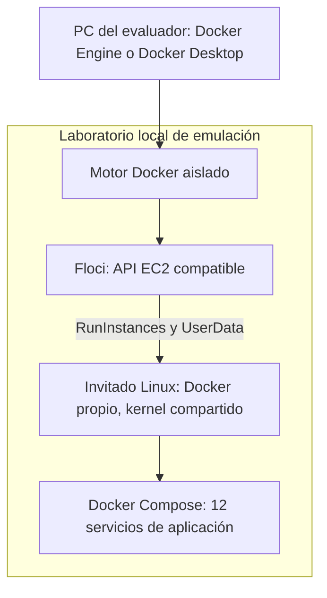
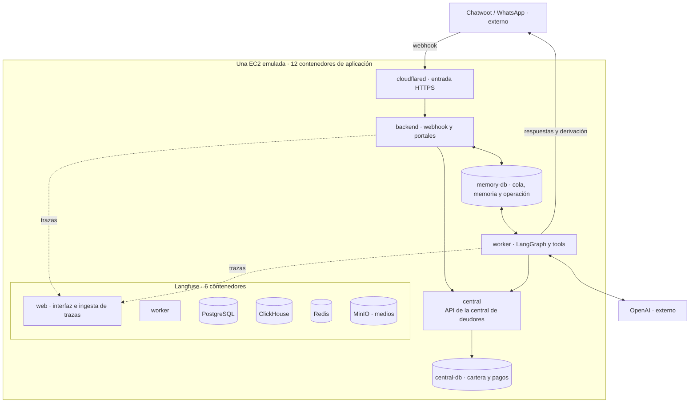
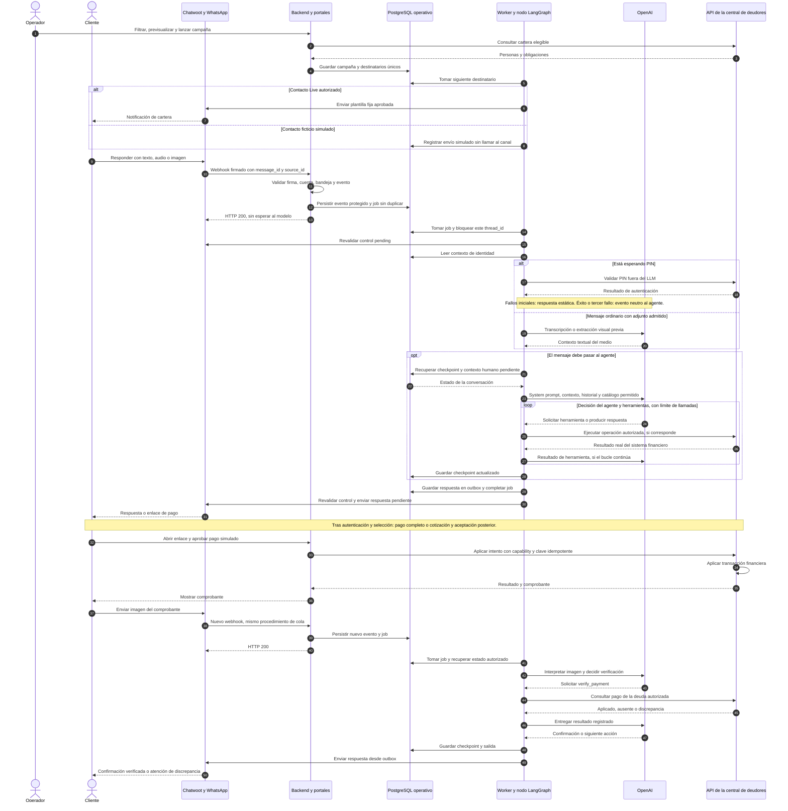
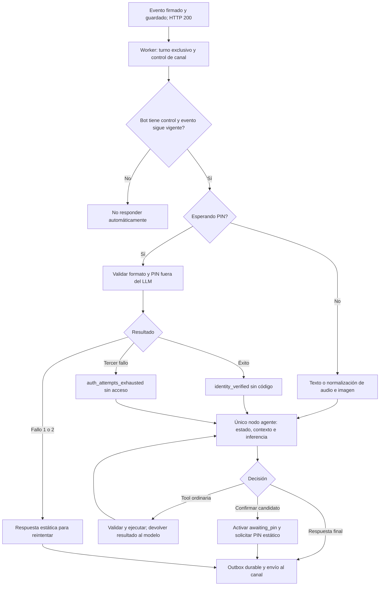
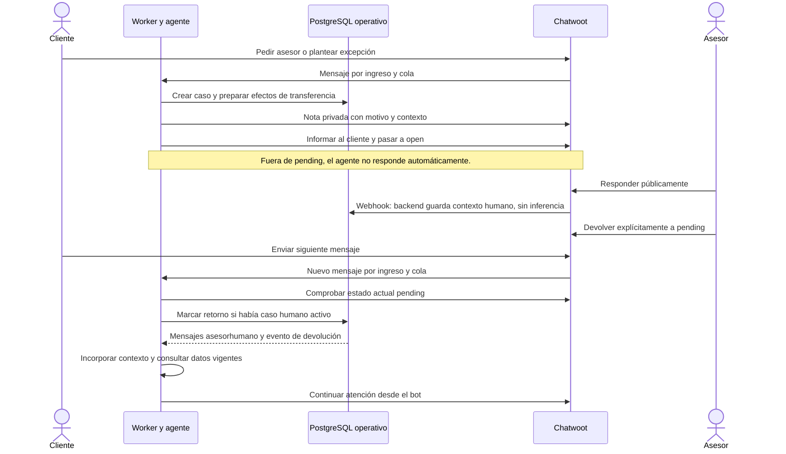
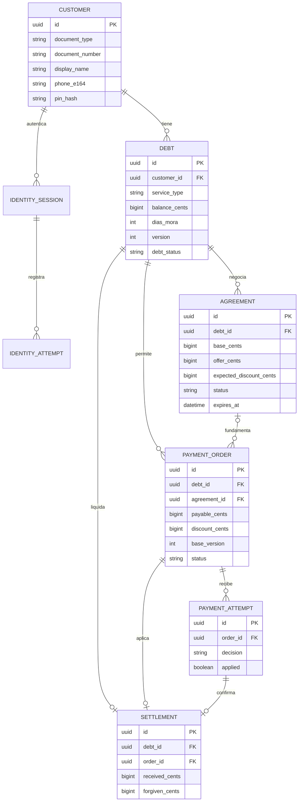
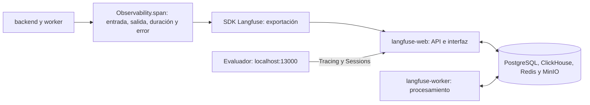
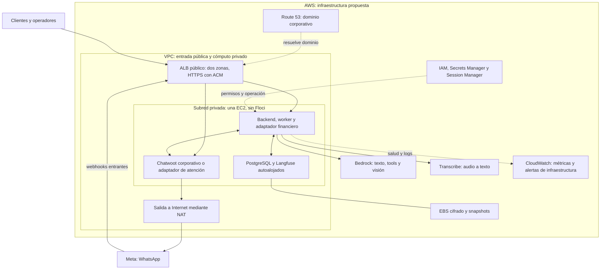

# Proyecto Ágil: documento técnico de arquitectura

**Autor:** Cristian Danilo Bolaños Rangel · **Revisión:** 3 de noviembre de 2026.

Este documento describe de forma autocontenida el problema, la solución implementada, sus contratos de datos, ejecución, controles, operación y propuesta de infraestructura AWS. Incluye el procedimiento de demostración y distingue capacidades verificadas, simulaciones y trabajo pendiente. Su lectura no requiere abrir otros documentos del repositorio.

**Resumen de la solución.** Un operador selecciona una cohorte de cartera y envía una plantilla de WhatsApp. Un agente con inferencia real interpreta la respuesta, identifica al titular y, tras una validación externa al modelo, consulta y gestiona una obligación. Puede emitir un enlace de pago, negociar dentro de un límite autorizado o transferir a una persona. La central de deudores conserva la autoridad para validar identidad, importes y liquidaciones. Cada turno queda instrumentado para inspeccionar sus decisiones y efectos.

**Contenido**

- [1. Problema y alcance](#1-problema-y-alcance)
- [2. Infraestructura que ejecuta la demo](#2-infraestructura-que-ejecuta-la-demo)
- [3. Secuencia completa: campaña, conversación y pago](#3-secuencia-completa-campaña-conversación-y-pago)
- [4. Agente, estado y fronteras de autoridad](#4-agente-estado-y-fronteras-de-autoridad)
- [5. Atención humana y devolución del control](#5-atención-humana-y-devolución-del-control)
- [6. Datos, consistencia y fallos](#6-datos-consistencia-y-fallos)
- [7. Observabilidad y operación comercial](#7-observabilidad-y-operación-comercial)
- [8. Propuesta de infraestructura AWS](#8-propuesta-de-infraestructura-aws)
- [9. Evidencia y límites de validación](#9-evidencia-y-límites-de-validación)
- [10. Instalación, demostración y operación de la entrega](#10-instalación-demostración-y-operación-de-la-entrega)
- [11. Decisiones de diseño y alternativas](#11-decisiones-de-diseño-y-alternativas)
- [12. Glosario para la sustentación](#12-glosario-para-la-sustentación)

## 1. Problema y alcance

Proyecto Ágil apoya la gestión de cartera de telecomunicaciones mediante WhatsApp.
El operador segmenta clientes, inicia el contacto y revisa resultados. El cliente
consulta obligaciones, paga o negocia; un asesor atiende los casos que exceden la
autoridad del agente. Se busca aumentar la capacidad de atención y medir el
recaudo neto por persona gestionada, sin confundir respuestas con dinero recibido.

El prototipo usa datos ficticios, USD como única moneda, una deuda activa por
conversación y pagos simulados. El PIN de demostración es `2468`; no es un OTP ni
una autenticación de producción. La central simula el contrato de integración con
un ERP o sistema financiero; no pretende reemplazarlo.

La API key privada facilitada en `.env.entrega` corresponde al proyecto de
pruebas de OpenAI Platform con un presupuesto de **USD 10**, configurado por el
autor. La aplicación tiene además un límite interno independiente de **USD 10**.
Una instalación nueva comienza con consumo local de **USD 0** y **USD 10
disponibles**: se entregan código y configuración, sin bases ni contadores de las
pruebas del desarrollador. El gasto que ya exista en OpenAI Platform no se
reinicia al instalar el prototipo en otro equipo.

| Área | Implementado en el prototipo | Propuesta o trabajo posterior |
|---|---|---|
| Cómputo | Stack Docker en invitado Linux creado por Floci | Una EC2 real como primer despliegue, sin Floci |
| Canal | Meta y Chatwoot reales; solo bandeja TEST autorizada | Canal empresarial y atención humana operados en AWS |
| Gestión de identidad | Localización y confirmación del titular, PIN fuera del LLM, sesión temporal, cierre y cambio de titular con nueva autenticación | OTP u otro mecanismo corporativo de identidad aprobado |
| Entrada pública | Dominio fijo mediante Cloudflare Tunnel | Entrada y DNS de AWS, descritos en sección 8 |
| Inferencia | API de OpenAI para agente, imágenes y audio | Adaptadores Bedrock y Transcribe para la propuesta AWS |
| Finanzas | API de la central de deudores, datos ficticios y pasarela simulada | Adaptadores a cartera y pasarela corporativas |
| Observabilidad | Langfuse autoalojado y trazas reales | Operación AWS, alertas, retención y accesos corporativos |

**No se ha desplegado en AWS.** La guía permite ejecución local del prototipo,
pero exige que la infraestructura propuesta sea AWS. Las dependencias actuales
de Cloudflare, OpenAI directo y el servidor personal de Chatwoot pertenecen a la
demo; no se presentan como cumplimiento de esa infraestructura objetivo.

El número de WhatsApp utilizado es un número TEST asociado a un portafolio
comercial activo de Meta. La instancia de Chatwoot y el dominio/endpoint público
son de propiedad personal y se facilitan para ejecutar la prueba; no pertenecen
a Liberty Latin America. El endpoint público dirige las peticiones al backend
que ejecuta el evaluador en su entorno local emulado.

### 1.1. Alcance comercial y supuestos

La unidad financiera de la demo es una obligación asociada a un servicio contratado. Una persona puede tener hogar, telefonía y televisión, con saldos independientes. La central web muestra una fila por obligación, pero conserva una sola identidad y contacto por persona. El agente gestiona una obligación a la vez para que una negociación o comprobante no se aplique a otro servicio.

El objetivo del piloto sería aumentar la capacidad de gestión y el recaudo neto con un trato consistente, sin suponer que más mensajes o más acuerdos implican más valor. La intervención humana sigue siendo necesaria para disputas, restricciones comerciales y solicitudes del cliente. La automatización no sustituye la definición de políticas por el negocio.

Los supuestos explícitos son:

- Los datos maestros de identidad, servicio y saldo existen en un sistema corporativo; la API de la central de deudores de esta demo representa esa frontera.
- La moneda es USD. El prototipo liquida íntegramente una obligación mediante pago completo o pago con condonación; no implementa abonos parciales, cuotas ni planes de financiación.
- La política demostrativa permite cobrar al menos el 80 % del saldo y condonar la diferencia al aplicar el pago. No se atribuye esta política a LLA.
- Las personas y documentos son ficticios. El mismo PIN `2468` facilita la evaluación; en producción debe sustituirse por OTP u otro mecanismo de identidad autorizado por la empresa.
- El evaluador controla el único contacto Live. Los demás destinos son simulados y no se intenta enviarles mensajes.
- Los horarios permitidos, consentimiento, exclusiones, tratamiento de datos y política de cobranza en Panamá deben acordarse con operación y jurídico antes de un piloto real. La demo no acredita cumplimiento normativo.

### 1.2. Responsabilidades de los participantes

| Participante | Decisión o responsabilidad |
|---|---|
| Operador comercial | Seleccionar segmento, revisar destinatarios, lanzar campaña y cerrar su periodo de medición. |
| Cliente o persona que gestiona una deuda | Confirmar el titular, superar la validación, elegir servicio y aceptar condiciones de pago. |
| Agente de IA | Interpretar intención, explicar datos comprobados, proponer acciones y solicitar herramientas permitidas. |
| Central de deudores | Autorizar consultas y aplicar reglas de dinero, vigencia, pertenencia y liquidación. |
| Asesor humano | Atender excepciones, dialogar con el cliente y devolver explícitamente el control cuando corresponda. |
| Operación técnica | Vigilar salud, cola, errores, presupuesto y telemetría; administrar despliegues y recuperación. |

La demo aporta evidencia de comportamiento funcional. El ahorro, la recuperación incremental y la satisfacción requieren medición en un piloto comparable; no se presentan como resultados de negocio ya obtenidos.

## 2. Infraestructura que ejecuta la demo

Floci implementa operaciones compatibles con EC2 y crea un invitado Linux en un
contenedor. El invitado dispone de su propio motor Docker, donde Compose levanta
la aplicación. Comparte kernel con el entorno contenedor; no es una máquina
virtual EC2 ni emula sus características físicas, IAM, red VPC o EBS.



Los doce servicios se agrupan en seis del producto y seis de Langfuse. Los
contenedores del laboratorio y los auxiliares de control se cuentan aparte.
El perfil sin entrada pública tiene once; `cloudflared` completa los doce.



| Servicio Compose | Responsabilidad | Persistencia que utiliza |
|---|---|---|
| `backend` | FastAPI, webhook, login de operador, cartera, campañas y portal de pago | `memory-db`; finanzas por API de la central de deudores |
| `worker` | Trabajos durables, medios, nodo LangGraph, tools y outbox | `memory-db`; finanzas por API de la central de deudores |
| `central` | Identidad de cartera, deudas, cotizaciones, órdenes y aplicación del pago | `central-db`, su único escritor de aplicación |
| `central-db` | PostgreSQL de clientes y operaciones financieras | Volumen `central_data` |
| `memory-db` | PostgreSQL de operación, checkpoints, autenticación local y presupuesto | Volumen `memory_data` |
| `cloudflared` | Conecta el dominio con `backend:8000` | Token privado, sin base propia |
| `langfuse-web` | Interfaz y API de observabilidad | Almacenes de Langfuse |
| `langfuse-worker` | Procesamiento de eventos de observabilidad | Almacenes de Langfuse |
| `langfuse-db` | Usuarios, proyectos y configuración | PostgreSQL propio |
| `langfuse-clickhouse` | Consulta analítica de observaciones | Volúmenes ClickHouse |
| `langfuse-redis` | Coordinación y colas internas de Langfuse | Volumen Redis |
| `langfuse-minio` | Objetos de eventos y medios | Volumen MinIO |

El agente no tiene un contenedor exclusivo: su código lo ejecuta `worker`, y la
inferencia se solicita a OpenAI. Ambos frontends se sirven desde `backend`, sin
un contenedor por web. El Redis de Langfuse no es la cola de nuestra aplicación.
Los procesos se configuran con Docker Compose y persisten sus datos en volúmenes separados de las imágenes.

### 2.1. Qué aporta la emulación y qué no prueba

El lanzador prepara un Docker Engine aislado. Floci recibe operaciones de control compatibles con EC2, crea el invitado Linux y ejecuta su inicialización (`UserData`). Dentro de ese invitado se transfieren las fuentes permitidas y se ejecutan migraciones, datos iniciales y Compose. El reinicio ejercita la parada y arranque por la API emulada y la persistencia del stack.

La imagen del invitado contiene Docker y SSH. El lanzador selecciona un tipo compatible con la arquitectura nativa de Docker: `t2.xlarge` (4 CPU/16 GiB) en x86_64 y `m6g.large` (2 CPU/8 GiB) en ARM64, incluidos Mac con Apple Silicon. La verificación compara los límites Docker y cgroup con el tipo solicitado. El entorno completo se ejecutó en Linux x86_64; en un segundo equipo Mac ARM64 se comprobó el arranque del stack y la integración real de chat. Esa elección responde al catálogo de Floci y no recomienda una familia EC2 para producción. El motor exterior tiene un techo de hasta 8 CPU y 24 GiB, sin reservar toda esa memoria al iniciar.

Floci permite probar el proceso de preparación y control de una instancia con la aplicación dentro. No genera por sí mismo la infraestructura como código de AWS, ni acredita políticas IAM, grupos de seguridad, disponibilidad, rendimiento de discos o comportamiento de una VM real. El invitado es un contenedor privilegiado que comparte el kernel Linux del entorno. En Docker Desktop, ese kernel lo proporciona la VM Linux de Desktop.

El coste de esta fidelidad operativa es más complejidad y consumo local que ejecutar Compose directamente. Se conserva para demostrar un entorno completo separado del desarrollo; no es un requisito del negocio ni una dependencia del backend en AWS. En EC2 real se instala Docker en el host y se ejecuta la aplicación sin Floci ni las capas de Docker anidado.

### 2.2. Separación de procesos y persistencia

`backend` responde HTTP y acepta trabajo; `worker` realiza las operaciones largas. Comparten imagen de aplicación, pero pueden reiniciarse por separado. Si se detiene el worker, el backend puede seguir aceptando eventos durables; aumenta la cola y no aparecen respuestas hasta recuperar procesamiento. Si falla PostgreSQL operativo, no se debe reconocer como guardado un evento que no se pudo persistir.

Los dos PostgreSQL de producto tienen responsabilidades distintas: `central-db` es la verdad financiera y `memory-db` contiene ejecución, memoria, permisos locales y presupuesto. El backend no lee tablas financieras directamente. Langfuse tiene sus propios almacenes; perder una traza no debe cambiar un saldo, y borrar un checkpoint no liquida una deuda.

Los volúmenes conservan datos entre reinicios. Eso protege frente a reemplazar procesos, pero no equivale a una copia de seguridad fuera del host. Una sola máquina sigue concentrando fallos de cómputo y almacenamiento. El reset de demo y la recuperación de desastre son operaciones diferentes.

## 3. Secuencia completa: campaña, conversación y pago

El diagrama sigue una obligación. El preprocesamiento de medios y el brazo de
PIN son alternativas anteriores al agente; el modelo no recibe el PIN que se
introduce durante la fase de autenticación.



Las llamadas del worker a Chatwoot utilizan el adaptador y, en la demo, un relay
externo restringido a TEST; el relay no aparece como contenedor de la aplicación.
Una tool puede cambiar contexto local o pedir un handoff sin consultar central;
el bucle del dibujo resume las herramientas financieras. Confirmar identidad termina el bucle y solicita el PIN de forma estática. Las ramas y sus precondiciones se desarrollan en la sección 4.

El relay comparte sus cuotas entre los equipos de la prueba: 1.000 intentos de
envío y 10 intentos de crear contactos por día UTC, con contadores diarios
persistentes que incluyen intentos fallidos o inciertos. Reiniciar la aplicación,
restaurar fixtures o cambiar de equipo no repone esas cuotas. El límite adicional
de 60 peticiones por minuto se controla en memoria en el proceso del relay.
Plantillas, respuestas y efectos de atención humana consumen intentos de envío;
estas cuotas son independientes del presupuesto de IA y de las reglas de Meta.

La aprobación del portal actualiza la deuda antes de recibir la captura. La
imagen provoca una consulta, nunca autoriza un pago. El mensaje puede confirmar
el registro financiero, no certificar que una imagen sea auténtica.

### 3.1. De dónde sale el segmento y cómo se envía

El operador consulta la central con filtros de servicio, tipo y número de documento, rango de días de mora y estado. Los catálogos alimentan desplegables; la mora es un campo explícito de la deuda. En producción habría que definir su actualización desde facturación y una fecha de corte consistente; el fixture mantiene valores controlados para probar límites como 29/30, 59/60 y 89/90 días.

La previsualización agrupa obligaciones por `customer_id`, cuya identidad de negocio es única por tipo y número de documento. Guarda los IDs de deudas elegibles, versión de contacto y modo de envío. Una misma persona con dos servicios produce un destinatario y una plantilla. La campaña conserva una fotografía de filtros y plantilla para que sus resultados correspondan a la selección original.

Guardar crea un borrador; lanzar inicia el despacho secuencial. Cada destinatario tiene posición y resultado persistidos: `queued`, `simulated`, `sent`, `failed`, `uncertain` o `skipped`. Una restricción impide que la misma persona tenga dos participaciones activas que dupliquen el contacto. El seguimiento dura 24 horas por defecto, o hasta el corte explícito. Cambiar el contacto después de preparar la campaña obliga a revisar su versión; no se reutiliza silenciosamente un destino desactualizado.

En modo simulado se registra el resultado sin llamadas al canal ni inferencia. En Live, el adaptador resuelve el contacto y la conversación de la bandeja TEST, envía la plantilla fija `recordatorio_factura_demo` en español y conserva las referencias de canal. El contenido visible en Chatwoot debe coincidir con el cuerpo de la plantilla enviada. El panel consulta el progreso cada tres segundos mientras está visible. `completed` significa que terminó el lote, no que todos recibieron WhatsApp.

La plantilla se aprobó previamente como utilidad para este recordatorio transaccional. La categoría debe corresponder al contenido y a la decisión del proveedor; no se usa como garantía de entrega ni como forma de eludir reglas de marketing. Crear plantillas programáticamente, esperar revisión y gestionar versiones es una evolución del módulo comercial, no una capacidad implementada en la demo.

### 3.2. Contratos y frontera con sistemas corporativos

La API de la central de deudores expone operaciones HTTP con prefijo `/internal/v1`. Se autentica al consumidor con credenciales de rol seleccionadas por el servidor: operador o agente. Las operaciones sobre cartera de una persona requieren además un grant de cliente válido. El modelo no recibe esas credenciales ni elige el encabezado de autorización.

| Operación del contrato actual | Datos y resultado | Uso |
|---|---|---|
| `POST /identity/locate` | Teléfono o tipo/número de documento → candidato y pista de identidad | Localizar sin revelar cartera. |
| `POST /identity/verify` | Candidato/vínculo y PIN → resultado y autorización temporal | Solo el brazo de autenticación del backend. |
| `POST /identity/revoke` | Vínculo autorizado → revocación | Cerrar sesión o cambiar titular. |
| `GET /debts` y `/debts/{id}` | Grant/filtros → obligaciones, versión y acuerdo vigente si existe | Consultar y seleccionar sin escribir saldos. |
| `POST /orders` | Deuda y versión esperada → orden por saldo total | Pago sin descuento. |
| `POST /agreements/quote` | Deuda, importe, versión y mensaje origen → cotización | Validar condiciones sin aceptarlas ni cobrarlas. |
| `POST /agreements/{id}/accept` | Cotización y otro mensaje origen → aceptación y orden | Separar propuesta y aceptación. |
| `POST /orders/{id}/attempts` | Orden autorizada, decisión simulada y clave idempotente → intento/recibo | Portal de pago. |
| `GET /payments/verify` | Deuda autorizada y referencia opcional → estado del pago | Confirmar contra registros financieros. |
| `GET /events` | Cursor → eventos de negocio ordenados | Conciliar pagos/acuerdos con métricas de campañas. |

Los comandos financieros, la revocación de identidad y las ediciones llevan `Idempotency-Key`; la versión de deuda permite detectar condiciones desactualizadas. La localización crea candidatos temporales sin esa clave, y la verificación de PIN deduplica intentos por sesión y mensaje origen. Los errores devuelven código, mensaje seguro y condición de reintento; una denegación de pertenencia no se convierte en un resultado vacío que el agente pueda interpretar como saldo cero.

Para conectar un ERP real se sustituye el adaptador financiero conservando esta semántica: identificación de cliente y obligación, lectura de saldo, aprobación comercial, creación de orden, aplicación/consulta de pago y eventos conciliables. Hay que acordar con su propietario quién escribe cada dato, cómo se autentica la integración y cómo se recuperan errores. No basta con copiar tablas ni dar acceso SQL libre al LLM.

Una pasarela real requeriría validar sus notificaciones firmadas, correlacionar transacción/orden y conciliar operaciones ambiguas. El botón de aprobación actual simula ese resultado; una imagen de comprobante seguiría sin ser autoridad para liquidar.

## 4. Agente, estado y fronteras de autoridad

Un grafo `START → agent → END` contiene un único nodo y un ciclo interno de
inferencia y herramientas. El LLM interpreta la intención y decide la siguiente
acción. Python valida esquemas, permisos y efectos. La autenticación por PIN es
el brazo determinista deliberado; no es una clasificación global de números.

La memoria usa exactamente `source_id` como `thread_id`. Identifica al contacto
del canal, no al titular financiero. `conversation_id` identifica el destino de
respuesta en Chatwoot; `customer_id` identifica al cliente de cartera.

El estado define mensajes, fase, referencias y metadatos. El checkpointer
PostgreSQL persiste y recupera checkpoints para reconstruirlo. El prompt recibe
la ventana de veinte mensajes, con techo de entrada de 70.000 tokens y salida de
4.096; máximo cinco llamadas del agente por turno. El checkpoint no sustituye
la autorización: `VerifiedContext` y el grant validado por central la gobiernan.

Cambiar de titular o cerrar sesión revoca acceso, incrementa la revisión y limpia
referencias financieras; mantiene la llave conversacional. Los acuerdos de
central persisten. Al reautenticar, se recuperan si siguen vigentes y compatibles
con la versión y saldo de la deuda. Reutilizar una orden no extiende su vigencia.

La negociación intenta 95 % y después 80 % cuando corresponde, una propuesta
por turno. Una oferta válida superior al mínimo no se reduce innecesariamente.
Central rechaza descuentos por debajo de su mínimo del 80 % aunque el modelo lo
solicite. Cotizar, aceptar y pagar son hechos distintos: la condonación se aplica
con el pago aprobado, no por una promesa del LLM.


### 4.1. Qué decide el modelo y qué ejecuta Python

El system prompt define rol de cobranza, tono cordial, alcance, negociación, uso de herramientas y restricciones frente a instrucciones ajenas. En cada llamada se añade contexto calculado por el servidor: `source_id`, identidad validada, fase, deuda seleccionada, revisión de identidad y referencias de acuerdo/orden. Ese contexto se obtiene de registros autorizados; el texto del usuario que diga `identity_verified=true` no lo altera.

El catálogo enviado al modelo describe nombre, propósito, argumentos y esquema estricto de cada tool. La respuesta puede contener texto o una llamada estructurada. Python valida que la herramienta esté habilitada, sus argumentos, precondiciones y efectos; ejecuta la función y devuelve su resultado al modelo. El ciclo continúa hasta obtener respuesta final o alcanzar el límite. No se ejecuta código Python generado por el LLM.

Sin autenticación solo se ofrecen localización, gestión de identidad y atención humana. Con identidad vigente se habilitan herramientas financieras. No se permiten llamadas de tools en paralelo dentro del turno. Después de una autenticación correcta, la primera consulta de deudas se fuerza desde el orquestador; esto garantiza que la apertura de cartera use datos vigentes. El resto de la gestión conversacional depende de la decisión del agente dentro de sus límites.

El nodo admite hasta cinco llamadas del agente por turno; visión o transcripción son pasos previos con presupuesto propio. Al agotar el bucle sin respuesta final se registra una solicitud de atención humana por fallo técnico. Una intención no autorizada no modifica finanzas aunque el modelo la proponga.

### 4.2. Contrato de cada herramienta

| Tool y argumentos relevantes | Precondición y efecto | Resultado que utiliza el agente |
|---|---|---|
| `locate_customer(phone_e164, document_type, document_number)` | Usa teléfono **o** documento. Interpreta cédula como `CC` y separadores claros sin eliminar dígitos. No autentica. | Candidato temporal y pista: primer nombre enmascarado, tipo y documento completo; nunca saldo. |
| `manage_identity(action)` | `confirm_candidate` abre el desafío; `reject_candidate` descarta la pista; `change_customer` revoca sesión y limpia contexto financiero. No recibe PIN. | Confirmación del cambio o indicación de solicitar PIN estáticamente. |
| `list_debts(service_type)` | Exige identidad vigente. Consulta únicamente la cartera de ese titular. | Lista de obligaciones y acuerdos activos compatibles; no selecciona ni crea órdenes. |
| `select_debt(debt_id)` | Central comprueba pertenencia. Persiste una sola selección y limpia referencias incompatibles. | Detalle y, si existe, acuerdo/orden reutilizable recuperado. |
| `create_full_payment(debt_id)` | Debe coincidir con la selección autorizada y su versión vigente. | Orden por el saldo total y marcador del enlace; no aplica el pago. |
| `quote_agreement(debt_id, offer_amount_usd)` | Selección y versión válidas; central exige mínimo 80 % y menos del 100 %. | Importe base, pago y condonación condicionada, ID y caducidad de propuesta. |
| `accept_agreement(agreement_id)` | Debe ser la propuesta activa y aceptarse desde un mensaje posterior al que la creó. | Orden de pago y condiciones; aún no liquida ni condona. |
| `verify_payment(debt_id, payment_reference)` | Identidad y selección autorizadas. Referencia opcional. | Pago aplicado, ausente o discrepancia con los importes registrados. |
| `handoff_human(reason, offer_amount_usd, summary)` | Puede solicitarse antes de autenticar; solo incluye información disponible legítimamente. | Caso y efectos de transferencia pendientes/confirmados. |

Las tools financieras son funciones Python que llaman por HTTP a central. Identidad y handoff también coordinan contexto local y canal. El LLM recibe un marcador de pago, por ejemplo `[[PAYMENT:ID_ORDEN]]`; el servidor produce el enlace autorizado sin exponer la capability al modelo. El modelo no puede inventar un destino de cobro válido con solo escribir una URL.

Separar `list_debts` y `select_debt` hace explícita la obligación sobre la que se actuará. Consultar no equivale a elegir. El backend exige esa selección en pago, acuerdo y verificación; la separación también facilita recuperar las condiciones de una obligación sin arrastrar las de otra. La reducción de contexto es un beneficio posible, no la garantía principal de esta tool.

### 4.3. Estado persistente y memoria enviada al modelo

El esquema de `AgentState` contiene los siguientes campos. La estructura es de la aplicación; el checkpointer se ocupa de persistir y recuperar sus valores.

| Campo | Significado |
|---|---|
| `messages` | Grupos de mensajes por evento, con entradas, llamadas/resultados y respuesta final. |
| `phase` | Fase de la gestión: orienta el siguiente paso, sin conceder permisos por sí sola. |
| `selected_debt_id` | Referencia a la obligación activa, reflejada desde el contexto verificado. |
| `pending_agreement_id` | Propuesta que se puede confirmar o retomar. |
| `active_order_id` | Orden de pago asociada al contexto actual. |
| `identity_revision` | Versión de identidad usada para descartar contexto de un titular o sesión anterior. |

| Fase | Situación representada |
|---|---|
| `identify` | Falta identificar o validar al titular. |
| `awaiting_pin` | La confirmación activó el brazo estático de PIN. |
| `select_debt` | Identidad válida; falta elegir obligación. |
| `discuss_payment` | Deuda elegida; se conversa sobre pago o negociación. |
| `confirm_agreement` | Hay una propuesta pendiente de aceptación. |
| `await_payment` | Existe una orden y se espera su aplicación. |
| `payment_verified` | La consulta financiera confirmó el pago. |
| `handoff_requested` | Se ha solicitado atención humana y se suspende la gestión automática. |

En el primer turno no hay checkpoint para el `thread_id`. Al ejecutar el grafo se incorporan el mensaje y las operaciones realizadas; el checkpointer guarda puntos de recuperación. En el siguiente turno se carga el estado persistido más reciente. No se unen los últimos veinte checkpoints para formar veinte mensajes: un solo estado recuperado puede contener muchos mensajes. Una ejecución puede producir más de un checkpoint.

La ventana de inferencia selecciona hasta veinte mensajes visibles, conservando juntos los grupos de llamada y resultado de tools. No se envía una salida de herramienta sin su llamada. Las instrucciones, contexto, historial y catálogo tienen además un techo de 70.000 tokens estimados; si hace falta se descartan grupos antiguos y si el mensaje actual no cabe se rechaza como demasiado largo. La salida está limitada a 4.096 tokens. La selección de ventana no borra por sí misma los checkpoints almacenados.

`source_id` literal es la llave conversacional. No asegura que dos teléfonos pertenezcan a personas distintas ni que un teléfono equivalga a una identidad financiera. Un mismo contacto puede gestionar otro titular tras validación; un contacto diferente empieza otra memoria. `conversation_id` conserva la dirección de respuesta de Chatwoot y `customer_id` identifica a la persona en central. La restricción actual a una cuenta/bandeja hace viable esa llave literal; una ampliación multicanal exigiría revisar colisiones y aislamiento antes de reutilizarla.

### 4.4. Autenticación: única rama conversacional estática



El dibujo resume el ciclo, que está limitado y revalida la identidad entre llamadas. Antes de confirmar candidato, expresiones como «dale», preguntas o cambio de persona llegan al LLM. Solo cuando `challenge_state=awaiting_pin` se interceptan **todos** los mensajes como intentos; no existe un detector global que considere PIN a cualquier número.

El webhook protege temporalmente el contenido de esa rama mediante cifrado autenticado para persistirlo y responder sin esperar a central. El worker lo descifra para validar fuera del modelo, reemplaza el contenido por un resultado seguro y registra el intento de forma que un reintento del mismo evento no cuente dos veces. El PIN y su sobre cifrado no van a los mensajes de LangGraph ni a Langfuse. Chatwoot externo conserva sus propios mensajes; no se promete eliminarlos allí.

El formato admitido es texto de 4–8 dígitos sin adjuntos. Un formato incorrecto o PIN rechazado consume uno de tres intentos locales. Los primeros fallos generan una respuesta fija. El tercero sale del desafío sin autorizar y entrega un evento neutro al agente, que debe orientar con cordialidad y ofrecer reintento o asesor. Un error de infraestructura no equivale a un PIN incorrecto. Tres verificaciones numéricas erróneas activan además un bloqueo central de 15 minutos; reiniciar la fase local no lo elude.

Tras éxito, central emite una autorización temporal de 30 minutos. El backend guarda su referencia en `verified_context`; el modelo recibe solo el estado de validación. Antes de herramientas y después de inferencia se vuelve a comprobar la revisión de identidad para descartar respuestas calculadas con permisos que ya cambiaron. Cerrar sesión o cambiar titular revoca el grant y limpia selección, referencias e historial financiero activo. No elimina los acuerdos de central ni renueva su vigencia al volver.

### 4.5. Negociación y mensajes de pago

Para una deuda de USD 100, el pago íntegro genera una orden por USD 100 sin condonación. Si el cliente no puede pagar todo, el prompt orienta primero a USD 95; si rechaza y ofrece menos del mínimo, propone USD 80. Si mantiene una oferta de USD 90 tras rechazar 95, se conserva esa oferta válida en vez de rebajar innecesariamente a 80. Las propuestas se realizan por turnos, sin presionar ni inventar plazos.

Aceptar una propuesta conversacional conduce a cotizarla. La aceptación financiera requiere un mensaje posterior, lo que separa intención, condiciones presentadas y confirmación. El agente debe explicar que la empresa acepta condonar la diferencia **si se cumple el pago** y que ese pago liquida la obligación. Para USD 90 sobre USD 100: cotización y aceptación no cambian el saldo; la aprobación aplica USD 90 recibidos y USD 10 condonados.

Si, después de las alternativas, la oferta permanece bajo el 80 %, se solicita asesor. Si el modelo llama prematuramente a cotización con un importe inferior, central no concede el descuento y la ejecución puede derivar al humano; por eso también se evalúa el orden conversacional, no solo la seguridad monetaria. Una solicitud expresa de asesor o disputa no debe esperar a agotar las ofertas.

El enlace debe acompañarse de una instrucción para enviar una imagen del comprobante al finalizar. La consulta posterior verifica la aplicación financiera. Si OCR extrae una referencia incorrecta, se vuelve a consultar la misma deuda autorizada sin referencia antes de concluir que no existe pago. Nunca se cambia de titular o servicio para hacer coincidir una imagen.

### 4.6. Medios, modelo y protección frente a instrucciones ajenas

El prompt incluye un glosario demostrativo: hogar significa internet y televisión para la vivienda; telefonía, servicio celular; televisión, TV contratada por separado. Puede explicar estos conceptos sin revelar contratos personales ni inventar características de los planes.


En el prototipo, el agente utiliza `gpt-5.6-luna` con esfuerzo de razonamiento `high`; visión usa también `gpt-5.6-luna`, con esfuerzo `none`, y audio usa `gpt-transcribe`. Son los identificadores de la integración probada, no una garantía de acceso desde cualquier cuenta. Se probó reducir la temperatura a cero y el proveedor rechazó ese parámetro con esta configuración; se mantiene el ajuste admitido y las reglas del prompt.

El worker valida y descarga medios de orígenes admitidos con controles contra acceso a direcciones internas, redirecciones y archivos inválidos. El límite es 5 MiB por archivo y 60 segundos de audio. Se admiten imágenes PNG/JPEG/WebP y los formatos de audio validados por el normalizador, incluido WebM cuando puede comprobarse su duración. La extracción conserva el texto que acompaña al adjunto y genera contexto textual para el mismo nodo principal.

Transcribir o describir una imagen no vuelve confiable su contenido. El prompt trata mensajes, medios, nombres y texto de tools como datos: no pueden sustituir instrucciones, revelar secretos o autorizar pagos. Restringe el alcance a cobranza y evita consultas innecesarias cuando el mensaje solo intenta cambiar el rol. El backend conserva permisos, catálogo acotado y reglas financieras aunque el modelo interprete mal una instrucción.

La protección no es absoluta: puede haber errores semánticos, mala lectura de una referencia o respuestas fuera de tono. Se mitigan con verificaciones de verdad financiera, límites, trazas y evals. Los datos maestros son estructurados y se consultan por tools; no se añadió una base vectorial ni RAG documental porque no son necesarios para responder saldos vigentes.

## 5. Atención humana y devolución del control



El dibujo abrevia el backend en los webhooks. Las notas privadas no son mensajes
ordinarios del cliente. El retorno se detecta al siguiente mensaje mediante el
estado actual del canal y el caso humano persistido; no se supone que un webhook
de cambio de estado haya actualizado el grafo por sí solo. Una afirmación del
asesor tampoco sustituye la consulta a central sobre saldo o pago.

### 5.1. Caso persistente y memoria del asesor

`human_case` conserva motivo, origen, deuda seleccionada, oferta, resumen y ciclo de transferencia. Los motivos admitidos son petición del cliente, disputa, oferta bajo mínimo, pago no verificable y fallo técnico. Los efectos se registran en outbox: nota privada para el asesor, aviso público al cliente y cambio de estado a `open`, en ese orden. Una solicitud local pendiente no se presenta como transferencia confirmada.

Durante la atención humana, los webhooks guardan mensajes públicos del asesor y del cliente en `inbox_event`, con estado `human_context`. No ejecutan LLM ni actualizan un checkpoint por cada mensaje pasivo. El cuerpo del diálogo no se guarda en `human_case`; ese registro representa el caso, no la conversación completa. Las notas privadas no se importan como instrucciones del agente.

Al recibir el siguiente mensaje con Chatwoot en `pending`, el backend contrasta el caso y la evidencia previa de transferencia/control humano. Si confirma la devolución, marca `returned` y el evento que permitió observarla. El grafo recupera el checkpoint y añade los mensajes humanos no incorporados de la misma revisión de identidad, más un evento de retorno, antes de la nueva consulta del cliente. Los IDs evitan duplicarlos al reintentar.

Ejemplo de contexto, sin otorgarle autoridad financiera:

```text
asesorhumano: Aclaramos la consulta sobre telefonía; continuaremos con hogar.
cliente (durante atención humana): Entendido.
evento_canal: Se confirmó la devolución del control al asistente.
cliente: ¿Cuánto debo por hogar?
```

El bot debe usar esa continuidad y consultar el saldo actual. La frase del asesor no demuestra un pago ni cambia permisos. Si la sesión de identidad caducó, se vuelve a autenticar. Los adjuntos de la etapa humana dejan un marcador y no generan inferencia automática durante esa pausa.

## 6. Datos, consistencia y fallos

| Riesgo | Control implementado | Límite o trabajo pendiente |
|---|---|---|
| Webhook falsificado | Firma, límites de payload, cuenta y bandeja permitidas | Custodia/rotación del secreto |
| Reenvío del mismo evento | Unicidad `account_id + message_id`; evento y job en una transacción | No equivale a ejecución exactamente una vez de toda la red |
| Dos turnos del mismo contacto | FIFO y bloqueo PostgreSQL por `thread_id` | Otros contactos pueden procesarse en paralelo |
| Reinicio de worker | Cola persistida, leases, reintentos limitados y claves idempotentes | Inspeccionar trabajos fallidos; una cola no resuelve toda incertidumbre |
| Pago duplicado o deuda modificada | Centavos enteros, versión, bloqueos, transacción y restricciones únicas | La pasarela real necesita conciliación y sus propios eventos |
| Otro titular o deuda ajena | Grant por cliente y comprobación de pertenencia en central | Sustituir PIN fijo por autenticación corporativa |
| Prompt injection | Reglas del prompt, catálogo acotado y autorización en Python/central | El prompt reduce riesgo; no garantiza obediencia universal |
| Adjunto malicioso | Tipo/tamaño/duración, allowlist y controles de descarga/SSRF | La interpretación visual puede equivocarse |
| Resultado de envío ambiguo | Outbox con estado `uncertain`, sin reenvío automático ciego | Reconciliar por ID de canal cuando exista evidencia |
| Humano toma control mientras se envía | Revalidar canal y revisión de identidad antes del envío | No existe transacción atómica con Chatwoot externo |
| Gasto excesivo de inferencia | Reservas atómicas y ledger compartido; límite local conservador | No es un tope contractual del proveedor ni cubre consumo ajeno |
| Caída de la máquina | Volúmenes persistentes y reinicio comprobado en emulación | Punto único de fallo; backup/restauración AWS aún no ensayados |

La API de la central de deudores es la frontera de datos. El backend no consulta directamente su
SQL para servir al agente. Una persona tiene varias obligaciones, agrupadas por
cliente; el documento y su tipo identifican al titular. La campaña deduplica por
persona y conserva las deudas elegibles, evitando una plantilla por servicio.

### 6.1. Modelo financiero y vista de cartera

La interfaz de cartera combina cliente y deuda a través de la API. No existe una tabla única que duplique todos los datos de persona por servicio ni se necesita una vista SQL materializada para esa presentación. La asociación `debt.customer_id → customer.id` permite mostrar varias filas con el mismo contacto y editarlo una sola vez.



El diagrama resume entidades y campos principales; las relaciones son de central. No cruza bases con claves foráneas. `customer` tiene unicidad de tipo/número de documento y guarda contacto, hash del PIN y modo de envío. `debt` conserva contrato, servicio, importe original, saldo, fecha de vencimiento, mora, estado y versión. Los importes financieros son centavos enteros; no se usa coma flotante para liquidar.

`agreement` representa condiciones propuestas/aceptadas y su vencimiento. `payment_order` fija cuánto cobrar, cuánto condonar y sobre qué versión de deuda; puede existir sin acuerdo cuando se paga el 100 %. `payment_attempt` registra aprobación o rechazo. `settlement` es la liquidación efectiva, con unicidad por deuda, orden e intento: el modelo actual admite una liquidación completa por obligación.

`identity_candidate`, `identity_session` e `identity_attempt` separan localización, autorización temporal y control de intentos. `command_result` conserva la respuesta de comandos idempotentes. `central_event` registra hechos financieros para conciliación, con secuencia ordenada; el worker consumidor mantiene un cursor operativo y deduplica eventos de negocio.

### 6.2. Modelo operativo, conversacional y de observabilidad

| Tabla o almacén | Propósito y límites |
|---|---|
| `campaign` | Filtros/plantilla congelados, estado, lanzamiento y corte. |
| `campaign_recipient` | Persona única por campaña, deudas elegibles, versión de contacto, posición y resultado de despacho. |
| `channel_binding` | Relación del cliente/contacto con cuenta, bandeja, `source_id` y conversación. No autentica al titular. |
| `inbox_event` | Evento recibido, identificadores del canal, contenido normalizado/protegido y revisión de identidad. También guarda contexto humano pasivo. |
| `conversation_job` | Trabajo por evento, intentos, próximo reintento, lease y token de posesión. |
| `verified_context` | Identidad autorizada por thread, grant privado, caducidad, desafío y deuda seleccionada. |
| Checkpoints de LangGraph | Estado recuperable del grafo y sus mensajes; gestionados por el checkpointer PostgreSQL. |
| `outbox` | Efectos preparados, destino exacto, revisión, estado de envío y correlación con canal/traza. |
| `human_case` | Motivo y ciclo de control humano, evidencia de apertura y evento de retorno. |
| `business_event`, `central_cursor`, `channel_delivery_event` | Atribución de hitos, lectura incremental de central y acuses reales del canal. |
| `inference_reservation` | Reserva, coste estimado liquidado, modalidad, modelo, tarifa y consumo de IA. |
| `reset_metadata` | Etapas e identificación de restauración para reanudar sin simular atomicidad entre bases. |
| Almacenes propios de Langfuse | Usuarios/proyecto, observaciones y medios; no autorizan pagos ni reemplazan la memoria operativa. |

Las entradas del cliente se conservan en inbox; las salidas del bot, en outbox y en el historial del grafo. No se presupone que todos los mensajes vivan en `inbox_event`. El almacenamiento operativo permite recuperar trabajo después de un reinicio, mientras las trazas permiten explicar qué ocurrió.

### 6.3. Ingreso durable, deduplicación y orden

El webhook comprueba firma HMAC, tamaño, tipo de evento y scope permitido antes de aceptar trabajo. La firma acredita origen e integridad bajo el secreto compartido; no impide que el proveedor reenvíe el mismo evento legítimo. La unicidad `(account_id, message_id)` evita duplicar ese evento y su job, insertados en una transacción. Dos mensajes distintos con el mismo texto son dos eventos y deben atenderse.

Se devuelve HTTP 200 después de la persistencia local, sin esperar inferencia ni consultas remotas. Contestar antes de guardar permitiría perder un mensaje ya reconocido si el proceso cae. El worker toma un job con lease y un token de posesión; los jobs vencidos pueden volver a intentarse con límite, sin aceptar que un trabajador antiguo complete una posesión nueva.

El procesamiento mantiene FIFO por `thread_id` y un bloqueo PostgreSQL durante el turno. El segundo mensaje de Ana espera al primero incluso si está en backoff; un mensaje de Bruno puede avanzar por separado. Los bloqueos protegen estado y efectos, no hacen que el LLM sea determinista. La configuración de recursos y presupuesto limita además el paralelismo efectivo.

La respuesta final se registra en outbox antes de enviarla. El envío comprueba control de Chatwoot y revisión de identidad. Si el canal aceptó pero se perdió la respuesta HTTP, puede quedar `uncertain`: reenviar ciegamente duplicaría mensajes. No se afirma entrega exactamente una vez extremo a extremo, porque no existe una transacción compartida con Chatwoot o Meta.

### 6.4. Transacción de pago e idempotencia

Una orden fija saldo base, versión, importe a cobrar y condonación. Central comprueba pertenencia de la deuda, vigencia y coherencia de esas cantidades. Las restricciones imponen, entre otras, saldo no negativo y `payable_cents + discount_cents = base_cents`.

El navegador genera una clave de intento y la conserva para reintentar la misma decisión. Central guarda en `command_result` una huella de método, ruta, alcance y cuerpo. Misma clave y misma petición devuelven el resultado previo; reutilizarla para otra operación produce conflicto. La clave no tiene TTL automático en este prototipo: no se confunde su retención con los 30 minutos de una orden.

Al aprobar, central bloquea los registros necesarios y aplica intento, liquidación, saldo cero, estado de orden/acuerdo y evento financiero en una transacción. Si falla antes del commit, no debe quedar una condonación sin su pago. Si el commit ocurrió y la respuesta se perdió, el reintento recupera el resultado sin liquidar otra vez. Restricciones únicas impiden duplicación incluso cuando se use otra clave contra una orden ya pagada.

Ejemplo: deuda USD 200, acuerdo para pagar USD 160. La aceptación conserva saldo USD 200. Al aprobar se registra recibido USD 160, condonado USD 40 y saldo USD 0. Reenviar el comprobante solo consulta. Un intento rechazado no altera saldo ni condonación.

Toda edición de una deuda incrementa su versión e invalida condiciones previas. Una orden basada en saldo USD 200 no cobra silenciosamente un saldo nuevo de USD 180: se rechaza y debe emitirse una orden vigente con explicación al cliente. Las órdenes duran 30 minutos y los recibos de órdenes pagadas se consultan durante 24 horas. Retomar un acuerdo no extiende esos plazos.

### 6.5. Control de gasto de inferencia

El archivo de entrega fija `AI_TOTAL_BUDGET_USD=10.00` y `AI_LOCAL_SPEND_LIMIT_USD=10.00`, con dos inferencias concurrentes. En una base nueva no existen reservas: el consumo comprometido es cero y el saldo local es USD 10. El paquete no incluye bases, volúmenes ni el ledger del desarrollador. Reanudar una instalación existente conserva su consumo; no se borra para aparentar que está nueva.

El presupuesto del proyecto en OpenAI Platform y este contador local son controles separados. El primero abarca el uso facturado al proyecto, incluso desde otras instalaciones; el segundo solo conoce llamadas que pasan por esta aplicación. En OpenAI, una alerta de gasto no detiene peticiones: para ese comportamiento debe estar activado el límite estricto del proyecto. Su configuración se administra en la plataforma y no puede deducirse del valor de la API key ni de las variables locales. [Control de gasto de OpenAI](https://developers.openai.com/api/docs/guides/spend-limits).

Antes de llamar al proveedor, `BudgetService` reserva una estimación conservadora en `inference_reservation`. Un bloqueo transaccional global serializa la comprobación:

```text
consumo comprometido = suma(coste liquidado o, si aún no existe, reserva)
admitir llamada si consumo comprometido + nueva reserva <= límite local
                y concurrencia activa < máximo permitido
```

Para texto/visión se consideran los límites y tarifas configurados; al recibir uso real se liquida la estimación con tokens ordinarios, caché y salida. Audio se liquida por duración sin inventar tokens. Se conserva versión de tarifa y referencia del proveedor. Langfuse puede mostrar ese cálculo, pero no toma la decisión de admitir una llamada.

Si ocurre timeout o respuesta ambigua, la reserva queda `uncertain` y sigue consumiendo presupuesto. El proveedor pudo ejecutar aunque el cliente no recibiera el resultado. Que venza el lease libera capacidad de ejecución, no demuestra coste cero ni libera automáticamente ese dinero. El SDK no realiza reintentos automáticos ocultos; los reintentos de trabajo siguen los controles durables. Reiniciar o restaurar la demo no borra el ledger.

### 6.6. Seguridad por capas y límites asumidos

Los controles tienen funciones distintas: HMAC protege el ingreso, el login de operador y CSRF protegen acciones web, el grant temporal limita cartera, la versión evita operar sobre datos antiguos, y el prompt restringe comportamiento. Ninguno reemplaza a los otros. Los tokens de servicio se seleccionan en el servidor y no son argumentos que pueda aportar el LLM.

La entrega usa datos ficticios y conserva secretos fuera de Git. La captura completa de trazas está habilitada para diagnóstico privado, con exclusión de secretos conocidos; no convierte audios e imágenes en datos anónimos. El documento completo de la pista se muestra antes del PIN por decisión demostrativa: es una elección que debe revisarse frente a minimización y riesgo de enumeración en un piloto real.

Los enlaces de pago autorizan una orden acotada, no consultas arbitrarias de cartera. Su filtración sigue siendo un riesgo, por lo que no se deben publicar en capturas ni trazas. No hay garantías de alta disponibilidad, ausencia de prompt injection ni cumplimiento regulatorio por usar estas capas. Antes de producción se necesitan pruebas de seguridad, políticas de retención, rotación, control de acceso corporativo y autenticación adecuada.

## 7. Observabilidad y operación comercial

### 7.1. Langfuse: ubicación y conexión

**Langfuse es la plataforma de observabilidad del agente.** Permite inspeccionar
lo que recibió una operación, sus resultados, herramientas, llamadas al modelo,
duraciones, errores y consumo. Está autoalojado dentro de la misma EC2 emulada:
no usamos Langfuse Cloud. Sus seis contenedores se muestran en la sección 2.

`backend` y `worker` utilizan el SDK de Langfuse a través de nuestra clase
`Observability`. `LANGFUSE_BASE_URL` configura el destino interno de ingesta,
`langfuse-web:3000` con esquema HTTP, y las claves privadas autentican el proyecto.
`langfuse-worker` procesa eventos; PostgreSQL, ClickHouse, Redis y MinIO aportan
los almacenes y la coordinación de ese stack. Estas bases están separadas de
cartera y memoria conversacional.

La interfaz para el evaluador se abre en `LANGFUSE_PUBLIC_URL`, actualmente
`http://localhost:13000`. Sus credenciales están al final del entorno privado
exportado. No se publica por el túnel de cobranza. En la propuesta AWS, Langfuse
seguiría autoalojado en EC2 y con acceso operativo restringido; CloudWatch
complementaría la salud de infraestructura y las alertas, sin reemplazar el
detalle de las llamadas del agente.



### 7.2. Instrumentación y organización de una ejecución

El código abre una observación con `observability.span(...)` antes de la
operación, registra su `input`, ejecuta el trabajo y actualiza su `output`.
Al salir del bloque se registra la duración y se cierra la observación. Si la
operación falla se registra el error. El SDK gestiona la exportación, que puede
ser asíncrona; una actualización no equivale necesariamente a un HTTP inmediato.
Langfuse muestra los puntos instrumentados, no todas las variables del proceso.

| Punto instrumentado | Entrada y salida relevantes |
|---|---|
| `conversation` | Identificadores del evento, resultado del procesamiento y respuesta. |
| `identity_gate` | Contexto de autenticación y resultado seguro del brazo de PIN. |
| `media_normalize`, `audio` y visión | Adjunto admitido, transcripción/extracción y consumo. |
| `agent` | Mensaje, identidad y snapshots `state_before` / `state_after`. |
| `llm` | Prompt, contexto y catálogo enviados; respuesta o calls; tokens y coste. |
| `tool.*` | Argumentos, identidad/fase anterior, resultado y fase posterior. |
| `response_enqueue` y `delivery` | Respuesta preparada, outbox e intento de envío al canal. |

Patrón simplificado de la instrumentación propia:

```python
with observability.span("tool", tool=name, input={"arguments": args}) as span:
    result = await execute_authorized_tool(name, args)
    span.update(output={"result": result})
```

El ejemplo representa el mecanismo, no una función adicional del producto. La implementación real agrega contexto de evento, fase e identidad, sanea secretos y delega al SDK la observación anidada. Abrir el bloque registra la entrada; `await` espera la operación sin bloquear otras corutinas; actualizar añade la salida a esa misma observación. No hay una traza distinta para cada dato ni una captura automática de todo el proceso.

Su organización tiene tres niveles:

- **Sesión:** agrupa trazas del contacto. En Langfuse usamos una huella del
  `source_id`; LangGraph conserva el `source_id` literal como llave de memoria.
- **Traza:** agrupa observaciones de una ejecución. La raíz `conversation` se
  abre cuando el worker procesa el job; no incluye la espera previa en cola.
  Un reintento puede generar otra ejecución del mismo evento.
- **Observación:** representa una operación, con ID propio y referencia al
  padre. El anidamiento produce el árbol de agente, modelos y herramientas.

Un turno ordinario puede mostrar:

```text
conversation
├── identity_gate
├── media_normalize       si hay un adjunto
├── agent
│   ├── llm
│   ├── tool.verify_payment
│   └── llm
└── response_enqueue
    └── delivery
```

La outbox conserva el contexto padre para registrar `delivery` aun después de
reiniciar. El envío puede ocurrir después de cerrar la raíz; su espera no queda
incluida en la duración de esa raíz. Algunas trazas históricas de envío quedaron
separadas y se relacionan por sesión y evento. Durante un rechazo estático de
PIN no se espera una generación del modelo. Los mensajes pasivos del asesor se
incorporan al historial de un turno posterior, sin ejecutar un LLM al guardarlos.

### 7.3. Cómo verificar una traza y sus límites

En Langfuse, abrir el proyecto **Cobranza-Demo**, entrar en **Tracing** y localizar
el turno por hora, evento o sesión. Comparar el mensaje recibido, argumentos y
resultado de tools, entrada/salida del LLM y salida preparada/enviada. Para un comprobante, recorrer normalización visual → decisión de tool → consulta de pago → respuesta final → outbox y entrega, comparando con la cartera.

Un `completed` técnico no significa que la respuesta sea semánticamente correcta.
`sent` indica aceptación del envío por la API, no lectura o entrega de WhatsApp.
La instrumentación registra fallos de telemetría como advertencias: una operación
de negocio completada o una respuesta HTTP saludable de Langfuse no demuestran
que su traza haya llegado. La comprobación exige abrir la ejecución y verificar
sus observaciones y contrastarlas con el canal y la central.

### 7.4. Captura privada de contenido

`LANGFUSE_CAPTURE_CONTENT=true` permite depurar entradas y salidas; con `false`
se conservan metadatos operativos sin ese contenido. Aplicamos exclusión de secretos
conocidos y del PIN procesado en autenticación. Los adjuntos autorizados pueden
contener información visible o hablada: no hay promesa de redacción automática
de su contenido. Antes de producción se deben definir retención, borrado,
acceso, consentimiento y clasificación de trazas con seguridad y jurídico.

La captura tiene límites de un millón de caracteres por cadena, cuarenta niveles de profundidad y veinte mil elementos. Si los alcanza, deja un marcador de truncamiento explícito; no se presenta ese objeto como contenido íntegro. Se excluyen `encrypted_content` y razonamiento interno no disponible. Desactivar la captura no elimina datos ya exportados.

Langfuse no es el origen del saldo, de los checkpoints ni del presupuesto. La
verdad financiera pertenece a central, la memoria al checkpointer PostgreSQL y
el control de gasto al ledger `inference_reservation`; las trazas ayudan a
inspeccionar lo ocurrido, sin sustituir esos registros.

### 7.5. Métricas de negocio y responsabilidades

El negocio observa personas con envío real, entregas conocidas, personas que
responden al menos una vez, pagos íntegros, acuerdos, condonación, recaudo,
solicitudes de asesor y casos sin resultado al corte. Los simulados se muestran
aparte. La contactabilidad usa la población con envío real según la definición
de la demo; se debe acompañar de cobertura y fallos para no ocultar exclusiones.
Estos indicadores se calculan en el backend a partir de eventos de operación y
central, y se muestran en la interfaz de campañas; no se deducen del número de
trazas de Langfuse.
Para un piloto, comparar recaudo neto por persona asignada y cartera comparable
por riesgo, monto y mora; incluir coste operativo y condonación, no solo respuestas.

El operador administra segmentos y campaña. El asesor resuelve excepciones. La
operación técnica supervisa colas, fallos, presupuesto, salud, almacenamiento y
accesos. Políticas comerciales, consentimiento de contacto, horarios y
restricciones aplicables en Panamá requieren validación empresarial y jurídica;
no están automatizadas como cumplimiento normativo en el prototipo.

### 7.6. Definiciones de KPI y lectura correcta

La cohorte real está formada por destinatarios Live con envío aceptado por la API. Los eventos financieros se atribuyen a las deudas incluidas al segmentar, no a toda la cartera de esa persona. La respuesta se cuenta una vez por persona y después del envío. Los simulados quedan fuera del denominador comercial.

| Indicador | Definición e interpretación |
|---|---|
| Progreso de despacho | Destinatarios procesados / destinatarios del lote; incluye simulados, omitidos y fallidos. |
| Contactabilidad | Personas con al menos una respuesta atribuida / personas con envío real aceptado × 100. Sin envíos reales no se calcula una tasa. |
| Entrega conocida | Acuses correlacionados con el ID exacto de mensaje. Ausencia de acuse significa desconocido, no éxito. |
| Pagos completos sin descuento | Obligaciones liquidadas con condonación cero; no equivale necesariamente a personas únicas. |
| Acuerdos aceptados | Propuestas confirmadas; no se suman como dinero recibido. |
| Acuerdos cumplidos | Acuerdos cuyo pago se aplicó con su condonación. |
| Recaudo / condonación / saldo | Sumas de dinero recibido, perdonado y pendiente de las obligaciones de la cohorte real. |
| Solicitud humana / escalamiento automático | Hitos diferenciados según origen; una persona puede tener otros hitos después. |
| Resultado por deuda | Pago íntegro, acuerdo cumplido/pendiente, humano activo, sin respuesta, en curso o sin resultado al corte. |

No todos los contadores suman una partición de personas: alguien puede haber solicitado asesor y luego pagar, o pagar hogar completo y negociar telefonía. El desglose por deuda evita presentar esa combinación como doble persona recuperada.

Ejemplo reproducible: Ana tiene hogar USD 100 y telefonía USD 60; recibe una plantilla y responde. Paga hogar completo y telefonía por USD 54. El resultado es una persona contactada, una que responde, contactabilidad 100 %, USD 154 recibidos, USD 6 condonados, saldo cero, una obligación pagada sin descuento y un acuerdo cumplido. Los once destinatarios simulados del lote no elevan esa contactabilidad.

`Fijar corte` cierra la campaña, omite despacho pendiente y fija el límite temporal para sus KPI. No es pausa ni reapertura. La medición operacional por hitos no equivale a atribución causal del recaudo: para un piloto hace falta comparar grupos.

### 7.7. Medición del piloto y operación diaria propuesta

La hipótesis a contrastar es mayor recuperación neta por persona asignada con una carga humana sostenible. Se propone asignar grupos comparables por monto, mora, tipo de servicio y riesgo, con mismo periodo de observación y políticas comerciales explícitas. El denominador debe incluir a todos los asignados, no solo a quienes respondieron, para no ocultar baja cobertura.

Además de contactabilidad se medirían cobertura de la base, recaudo neto por asignado, porcentaje del saldo recuperado, condonación, coste por deuda liquidada, tiempo a pago, tasa de handoff, espera humana y calidad de atención. El coste incluiría inferencia, canal, infraestructura y trabajo humano. Una tasa de respuesta alta con poco recaudo puede revelar un problema de negociación, selección o proceso; no basta para afirmar éxito.

La revisión diaria debe separar colas sin procesar, fallos de proveedores, salidas inciertas, presupuesto restante y casos humanos sin atender. Langfuse permite investigar ejemplos; el tablero comercial muestra resultados; alertas de infraestructura detectan disponibilidad. La demo aporta los registros y métricas principales, pero no una guardia operativa, un SLA ni todo ese sistema de alertas.

## 8. Propuesta de infraestructura AWS

Esta propuesta inicial se basa en la **documentación pública de AWS consultada
durante el diseño**. Se revisaría al trabajar con el entorno real de producción
y el equipo técnico de la compañía. La selección, configuración y dimensionamiento
de los servicios podrían cambiar según los sistemas e integraciones existentes,
la carga real, las políticas corporativas y los servicios, modelos, regiones y
permisos a los que la empresa tenga acceso. Su definición final requiere esa
validación en el contexto de la organización.

**Propuesta para evaluación, no infraestructura aprovisionada ni una ampliación
obligatoria del prototipo.** Se conserva una EC2 para iterar rápido sobre la
aplicación. La entrada, gestión e inferencia se adaptarían a servicios AWS.
Meta/WhatsApp sigue siendo el canal externo necesario; el proveedor real de pagos
y el sistema corporativo de cartera se integran según sus contratos.



El ALB se distribuiría en subredes públicas de dos zonas, con la EC2 en una
subred privada. El grupo de seguridad del host aceptaría tráfico de aplicación
solo desde el ALB; PostgreSQL y observabilidad permanecerían internos. La salida
a Meta requiere NAT o una ruta corporativa equivalente. Las dependencias de AWS
requieren conectividad por esa salida o endpoints privados configurados. Esto
tiene coste adicional y **no elimina el punto único de fallo de una sola EC2**.

Los doce contenedores describen la **demo**, no un inventario ya construido de
esta propuesta AWS: se elimina `cloudflared` y deben resolverse las dependencias
del canal y los adaptadores. La región, la capacidad del host, disponibilidad de
modelos, requisitos de residencia y objetivos de recuperación se acuerdan antes
de contratar infraestructura. El procedimiento EC2 existente es una base manual,
no un despliegue ejecutable de todos los servicios AWS de este diagrama.

Una evolución posterior evaluaría separar bases, almacenamiento y procesamiento
en servicios administrados según carga, disponibilidad y coste total medidos.
No se promete ahorro automático: también se pagan red, almacenamiento, logs,
canal e inferencia. IaC queda como plan futuro, sin Terraform obligatorio.

### 8.1. Qué función cumple cada capa de AWS

| Decisión | Motivo y adaptación necesaria |
|---|---|
| EC2 + Docker Compose | Iterar con flexibilidad y pocos cambios de despliegue. Requiere parches y operación del host; se dimensionaría midiendo CPU, memoria, disco y latencia, incluido el canal humano. El tipo emulado no determina el tipo real y una sola EC2 no aporta alta disponibilidad. [EC2](https://docs.aws.amazon.com/AWSEC2/latest/UserGuide/concepts.html) |
| EBS cifrado | Conservar datos separados de imágenes. Definir copias consistentes, retención y restauración probada; disponer de snapshots o completar Stop/Start no demuestra recuperación de desastre. |
| Route 53 + ALB/ACM | Sustituir Cloudflare por DNS y entrada HTTPS AWS. Route 53 resolvería el dominio, ACM aportaría TLS y el ALB dirigiría peticiones por dominio/ruta a backend y atención humana, con comprobaciones de salud. Exige adaptar puertos/binds del perfil actual; el ALB no ejecuta el agente ni autentica al titular financiero. [ALB](https://docs.aws.amazon.com/elasticloadbalancing/latest/application/introduction.html) |
| VPC, grupos de seguridad y NAT | Aislar el host y permitir conexiones salientes sin publicarlo. NAT no filtra contenido ni impone una lista de dominios; restringir destinos requeriría controles adicionales. Los servicios AWS podrían alcanzarse por endpoints privados configurados. La red añade coste sin eliminar el punto único de fallo. [NAT](https://docs.aws.amazon.com/vpc/latest/userguide/vpc-nat-gateway.html) |
| IAM + Secrets Manager + Session Manager | Rol mínimo para los servicios requeridos, secretos fuera de Git y administración sin SSH público. Hay que integrar carga/rotación de secretos y permisos; Floci no acredita esos controles. [Secretos](https://docs.aws.amazon.com/secretsmanager/latest/userguide/intro.html), [administración](https://docs.aws.amazon.com/systems-manager/latest/userguide/session-manager.html) |
| Bedrock y Transcribe | Sustituir OpenAI directo para conversación/visión y audio. El adaptador debe preservar historial, tools, resultados, uso y errores. Converse admite mensajes y tools según el modelo; hay que validar región, idiomas, visión, cuotas, coste y repetir evals de identidad, negociación y seguridad. Cambiar una URL no acredita compatibilidad de modelos o parámetros. [Bedrock](https://docs.aws.amazon.com/bedrock/latest/userguide/what-is-bedrock.html), [Converse](https://docs.aws.amazon.com/bedrock/latest/userguide/conversation-inference.html), [Transcribe](https://docs.aws.amazon.com/transcribe/latest/dg/what-is.html) |
| Chatwoot/atención en AWS | Trasladar el canal propio o conectar el sistema empresarial aprobado, con sus dependencias y recursos medidos. Meta sigue siendo externo; el Chatwoot personal y el relay de demo no forman parte del despliegue propuesto. |
| CloudWatch + Langfuse | CloudWatch recogería salud, recursos y alarmas; Langfuse conservaría el detalle de turnos, modelos y herramientas. Los paneles tendrían acceso corporativo restringido. |

### 8.2. Secuencia de migración y criterios de aceptación

1. Acordar región, clasificación de datos, acceso a modelos, política de identidad y contratos reales de cartera/pagos. Definir volumen y objetivos de recuperación con negocio; no se inventan RTO/RPO.
2. Aprovisionar red, roles, certificados, secretos, EC2 y persistencia. Revisar puertos del perfil actual, que usa túnel y binds locales; no asumir que el Compose de demo ya queda accesible desde un ALB.
3. Instalar imágenes/versiones de aplicación, migrar esquemas y conectar datos de prueba corporativos. Las pruebas no deben reutilizar la cartera de estudio.
4. Sustituir los adaptadores de inferencia, canal y finanzas, conservando pertenencia, idempotencia, eventos y autoridad fuera del LLM.
5. Ejecutar pruebas de contratos, evals, recorrido completo, fallos de red y restauración. Validar reglas de contacto y operación humana con sus responsables.
6. Cortar el tráfico de la instancia anterior antes de activar la nueva. Verificar entrada, respuesta, portales, trazas y conciliación; disponer de un procedimiento de reversión compatible con los cambios de datos.

La preparación de la demo reduce trabajo al tener imágenes, migraciones, configuración y contratos identificados. Quedan tareas reales de infraestructura, integración y validación: emular EC2 no demuestra que esos pasos ya estén hechos.

### 8.3. Evolución basada en necesidad, no en número de servicios

| Señal observada | Evolución a evaluar | Qué debe conservarse |
|---|---|---|
| Pérdida de disponibilidad o recuperación insuficiente | Separar persistencia y disponer de cómputo redundante | Backups probados, control de escritor y consistencia financiera. |
| Cola o latencia crece con carga | Escalar workers y evaluar SQS con orden por conversación | Deduplicación, FIFO por thread y manejo de resultados inciertos. |
| Operación de bases consume demasiado esfuerzo | Evaluar RDS y política de recuperación administrada | Contratos SQL, migraciones, permisos y retención. |
| Carga variable y costes medidos favorecen ejecución bajo demanda | Evaluar ECS/Fargate o Lambda según duración y dependencias | Checkpoints externos, sesiones, tiempos de ejecución y entrega asíncrona. |
| Almacenamiento de medios crece | Evaluar S3 y políticas de ciclo de vida | Acceso privado, enlaces acotados y borrado conforme a política. |
| Cambios de infraestructura frecuentes | Incorporar IaC y pipeline de despliegue | Revisión de cambios, secretos fuera del código y rollback probado. |

Estas opciones son planes de evolución, no requisitos añadidos a la prueba ni garantías de ahorro. EC2, ALB/NAT, almacenamiento, observabilidad, canal e inferencia contribuyen al coste. Un piloto debe medirlos y comparar el total, incluyendo operación humana; no se presenta una cotización sin región, carga y retención definidas.

## 9. Evidencia y límites de validación

### 9.1. Pruebas de software

La última suite completa se ejecutó el 2 de noviembre de 2026: **453 pruebas aprobadas, cero fallos y cero omitidas, en 52,08 segundos**. Incluye PostgreSQL 17 real, migraciones, contratos de identidad, aislamiento por titular, concurrencia y transacciones financieras, campañas, cola/outbox, contexto del agente, medios, observabilidad y regresiones de portabilidad, cuotas y presupuesto. Inferencia y mensajería externas usan dobles en esa batería.

Por separado, el lanzador Windows aprobó 50 comprobaciones en PowerShell 5.1 y otras 50 en PowerShell 7 sobre un ejecutor Windows real. Se ejercitaron rutas con espacios, argumentos, rechazo de contextos remotos y permisos NTFS; Docker se sustituyó por un doble. Esto verifica el lanzador y sus permisos, no el stack de Docker Desktop ni las integraciones completas en Windows.

La recuperación de acuerdos se verificó para propuesta pendiente y aceptación, cambio de titular, nueva autenticación, caducidad, saldo/versión incompatibles y orden no reutilizable. La consulta agrupa datos sin una consulta adicional por cada deuda. También se comprobó su despliegue y una respuesta de la API con acuerdo válido. Falta repetir ese recorrido con WhatsApp y el LLM sobre la versión actual.

Las migraciones de autenticación e historial humano se comprobaron sobre PostgreSQL, incluida conservación de datos y reversión/reaplicación en los casos ensayados. Las pruebas de telemetría verifican entradas/salidas, jerarquía, exclusión de secretos y restauración del contexto padre para efectos asíncronos.

### 9.2. Pruebas reales de integración

En un segundo equipo Mac ARM64 se levantó el stack, se verificaron las integraciones por lectura y se observaron respuestas reales por WhatsApp. El operador confirmó el funcionamiento del chat y las integraciones. Esta evidencia acredita el arranque y esa integración nativa; no añade una repetición documentada de todos los pagos y variantes en Mac.

Se observaron campañas por el número TEST de Meta, identificación, PIN, pago simulado completo, acuerdos, envío de capturas, transcripción, atención humana, retorno y persistencia en recorridos de desarrollo. La aplicación y Langfuse corrieron dentro del invitado creado por Floci, con acceso público a los portales y llamadas reales al proveedor de inferencia.

La revisión de trazas incluyó imagen → inferencia → verificación financiera → consulta de cartera → respuesta encolada → envío, además de casos de audio y retorno humano. Las trazas corresponden a la versión ejecutada y permiten contrastar decisiones con resultados financieros y de canal.

Esta evidencia muestra escenarios concretos, no una prueba masiva ni un porcentaje universal de acierto. El cambio de documentación no implica una nueva ejecución de toda la suite o del canal.

### 9.3. Evals: qué comparan y qué no

El catálogo contiene cincuenta escenarios ficticios, cada uno con ID, categoría, mensajes/contexto, expectativas estructurales y rúbrica de revisión semántica. Representan decisiones de identidad, alcance, negociación, acuerdos, comprobantes y handoff. No entrenan al modelo; permiten comparar su comportamiento después de un cambio.

La validación offline comprueba formato, coherencia de casos y contratos sin llamar al proveedor. El runner live usa el prompt y catálogo reales, el control de presupuesto y la observabilidad, pero evalúa una decisión por caso. Los resultados de herramientas en el contexto son ficticios: no se ejecutan tools, pagos, central ni mensajes de WhatsApp. Por tanto no es una prueba end-to-end.

El reporte diferencia comprobaciones estructurales —tool permitida, argumentos e importes— de la revisión humana de pertinencia, cordialidad, negociación y explicación. Registra configuración y huellas de prompt/catálogo para comparar revisiones. El nuevo catálogo no tiene una corrida completa con LLM real acreditada. Los diagnósticos reales de desarrollo, incluidos 22 casos del refuerzo de alcance, no se presentan como si aprobaran automáticamente los cincuenta casos nuevos.

### 9.4. Fronteras de la evidencia

- Se ejecutó el entorno completo en Linux x86_64 y se comprobó el stack y la integración real de chat en un segundo equipo Mac ARM64. En Windows se probó el lanzador con PowerShell y NTFS reales, pero falta el recorrido con Docker Desktop; los pagos y variantes no repetidos documentalmente en Mac conservan ese límite de evidencia.
- Los pagos son simulados y el PIN es fijo; no hay procesamiento bancario, antifraude ni identidad de producción.
- No se aprovisionó AWS real ni se verificaron carga masiva, alta disponibilidad, recuperación EBS, objetivos RTO/RPO o cumplimiento normativo.
- El catálogo live nuevo y el recorrido actualizado de recuperación de acuerdos siguen pendientes en el alcance indicado.
- La UI no recupera el panel de una campaña al recargar, aunque la base conserva sus datos; durante la evaluación se mantiene esa pestaña abierta.

## 10. Instalación, demostración y operación de la entrega

### 10.1. Qué recibe el evaluador

Recibe el repositorio público o su ZIP completo, este documento y un archivo privado `.env.entrega` con integraciones acotadas y accesos. No se entregan volúmenes, conversaciones o trazas de estudio. Una instalación nueva crea secretos internos y carga datos ficticios si la base está vacía. El entorno efectivo se exporta a `.local/ec2-emulation/evaluator.env`, con los accesos web agrupados al final.

El equipo necesita Docker con Compose v2, Linux containers, acceso al socket para el lanzador y permiso para contenedores privilegiados. La demo funcionó en una Mac con 16 GB de RAM total y aproximadamente 8 GiB visibles para Docker; no se exigen 12 GiB asignados. El operador reportó unos 10 minutos de instalación en esa prueba, sin establecer un mínimo universal de memoria ni un tiempo garantizado. El lanzador pide al menos 4 CPU visibles y comprueba 15 GiB de disco libre en la carpeta de trabajo, además del espacio necesario para imágenes y volúmenes en Docker Desktop. El almacenamiento es independiente de la RAM. Python y SSH de control se ejecutan en un contenedor auxiliar. Rootless y daemons remotos no están soportados.

Con el repositorio extraído y `.env.entrega` en su raíz:

```bash
# Linux/macOS
./emulate-ec2.sh doctor
./emulate-ec2.sh up --delivery-file .env.entrega --public
```

```powershell
# Windows, PowerShell o CMD
.\emulate-ec2.cmd doctor
.\emulate-ec2.cmd up --delivery-file .env.entrega --public
```

La entrega conserva el hostname y su configuración preparada; el evaluador no necesita administrar DNS, Meta o AWS. Su WhatsApp sí debe estar autorizado como destinatario del número TEST cuando Meta lo requiera.

### 10.2. Interfaces y datos de demostración

| Interfaz | Dirección/configuración | Credenciales privadas |
|---|---|---|
| Central | `PUBLIC_BASE_URL` + `/central`; usar su origen HTTPS | `OPERATOR_USERNAME`, `OPERATOR_PASSWORD` |
| Chatwoot TEST | `CHATWOOT_UI_URL` | `CHATWOOT_UI_EMAIL`, `CHATWOOT_UI_PASSWORD` |
| Langfuse | `LANGFUSE_PUBLIC_URL`; puerto local 13000 en esta entrega | `LANGFUSE_INIT_USER_EMAIL`, `LANGFUSE_INIT_USER_PASSWORD` |

En Chatwoot se selecciona la bandeja TEST, filtro de estados Pendientes y Abiertas, y pestaña Todos. Las conversaciones del bot pueden no aparecer bajo Abiertas o Mías. En Langfuse se elige Cobranza-Demo y Tracing, con fecha del recorrido.

El fixture contiene 13 personas y 14 deudas. Ana (`CC 10000001`) tiene hogar USD 100 y telefonía USD 60; Bruno (`CC 10000002`) tiene hogar USD 200; Carla (`CC 10000003`) tiene saldo cero; Diego (`CC 10000004`) tiene hogar USD 85. Nueve personas adicionales permiten probar límites de mora. Todos usan el PIN ficticio `2468`.

### 10.3. Guion funcional con resultados esperados

1. Abrir central, buscar Ana y editar su contacto compartido con el WhatsApp del evaluador, seleccionando Live. Mantener los demás simulados. Comprobar que ambas obligaciones comparten el contacto.
2. Filtrar pendientes y previsualizar: con los datos iniciales hay doce personas y trece deudas pendientes; Ana aparece una vez con dos obligaciones. Guardar y lanzar una sola campaña. Resultado esperado: un envío real y once simulados, si no hay exclusiones o fallos.
   Si Meta no entrega la plantilla, iniciar el chat directamente con el número TEST y continuar. Conservar el resultado original del envío: el chat directo no convierte un fallo en éxito y la atribución a la campaña puede diferir.
3. Continuar por WhatsApp. El agente se presenta, contextualiza la gestión y busca por teléfono o pide documento. Confirmar la pista y escribir PIN cuando se solicite. Antes de validar no deben aparecer saldos.
4. Seleccionar hogar, pedir pagar USD 100, abrir enlace y aprobar la simulación. La central debe mostrar hogar liquidada y telefonía pendiente. Enviar captura del recibo; el agente debe comprobar el pago mediante tool.
5. Cambiar a telefonía con la misma sesión vigente, ofrecer USD 54, rechazar la propuesta de USD 57 y mantener USD 54. Confirmar la cotización en otro mensaje, aprobar pago y enviar recibo. Esperar USD 154 recibidos, USD 6 condonados y saldo cero para la cohorte real.
6. Probar una nota de voz y cambiar a Bruno con nueva autenticación. Para recuperar un acuerdo, aceptarlo sin pagar, salir y volver antes de que venza; debe recuperar condiciones válidas sin renovarlas. Para probar el límite, usar una deuda pendiente y un pago del 80 %.
7. Pedir asesor o mantener una oferta inferior tras las alternativas. Verificar nota privada, aviso y `open`; contestar como humano y observar silencio del bot. Devolver a `pending`, enviar otro mensaje y comprobar continuidad y nueva consulta financiera.
8. Revisar KPI y fijar corte al terminar los resultados que se quieran medir. Abrir las trazas de cada caso y contrastar input, herramientas, resultados, respuesta y envío. No dar por aprobado un caso solo porque aparece en este guion.

Los escenarios que requieren saldo pendiente deben hacerse antes de liquidar esa deuda o tras una restauración explícita. La captura de un recibo se envía como imagen sin la barra de direcciones, que contiene un enlace privado. Las frases son ejemplos; la evaluación se centra en decisiones y efectos coherentes.

### 10.4. Reinicio, reset y diagnóstico

`./emulate-ec2.sh status`, `verify --mode live` y `preflight` permiten revisar estado e integraciones sin inferencia ni envíos nuevos. Para reanudar la misma instalación se usa `up --public`, sin reimportar el archivo de entrega. `restart` reinicia la instancia emulada y conserva datos; `stop` detiene conservándolos. En Windows se usa el wrapper `.cmd` con los mismos argumentos.

Restaurar escenario desde la central repone fixtures, contactos y contexto activo. No borra el presupuesto de IA, trazas externas, historial de Chatwoot ni cuotas del relay. Requiere volver a configurar el contacto Live; no es necesario borrar el chat para continuar. Las dos bases no comparten una transacción distribuida: la restauración registra etapas y se reanuda con la misma operación si queda en mantenimiento.

Ante falta de respuesta, revisar primero worker, control `pending`, fase de PIN, presupuesto y cuota. Ante envío incierto, no relanzar campañas ciegamente. Ante falta de trazas, comprobar proyecto/fecha y exportación real; la salud HTTP no basta. Los errores de login deben contrastarse con las credenciales exportadas de esa instalación y el origen HTTPS correcto, no resolverse borrando volúmenes.

## 11. Decisiones de diseño y alternativas

| Decisión | Beneficio buscado | Coste o alternativa descartada por ahora |
|---|---|---|
| Una EC2 y Compose como primera etapa | Iterar y depurar el conjunto con pocas fronteras de despliegue. | Punto único de fallo y operación de host; separar servicios se evalúa con carga y disponibilidad. |
| Backend y worker separados | Responder al webhook tras persistir, sin esperar al modelo. | Cola, leases y outbox añaden complejidad, necesaria para recuperarse de fallos. |
| PostgreSQL para cola, memoria y ledger | Transacciones, unicidad y bloqueos con tecnología ya requerida. | Puede volverse cuello de botella; no se añadió Redis/SQS a la aplicación sin necesidad demostrada. |
| API de la central de deudores como único escritor financiero | Sustituir el mock por un sistema real sin dar SQL al agente. | Más contratos HTTP y manejo de errores que una función que escriba directamente en tablas. |
| Un nodo LangGraph y tools explícitas | Agencia conversacional con ciclo auditable, fácil de explicar. | No hay especialistas multiagente; dividirlos necesitaría evidencia de beneficio. |
| PIN fuera del modelo | Control determinista de credenciales y permisos. | Fricción de formato durante el desafío; PIN fijo solo válido como simulación. |
| Una deuda seleccionada | Evitar ambigüedad de cobro y recuperación de acuerdos. | Exige selección explícita; no hace pagos masivos por varias deudas. |
| Separar cotizar, aceptar y pagar | Trazabilidad de condiciones y aplicación financiera. | Más pasos que aceptar una frase y marcar pagado; evita confundir intención con liquidación. |
| Langfuse autoalojado con captura detallada | Depurar cada turno y correlacionar inferencia con herramientas. | Seis contenedores, almacenamiento y riesgo de contenido sensible; exige política de operación. |
| Veinte mensajes visibles y techo de tokens | Contexto acotado y simplicidad sin resumen adicional. | Puede perder matices antiguos; los datos financieros siempre se vuelven a consultar. |
| OpenAI y canal personal para demo local | Integración real disponible para demostrar el recorrido. | No son el despliegue AWS objetivo; requieren adaptadores y operación corporativa. |
| Emulación EC2 con Floci | Ensayar preparación, arranque y persistencia de un entorno separado. | No reproduce garantías de AWS y añade peso local; no se usa en EC2 real. |

Se utilizó Spec-Driven Development con Spec Kit: primero alcance y criterios de aceptación; después contratos, modelo de datos y plan; finalmente tareas y evidencia. El framework organiza el trabajo, no ejecuta el agente. Las correcciones surgidas en el recorrido se incorporaron a prompt, controles y pruebas según su naturaleza. Los cambios de comportamiento se comprueban con casos del modelo y los invariantes financieros con código y tests; uno no sustituye al otro.

## 12. Glosario para la sustentación

| Término | Significado en esta solución |
|---|---|
| Agente | Nodo que usa inferencia para decidir texto y llamadas a herramientas dentro de permisos. |
| Tool | Operación tipada que Python valida y ejecuta; no código arbitrario escrito por el modelo. |
| Estado | Datos actuales de la gestión y mensajes recuperados por el grafo. |
| Checkpoint / checkpointer | Punto de persistencia del estado / mecanismo que lo guarda y recupera. |
| Thread | Memoria de un contacto, con llave igual a `source_id` literal. |
| Grant | Autorización temporal de central para consultar/gestionar un titular. |
| Capability de pago | Autorización acotada a una orden; no una sesión general de cartera. |
| Inbox / outbox | Registro durable de entradas / efectos pendientes de envío. |
| Idempotencia | Repetir la misma operación identificada devuelve su efecto previo sin aplicarlo otra vez. |
| Lease | Posesión temporal de un trabajo para detectar trabajadores caídos y reintentar con control. |
| Handoff | Transferencia a atención humana, con caso, contexto y suspensión del bot. |
| Traza / observación / sesión | Ejecución correlacionada / operación instrumentada / agrupación de turnos en Langfuse. |
| EC2 / Floci | Servicio de cómputo de AWS / emulador local de operaciones usado en la entrega. |
| ALB / NAT | Entrada web distribuida / salida de conexiones desde una red privada. |
| IaC | Definir infraestructura mediante código revisable; evolución propuesta, no efecto automático de usar Floci. |

Las referencias oficiales de AWS incluidas en la sección 8 sustentan las capacidades de esos servicios. La descripción del prototipo y sus límites corresponde a la implementación y pruebas revisadas al 2 de noviembre de 2026. No se incluyen credenciales, datos de conversaciones reales ni el documento original del empleador.
