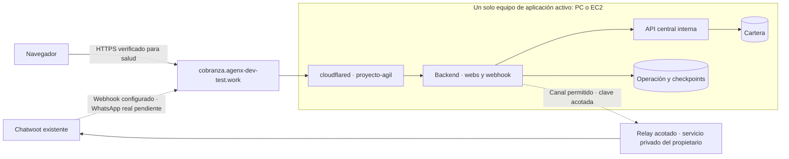

# Dominio fijo de la demo

Estado comprobado al **1 de noviembre de 2026**: el túnel administrado
**`proyecto-agil`** ya conecta el runtime local y publica
**`cobranza.agenx-dev-test.work`**. Las consultas HTTPS a `/health` y `/ready`
respondieron **200**. `/central` redirigió a login y el webhook rechazó una
petición sin autenticación con **401**. Estas comprobaciones no acreditan un
mensaje auténtico de WhatsApp ni un recorrido del evaluador.

El corte público ya está aplicado: backend en **producción**, `PUBLIC_BASE_URL`
con el origen HTTPS de esta aplicación y entrada local de mensajes deshabilitada
(**403**). El login público por cliente HTTP devolvió **303**, estableció cookie
**Secure** y permitió consultar la tabla con **200**.

La URL de salida del bot de prueba ya apunta a `/webhooks/chatwoot`; el bot y la
bandeja de producción se comprobaron intactos. Un evento de prueba con cabeceras
HMAC generadas por el mecanismo instalado recibió **200** como evento ignorado;
una firma incorrecta recibió **401** y otra bandeja firmada **403**. Todavía falta
el mensaje de WhatsApp real del evaluador.

El login en Chrome real ya se comprobó: la central muestra 14 filas y sus acciones
JavaScript funcionan. `/login` conserva `Referrer-Policy: same-origin` para el
formulario; Origin y CSRF siguen activos. El resto de respuestas usa `no-referrer`.

## Recorrido y límites actuales



`cloudflared` está disponible en el perfil `public` de Compose, con imagen fijada,
conexión saliente y origen interno `http://backend:8000`. Su dependencia es
`service_started`: el acceso administrativo sigue disponible para reanudar una
restauración aunque `/ready` devuelva 503 por mantenimiento. El túnel no sustituye
la firma/relay del webhook ni el login privado del operador.

Solo se publica el backend. PostgreSQL, API central, Floci y almacenes de Langfuse
permanecen fuera de esta ruta. Los tokens de túnel y proveedor solo viven en
configuración privada; no se entregan credenciales de administración de Cloudflare.

## Relay del canal

El token de AgentBot permite las operaciones necesarias de conversaciones y
mensajes, pero no las consultas de contactos e inboxes usadas por el preflight y
la preparación de campañas. Un usuario de servicio asignado a la bandeja de
prueba conserva, a través de la API de contactos de Chatwoot, un alcance de cuenta
más amplio que esa bandeja. Por eso **su token no se entrega al evaluador ni se
copia al backend de la demo**.

El relay de [infra/chatwoot-relay](../infra/chatwoot-relay/) está desplegado en el
entorno privado del propietario. Su configuración conserva allí las credenciales
de usuario y AgentBot, y acepta una clave distinta, limitada a las rutas, cuenta
y bandeja de prueba permitidas. El evaluador recibe solo esa clave; las escrituras
conservan al bot como actor y el relay no permite leer el historial de mensajes.
Se comprobó lectura autorizada **200**, rechazo de otra bandeja/producción y de
otra cuenta **403**, y petición sin token **401**. Son pruebas de autorización y
lectura; no se enviaron mensajes por esas comprobaciones.

| Configuración del backend | Uso |
|---|---|
| `CHATWOOT_BASE_URL`, `CHATWOOT_CONTACTS_BASE_URL` | El mismo origen HTTPS del relay para ambos clientes HTTP. |
| `CHATWOOT_API_TOKEN`, `CHATWOOT_CONTACTS_API_TOKEN` | La misma clave acotada del relay; ninguno es un token general de Chatwoot. |
| `CHATWOOT_WEBHOOK_AUTH_MODE` y su secreto | Autenticación del webhook entrante, independiente de la clave del relay. |

Las variables `CHATWOOT_UPSTREAM_API_TOKEN`, `CHATWOOT_UPSTREAM_BOT_TOKEN`,
`CHATWOOT_RELAY_SHARED_TOKEN` y los límites de cuenta/inbox se configuran solo en
el despliegue privado del relay. No se publican direcciones del host, credenciales
ni datos de contactos.

El relay ya se publicó con autorización en
**`https://canal-cobranza.agenx-dev-test.work`**. Por esa ruta pública se comprobó
lectura de la bandeja de prueba **200**, rechazo de la bandeja de producción y de
otra cuenta **403**, y petición sin clave **401**. Esa publicación no completa
por sí sola el recorrido de WhatsApp. La URL del bot de prueba ya se
actualizó al webhook de la aplicación, sin modificar el canal de producción.

El runtime activo ya usa este origen y la misma clave acotada para ambos clientes;
los tokens de usuario y AgentBot permanecen exclusivamente en ASUS. Backend y
worker reconstruidos están saludables. La consulta pública de una conversación
de prueba devolvió **200** con solo identificador, bandeja, estado y `can_reply`,
sin inventar un binding ausente. El preflight posterior pasó completo, incluido
acceso a la bandeja y autenticación de Langfuse, con **cero escrituras e inferencias**.

La plantilla **`recordatorio_factura_demo`**, idioma **`es`**, categoría
**`UTILITY`**, está aprobada. Falta acreditar su envío y entrega desde esta
aplicación al contacto de prueba autorizado.

## Corte aplicado y comprobaciones pendientes

El despliegue activo ya tiene el origen público y el bot configurados. Para
reproducirlo en una entrega nueva y terminar su verificación:

1. Comprobar en backend/worker el origen HTTPS del relay y su clave acotada;
   repetir su lectura autenticada desde el despliegue del evaluador. La credencial
   de usuario y la del AgentBot permanecen exclusivamente en el servicio privado.
2. Mantener en la configuración privada de backend **y worker**:

   ```dotenv
   APP_ENV=production
   PUBLIC_BASE_URL=https://cobranza.agenx-dev-test.work
   ENABLE_LOCAL_MESSAGE_ENDPOINT=false
   ```

   Estos valores ya se aplicaron al runtime activo. En una instalación nueva se
   recrean ambos servicios con ellos. Conservar `DEMO_MODE=true` para la cartera
   ficticia y los pagos simulados. Los enlaces proceden de
   `PUBLIC_BASE_URL`, nunca de un hostname aportado por el modelo o navegador.
3. Validar los enlaces de pago/recibo por HTTPS. El login, la sesión Secure y la
   cartera ya se comprobaron por cliente HTTP y en Chrome real.
4. Conservar la URL de salida del bot de prueba en
   `https://cobranza.agenx-dev-test.work/webhooks/chatwoot`, ya configurada con
   autenticación HMAC. Las pruebas firmadas y negativas ya pasaron; falta la
   recepción auténtica de WhatsApp. No poner el webhook detrás de un login
   interactivo de Cloudflare.
5. Repetir el preflight por lectura y ejecutar, con autorización del destino,
   WhatsApp → agente → enlace → pago simulado → comprobante → verificación, más
   campaña, audio y atención humana. Registrar fallos, consumo y evidencia segura.
6. Repetir en el equipo de destino el arranque con volúmenes nuevos. El ensayo
   limpio documentado en [evaluación](evaluacion.md) pasó en este mismo equipo;
   no acredita portabilidad a otro PC.

El recorrido local con Luna real ya ejercitó identificación, listado, selección,
creación de enlace y aplicación de pago ficticio; sigue pendiente el recorrido
WhatsApp completo. El registro detallado y sus límites están en
[evaluacion.md](evaluacion.md).

## Cambio de equipo

### Transición al invitado EC2 emulado

El perfil `./emulate-ec2.sh up` se verifica inicialmente por accesos locales y
no inicia `cloudflared`. El dominio continúa sirviendo el entorno anterior hasta
un corte explícito; levantar Floci por sí solo no cambia ninguna ruta pública.

Para conservar `cobranza.agenx-dev-test.work` no hace falta cambiar su registro
DNS si se reutiliza el mismo túnel administrado y su ruta de servicio. Se debe
preparar en el invitado la configuración privada de entrega, comprobar que el
origen de la ruta alcanza su backend y detener el conector anterior antes de
iniciar el nuevo. Los enlaces y el webhook conservan el hostname. Si se crea
otro túnel o se cambia el nombre interno del servicio, sí habrá que ajustar la
ruta correspondiente en Cloudflare. Nunca deben quedar dos conectores hacia
bases independientes del mismo sistema.

El perfil limpio todavía tiene OpenAI y Chatwoot deshabilitados. La salud local
no acredita ese corte ni las integraciones. Las credenciales, la continuidad del
presupuesto de IA y las comprobaciones HTTPS se preparan por separado, sin
transferir conversaciones de estudio a la instalación del evaluador.

El hostname puede conservarse al pasar de PC a EC2. Primero se detienen el
conector y la aplicación del equipo anterior; después se prepara el nuevo y se
arranca allí el mismo túnel. Se mantiene **un solo equipo de aplicación activo**:
no repartir webhooks ni pagos entre dos bases independientes.

El túnel mueve el acceso, no los datos. Conservar cartera, órdenes, acuerdos,
checkpoints y consumo exige backup/restauración antes de reabrir el conector.
Si se inicia con fixtures nuevos, se declara como otra ejecución; no se borra el
presupuesto para eludir el límite de IA. No se entrega al evaluador un respaldo
privado con conversaciones o credenciales del propietario.

El cambio de equipo y el arranque limpio aún deben ensayarse. La
[guía de EC2](despliegue-ec2.md) prepara EBS y restauración, pero no acredita un
host AWS desplegado. Caddy continúa como alternativa de diseño, sin configuración
ni validación en esta entrega.

## Comprobaciones que faltan conservar como evidencia

- Login y pagos con el origen público definitivo y respuestas `Cache-Control: no-store`.
- Evento auténtico del bot configurado y rechazo de cuenta/inbox o firma incorrectos.
- Campaña entregada al destino autorizado, simulaciones aparte y comprobante verificado.
- Nota privada/open, toma humana durante inferencia y devolución explícita a pending.
- Estados de entrega/lectura/fallo: los recibos firmados ya se persisten y solo se atribuyen al ID exacto de un mensaje real de campaña. El payload instalado no siempre incluye estado para ese ID: esos casos quedan pendientes (`status_missing`), sin inventar entrega. Falta probar los eventos reales del canal y decidir si hace falta una consulta restringida posterior.
- Reinicio del conector y cambio secuencial de equipo conservando URL y datos según el escenario declarado.

## Privacidad y reintentos del canal

La protección implementada evita persistir PIN en la cola conversacional, enviarlo
al modelo o exportarlo a Langfuse. Esa afirmación se limita a nuestro backend y
sus trazas. **Chatwoot externo conserva los mensajes del canal, incluido el PIN
ficticio de la demo; su job instalado registra el payload al reintentar.** No se
cambió el logging del servicio externo ni se atribuye a esta aplicación una
redacción que no controla allí.

La instalación de AgentBot reintenta HTTP **429/500**, tres intentos con espera
de tres segundos. Tras agotar intentos puede transferir la conversación a open.
Por eso el webhook usa **429** durante mantenimiento o cuando el thread está
ocupado; las otras mutaciones web conservan 503 durante mantenimiento. Un estado
`message_updated` no inicia inferencia ni se convierte en respuesta del cliente.
Los recibos guardan solo IDs, estado y tiempos, nunca el cuerpo original.
La primera respuesta a una campaña real también se contabiliza mientras la
conversación está en atención humana, mediante metadatos deduplicados por
cuenta/mensaje. Eso no inicia IA ni guarda el contenido de esa respuesta; las
campañas preparadas o simuladas no se incluyen.

Referencias de operación: [Cloudflare Tunnel](https://developers.cloudflare.com/tunnel/),
[túneles administrados con Docker](https://developers.cloudflare.com/cloudflare-one/networks/connectors/cloudflare-tunnel/get-started/create-remote-tunnel/)
y [tokens de túnel](https://developers.cloudflare.com/tunnel/reference/tunnel-tokens/).
