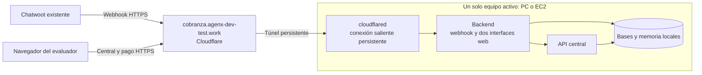

# Dominio fijo de la demo

Dominio aportado: `agenx-dev-test.work`, administrado en Cloudflare. Subdominio
previsto para esta aplicación: **`cobranza.agenx-dev-test.work`**. Todavía no se ha
creado ni verificado su ruta en Cloudflare; la aplicación tampoco está implementada.

## Recorrido de una petición

Un túnel persistente permite asociar un hostname público a un servicio local sin
necesitar IP pública ni abrir puertos entrantes. `cloudflared` establece la conexión
saliente desde el equipo activo. [Documentación de Cloudflare Tunnel](https://developers.cloudflare.com/tunnel/).

## Configuración prevista

1. Crear un túnel administrado desde Cloudflare para esta demo, con nombre
   `proyecto-agil`. Comprobar primero que no exista un túnel o registro DNS con el
   mismo destino; no sobrescribir otros proyectos del dominio.
2. Publicar `cobranza.agenx-dev-test.work` hacia el servicio del backend en la red
   interna de Compose. Su nombre y puerto se fijarán al implementar el contenedor;
   `localhost` dentro del conector no identifica al contenedor del backend.
3. Guardar su token de ejecución solo en `CLOUDFLARE_TUNNEL_TOKEN` del `.env`
   privado. No requiere entregar credenciales de administración DNS al evaluador.
4. Incorporar `cloudflared` como servicio opcional de Compose, con versión fijada
   y reinicio automático. Activarlo únicamente en el equipo que atenderá la demo.
5. Al verificar HTTPS, establecer `PUBLIC_BASE_URL=https://cobranza.agenx-dev-test.work`.
   Los enlaces de pago deben derivarse de esta variable; nunca de un hostname
   enviado por el usuario o inferido por el modelo.
6. Configurar una sola vez la URL completa del webhook en el bot de Chatwoot,
   usando ese origen y la ruta definida por el contrato de integración. El túnel
   no sustituye la autenticación del webhook ni el login del operador.

La ruta publicada y su DNS se crean siguiendo la
[guía oficial de configuración](https://developers.cloudflare.com/tunnel/get-started/).
El token de ejecución es privado y permite conectar el túnel; su manejo está
descrito en [Tunnel tokens](https://developers.cloudflare.com/tunnel/reference/tunnel-tokens/).
Estos pasos son pendientes de implementación y conexión, no comandos ya verificados.

## Cambio de equipo

El hostname permanece igual. Se detiene el conector y la aplicación del equipo
anterior, se instala el repositorio en el nuevo, se aporta configuración privada
y se arranca allí el conector del mismo túnel. Solo habrá **un equipo activo**:
dos instalaciones con bases independientes no deben recibir tráfico simultáneo.

El túnel mueve el acceso, no las bases. Si se quiere conservar cartera, acuerdos,
órdenes, memoria y consumo acumulado, se realiza backup y restauración de los
volúmenes antes del cambio. Un inicio con fixtures nuevos debe declararse como
otra ejecución de la demo; no se reinicia el presupuesto para eludir el límite.
El equipo activo debe estar encendido y conectado para responder.

En una EC2 puede usarse el mismo conector. EC2 sigue alojando la aplicación y los
datos; Cloudflare resuelve su entrada pública. Caddy queda como alternativa de
exposición HTTPS directa, no como otro paso obligatorio del túnel.

## Verificación de la entrega

- Resolver el hostname y comprobar `/health` y `/ready` por HTTPS.
- Verificar login de central y enlaces de pago con el origen público configurado.
- Recibir un evento auténtico de Chatwoot y rechazar uno sin autenticación válida.
- Detener y arrancar el conector: conservar la URL sin editar Chatwoot.
- Probar cambio de equipo secuencial, indicando si se restauraron datos o fixtures.
- Mantener PostgreSQL, la API central interna, Floci y Langfuse fuera de esta ruta
  pública. El webhook no debe quedar detrás de un login interactivo de Cloudflare.
- Evitar caché para webhook, central y pagos; verificar que las respuestas privadas
  de la aplicación emitan `Cache-Control: no-store`.
