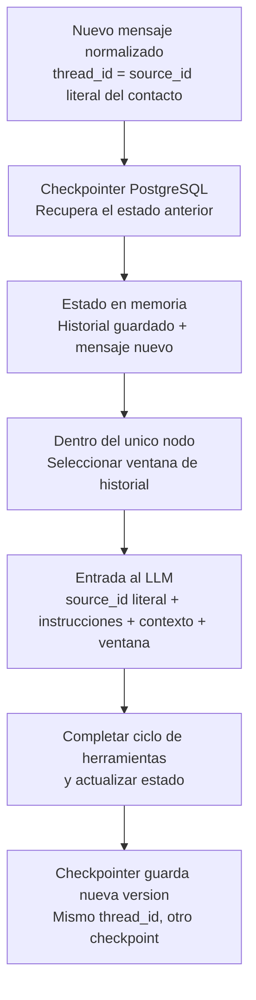

# Estado, memoria y contexto del agente

**Estado:** contrato de estado y comportamiento; la evidencia de implementación
y del recorrido real se registra por separado. Amplía FR-08, FR-09, FR-11, FR-12,
FR-17, FR-18 y FR-19; no añade nodos al grafo START → agent → END.

## Qué guarda y qué envía

El estado es la estructura que recibe y actualiza el nodo. El checkpointer guarda
versiones de esa estructura en PostgreSQL. Un checkpoint es una versión guardada;
el thread_id agrupa las versiones de una conversación. El nodo decide qué parte
del estado incluye en cada llamada al modelo.
[Estado y actualizaciones](https://docs.langchain.com/oss/python/langgraph/graph-api),
[persistencia por conversación](https://docs.langchain.com/oss/python/langgraph/persistence).

## Llave de memoria e identificación

**thread_id = source_id literal del contacto.** Se toma del objeto contact_inbox
de la conversación en el webhook; la ruta prevista es
`body.conversation.contact_inbox.source_id`, a confirmar en el preflight del inbox.
No se usa el source_id de primer nivel que identifica el mensaje externo.
Se conserva la cadena completa: sin quitar prefijos, signos, espacios o caracteres,
sin convertirla a número, sin hash y sin concatenar cuenta, inbox, conversación,
cliente ni epoch. Si falta el campo o no es una cadena no vacía, no se inventa
una llave: se registra el fallo seguro y no se inicia el agente.

El despliegue acepta solo la cuenta/inbox configurados. Esos filtros son externos
a la llave. Otro canal, número o Business ID distinto tiene otra memoria; no se
fusionan identidades. Varias conversaciones de Chatwoot con el mismo source_id
comparten thread y se procesan en serie bajo un lock de ese thread. Cada evento
conserva su conversation_id para validar pending y responder al destino correcto.

El contexto confiable del prompt incluye el source_id tal como llegó. El LLM
interpreta si representa un teléfono o un Business ID: intenta localizar por celular
cuando corresponda y pide tipo/número de documento si es un ID, es desconocido,
no hay coincidencia o el interlocutor rechaza al candidato. No hay nodo previo
de clasificación ni un source_type calculado por el backend. Las herramientas sí
validan formato y permisos de los argumentos recibidos. La central conserva los
celulares e identificaciones ficticias, sin Business IDs de Meta.

En esta demo, el candidato se muestra con el nombre enmascarado y el tipo y número
de documento completos, incluso antes del PIN. El agente copia literalmente la
pista entregada; se confirma el registro que se quiere gestionar y se pide su PIN. Conocer un documento no concede acceso. En la
demo se puede gestionar otro titular si se valida el PIN correspondiente; la
respuesta confirma acceso al registro, no que el interlocutor sea su titular.

Fuera de awaiting_pin / waiting_auth, todo mensaje admitido entra al único nodo
agente con system prompt y memoria: «sí», «no», «dale», preguntas, asesor,
cambio de cliente, números aislados y medios. No hay una regex global de PIN
ni interceptores semánticos antes del nodo. El LLM decide confirmar o rechazar
al candidato o cambiar de cliente mediante manage_identity; una confirmación
clara como «dale» permite avanzar y una intención ambigua exige aclaración.

manage_identity(confirm_candidate) activa awaiting_pin, pone el contador local
de fallos en cero y termina el bucle con una solicitud estática de PIN, sin otra
inferencia. La herramienta solo modifica el desafío o revoca contexto; nunca
autoriza cartera. Mientras awaiting_pin está activo, TODOS los mensajes van al
brazo estático IdentityService.consume_auth, fuera del LLM. Solo se admite texto numérico de
4 a 8 dígitos; formato incorrecto, medio o PIN rechazado cuenta como un fallo.
Antes de tres fallos se responde de forma fija. Un PIN correcto termina la fase
y entrega identity_verified; al tercer fallo termina sin autorización y entrega
auth_attempts_exhausted. Estos eventos neutros vuelven al nodo, que consulta
cartera solo con sesión validada u orienta la continuación sin ella. El agotamiento
no provoca una transferencia humana automática; puede atender una petición posterior.
El contador local no elude el bloqueo de PIN de 15 minutos de central.

El webhook da acuse tras validar firma/scope/evento y persistir trabajo durable
local, sin esperar consultas de negocio. Durante auth el contenido se transporta
cifrado temporalmente con Fernet y el worker valida el PIN después del acuse.
Ni el PIN en claro ni su sobre cifrado entran a messages, checkpoints o Langfuse.
Mientras el humano controla el chat, sus mensajes públicos y los del cliente se
guardan directamente en inbox_event con status=human_context, sin invocar el nodo.
En el siguiente turno admitido, el nodo añade al historial los mensajes de esa
conversación y revisión de identidad, deduplicados y anteriores al mensaje actual.
Los mensajes del asesor llevan el prefijo asesorhumano: en un mensaje normal de
contexto. Se guardan en el próximo checkpoint y usan la misma ventana de historial;
no se convierten en permisos ni resultados de herramientas.
Al verificar una devolución real, HandoffService guarda returned y return_event_id
atómicamente. HumanMemory recupera el evento por esa referencia durable, incluso
si el worker se reinició antes del checkpoint. El nodo lo incorpora a messages,
después del diálogo humano y antes del mensaje de retorno del cliente, con prefijo
evento_canal:. El id estable channel-return:<case_id> impide duplicados. Una fase
handoff_requested anterior vuelve a la fase de gestión correspondiente cuando se
incorpora el evento. No hay campos nuevos en AgentState ni indicador channel_control
en el system prompt; el evento forma parte de la secuencia conversacional. El prompt
pide consultar cartera al retomar una pregunta de saldo. Los casos históricos
devueltos sin return_event_id no generan eventos reconstruidos.
El diagrama siguiente representa los turnos fuera del brazo estático y los eventos
neutros de salida de autenticación; no añade nodos al grafo conversacional.

La ventana no se construye leyendo los últimos N checkpoints. Se construye
seleccionando mensajes del estado recuperado. Ejemplo: el estado contiene 100
mensajes y el nodo envía los últimos 20. La respuesta se agrega al historial
guardado; los 80 anteriores no se borran por haber quedado fuera de esa llamada.
Este patrón está documentado en
[gestión de memoria y recorte de mensajes](https://docs.langchain.com/oss/python/langgraph/add-memory#manage-short-term-memory).

Un único checkpoint puede contener el estado de una conversación con muchos
mensajes. Se utiliza un solo thread_id de esa conversación, no los últimos 20
thread_id. La cantidad de checkpoints tampoco equivale a la cantidad de mensajes:
una ejecución puede generar varios puntos de guardado.

## Esquema del estado

Se gestiona **una deuda a la vez por thread de memoria**. El cliente puede consultar
sus diferentes deudas y gestionarlas sucesivamente en el mismo thread_id.
Cambiar de selección no borra acuerdos ni órdenes de la central: conservan su
propia vigencia; las referencias activas del estado corresponden a la deuda elegida.

| Campo | Contenido | Cómo se actualiza |
|---|---|---|
| messages | Mensajes normalizados de usuario/asistente y llamadas/resultados de herramientas, sin secretos | Incorporar mensajes por ID estable, evitando duplicarlos en reintentos; no reemplazar todo el historial con la ventana enviada al modelo |
| phase | Etapa orientativa de la gestión | Derivar de identidad vigente y resultados comprobados de herramientas; no autoriza acciones |
| selected_debt_id | Referencia opcional a la deuda en conversación | Reflejar la selección validada en verified_context; no aceptar una selección libre del texto del modelo |
| pending_agreement_id | Referencia opcional a la propuesta pendiente de confirmar | Registrar la quote autorizada; limpiar si cambia deuda, vence o deja de ser aplicable |
| active_order_id | Referencia opcional a la orden sobre la que se conversa | Registrar resultado de creación/aceptación y consultar vigencia o pago en central |
| identity_revision | Revisión interna del contexto de identidad | Reflejar el contador del backend para detectar un checkpoint anterior a un cambio de cliente; no forma parte del thread_id ni concede acceso |

La fase puede ser identify, awaiting_pin, select_debt, discuss_payment, confirm_agreement,
await_payment, payment_verified o handoff_requested. Son valores de una variable,
no nodos separados. payment_verified exige verify_payment exitoso; handoff_requested
no sustituye el estado externo de Chatwoot ni prueba que el cambio a open terminó.

Los IDs guardados ayudan a continuar la conversación; no son permisos ni garantizan
que una orden o acuerdo sigan vigentes. Cada turno revalida sesión y selección,
y cada herramienta comprueba titularidad, versiones y condiciones actuales.
Cambiar de deuda limpia referencias incompatibles al acuerdo y a la orden previos.

Cambiar de cliente invalida la sesión anterior, incrementa identity_revision y
limpia messages y las referencias a deuda, acuerdo y orden del estado activo.
Se conserva un aviso neutro de cambio y se pide nueva validación. Los checkpoints
anteriores siguen siendo históricos privados, pero no se usan como contexto del
nuevo cliente. El backend contrasta revisiones antes de llamar al modelo, incluso
si la ejecución cayó antes de guardar la limpieza. El bucle reinicia su entrada
al LLM tras un cambio de registro, sin arrastrar el prompt financiero anterior.

El cierre explícito de sesión utiliza esa misma operación de cambio: revoca y
limpia antes de volver a identify; el agente espera un nuevo documento en lugar
de localizar automáticamente al titular anterior. La negociación de hasta dos
contraofertas (95 % y después 80 % si la oferta sigue bajo el mínimo) se orienta desde el prompt y el historial de la deuda seleccionada;
no añade campos de permiso, nodos ni altera el mínimo financiero del backend.

## Información que se conserva fuera del estado

| Ubicación | Información y autoridad |
|---|---|
| verified_context, en PostgreSQL operativo | thread_id, revisión, candidato pendiente, confirmación/PIN pendientes, contador local de fallos de auth y, tras validar, cliente, grant, caducidad y selección autorizada. El grant no se copia al estado ni al prompt |
| API/base central | Saldos, acuerdos, órdenes, intentos y liquidaciones. El historial solo conserva resultados pasados, que pueden haber quedado desactualizados |
| inbox_event, conversation_job y outbox | Recepción, deduplicación, trabajos y envíos. Un mensaje generado no equivale a un envío confirmado |
| human_case y Chatwoot | Caso durable y control humano; fuera de pending se suspende la respuesta automática |
| inference_reservation | Presupuesto compartido; no depende de lo que recuerde el agente |
| Contexto de ejecución | Cuenta, inbox, conversación, evento actual, correlación, clientes HTTP y secretos del servidor |

Durante awaiting_pin, el contenido entra a la cola cifrado temporalmente con
Fernet; el worker lo procesa de forma estática sin copiar el PIN en claro ni el
sobre cifrado a historial o trazas. Los medios en esa fase son formato no válido
y consumen un intento, sin transcripción ni visión. Fuera de auth no hay filtro
global de números: todo contenido admitido llega al agente. Audio e imagen aportan
contexto no verificado; no se guardan bytes ni URLs privadas del adjunto en messages.
No se autentica con un PIN hablado o extraído de una imagen, ni se promete detectar
u ocultar secretos dentro de medios procesados fuera de auth. Los enlaces de pago
se representan por marcadores sin el token firmado. Si la sesión vence, se pide
revalidación antes de usar historial financiero en otra llamada; ese historial
no se reutiliza para una identidad distinta.

## Ventana de historial

**Valor inicial:** hasta 20 mensajes visibles de usuario/asistente, configurable.
Las llamadas y resultados de herramientas asociados se incluyen como grupos válidos,
sin separar una llamada de su resultado. Veinte mensajes no significan veinte turnos
completos ni veinte checkpoints.

El límite del plan, 12 000 tokens de entrada, incluye instrucciones, contexto,
definiciones de herramientas e historial; tiene prioridad sobre la cantidad de
mensajes. El selector descarta grupos antiguos completos y conserva el mensaje actual.
Si lo imprescindible no cabe, no se envía una petición excesiva: se aplica el manejo
seguro de límites. La selección se repite durante el ciclo de herramientas porque
sus resultados también consumen contexto.

La deuda seleccionada y las referencias a propuesta/orden se revalidan y se aportan
como contexto actual aunque su mensaje original salga de la ventana. Un «acepto»
ambiguo requiere aclaración; reducir historial no permite omitir la confirmación
posterior a la quote. No se añade un LLM de resumen para este alcance.

## Cómo queda PostgreSQL

No se crea una tabla propia de estados ni una tabla por cada fase. El esquema
del estado se define en Python, y AsyncPostgresSaver administra su almacenamiento
de checkpoints y escrituras. Su setup crea las tablas del framework; no se duplica
ese esquema con migraciones propias. Las demás tablas operativas conservan sus
migraciones según [el modelo de datos](data-model.md).

El thread_id conserva el source_id literal. El reset elimina sus checkpoints y
escrituras y limpia su contexto local antes de aceptar el escenario nuevo; epoch
y la fecha de corte solo son metadatos de control y nunca se concatenan a la llave.
Recuperar el último estado no exige recomponer el historial
leyendo cada checkpoint anterior. La retención hasta reset es distinta de la
ventana que se envía al modelo.

El grafo guarda checkpoints en límites de ejecución, no después de cada llamada
interna del nodo. Una caída puede repetir parte del ciclo; herramientas y outbox
usan claves estables del evento para evitar efectos duplicados. Las verificaciones
de implementación deben cubrir reanudación, ventana acotada, herramientas completas,
sesión vencida, cambio de cliente, referencias caducadas, igualdad literal de
source_id/thread_id y ausencia de secretos en checkpoints y trazas. El teléfono
puede formar parte de la llave privada; logs y metadatos de sesión usan una
referencia opaca. Con captura de contenido habilitada, el source_id literal,
estado conversacional y contexto del modelo se registran en las entradas/salidas
del Langfuse privado para depuración, por autorización del propietario. No se
exportan credenciales, grants ni PIN interceptados. El source_id literal
autorizado sí se entrega al proveedor de inferencia.
[Reejecución e idempotencia](https://docs.langchain.com/oss/python/langgraph/graph-api#re-execution-and-idempotency).
