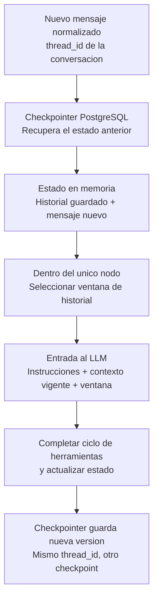

# Estado, memoria y contexto del agente

**Estado:** diseño propuesto para implementación. Amplía FR-09, FR-11, FR-12,
FR-17, FR-18 y FR-19; no añade nodos al grafo START → agent → END.

## Qué guarda y qué envía

El estado es la estructura que recibe y actualiza el nodo. El checkpointer guarda
versiones de esa estructura en PostgreSQL. Un checkpoint es una versión guardada;
el thread_id agrupa las versiones de una conversación. El nodo decide qué parte
del estado incluye en cada llamada al modelo.
[Estado y actualizaciones](https://docs.langchain.com/oss/python/langgraph/graph-api),
[persistencia por conversación](https://docs.langchain.com/oss/python/langgraph/persistence).

La ventana no se construye leyendo los últimos N checkpoints. Se construye
seleccionando mensajes del estado recuperado. Ejemplo: el estado contiene 100
mensajes y el nodo envía los últimos 20. La respuesta se agrega al historial
guardado; los 80 anteriores no se borran por haber quedado fuera de esa llamada.
Este patrón está documentado en
[gestión de memoria y recorte de mensajes](https://docs.langchain.com/oss/python/langgraph/add-memory#manage-short-term-memory).

Un único checkpoint puede contener el estado de una conversación con muchos
mensajes. Se utiliza un solo thread_id de esa conversación, no los últimos 20
thread_id. La cantidad de checkpoints tampoco equivale a la cantidad de mensajes:
una ejecución puede generar varios puntos de guardado.

## Esquema propuesto del estado

Se gestiona **una deuda a la vez por conversación**. El cliente puede consultar
sus diferentes deudas y gestionarlas sucesivamente en el mismo thread_id.
Cambiar de selección no borra acuerdos ni órdenes de la central: conservan su
propia vigencia; las referencias activas del estado corresponden a la deuda elegida.

| Campo | Contenido | Cómo se actualiza |
|---|---|---|
| messages | Mensajes normalizados de usuario/asistente y llamadas/resultados de herramientas, sin secretos | Incorporar mensajes por ID estable, evitando duplicarlos en reintentos; no reemplazar todo el historial con la ventana enviada al modelo |
| phase | Etapa orientativa de la gestión | Derivar de identidad vigente y resultados comprobados de herramientas; no autoriza acciones |
| selected_debt_id | Referencia opcional a la deuda en conversación | Reflejar la selección validada en verified_context; no aceptar una selección libre del texto del modelo |
| pending_agreement_id | Referencia opcional a la propuesta pendiente de confirmar | Registrar la quote autorizada; limpiar si cambia deuda, vence o deja de ser aplicable |
| active_order_id | Referencia opcional a la orden sobre la que se conversa | Registrar resultado de creación/aceptación y consultar vigencia o pago en central |

La fase puede ser identify, select_debt, discuss_payment, confirm_agreement,
await_payment, payment_verified o handoff_requested. Son valores de una variable,
no siete nodos. payment_verified exige verify_payment exitoso; handoff_requested
no sustituye el estado externo de Chatwoot ni prueba que el cambio a open terminó.

Los IDs guardados ayudan a continuar la conversación; no son permisos ni garantizan
que una orden o acuerdo sigan vigentes. Cada turno revalida sesión y selección,
y cada herramienta comprueba titularidad, versiones y condiciones actuales.
Cambiar de deuda limpia referencias incompatibles al acuerdo y a la orden previos.

## Información que se conserva fuera del estado

| Ubicación | Información y autoridad |
|---|---|
| verified_context, en PostgreSQL operativo | Cliente autenticado, grant, caducidad y selección autorizada. El grant no se copia al estado ni al prompt |
| API/base central | Saldos, acuerdos, órdenes, intentos y liquidaciones. El historial solo conserva resultados pasados, que pueden haber quedado desactualizados |
| inbox_event, conversation_job y outbox | Recepción, deduplicación, trabajos y envíos. Un mensaje generado no equivale a un envío confirmado |
| human_case y Chatwoot | Caso durable y control humano; fuera de pending se suspende la respuesta automática |
| inference_reservation | Presupuesto compartido; no depende de lo que recuerde el agente |
| Contexto de ejecución | Cuenta, inbox, conversación, evento actual, correlación, clientes HTTP y secretos del servidor |

Los mensajes PIN se interceptan antes de persistir texto o llamar al LLM. Audio e
imagen aportan texto normalizado con procedencia no verificada; no se guardan bytes
ni URLs privadas del adjunto en messages. Los enlaces de pago se representan por
marcadores sin el token firmado. Si la sesión vence, se pide revalidación antes de
volver a usar historial financiero en una llamada al modelo. No se reutiliza ese
historial para una identidad distinta.

## Ventana de historial

**Propuesta inicial:** hasta 20 mensajes visibles de usuario/asistente, configurable.
Las llamadas y resultados de herramientas asociados se incluyen como grupos válidos,
sin separar una llamada de su resultado. Veinte mensajes no significan veinte turnos
completos ni veinte checkpoints.

El límite del plan, 12 000 tokens de entrada, incluye instrucciones, contexto,
definiciones de herramientas e historial; tiene prioridad sobre la cantidad de
mensajes. El selector descarta grupos antiguos completos y conserva el mensaje actual.
Si lo imprescindible no cabe, no se envía una petición excesiva: se aplica el manejo
seguro de límites. La selección se repite durante el ciclo de herramientas porque
sus resultados también consumen contexto.

La deuda seleccionada y las referencias a propuesta/orden se revalidan y se aportan
como contexto actual aunque su mensaje original salga de la ventana. Un «acepto»
ambiguo requiere aclaración; reducir historial no permite omitir la confirmación
posterior a la quote. No se añade un LLM de resumen para este alcance.

## Cómo queda PostgreSQL

No se crea una tabla propia de estados ni una tabla por cada fase. El esquema
del estado se define en Python, y AsyncPostgresSaver administra su almacenamiento
de checkpoints y escrituras. Su setup crea las tablas del framework; no se duplica
ese esquema con migraciones propias. Las demás tablas operativas conservan sus
migraciones según [el modelo de datos](data-model.md).

El thread_id se deriva de epoch/cuenta/inbox/conversación y se mantiene estable
durante el escenario. Recuperar el último estado no exige recomponer el historial
leyendo cada checkpoint anterior. La retención hasta reset es distinta de la
ventana que se envía al modelo.

El grafo guarda checkpoints en límites de ejecución, no después de cada llamada
interna del nodo. Una caída puede repetir parte del ciclo; herramientas y outbox
usan claves estables del evento para evitar efectos duplicados. Las verificaciones
de implementación deben cubrir reanudación, ventana acotada, herramientas completas,
sesión vencida, referencias caducadas y ausencia de secretos en checkpoints.
[Reejecución e idempotencia](https://docs.langchain.com/oss/python/langgraph/graph-api#re-execution-and-idempotency).
