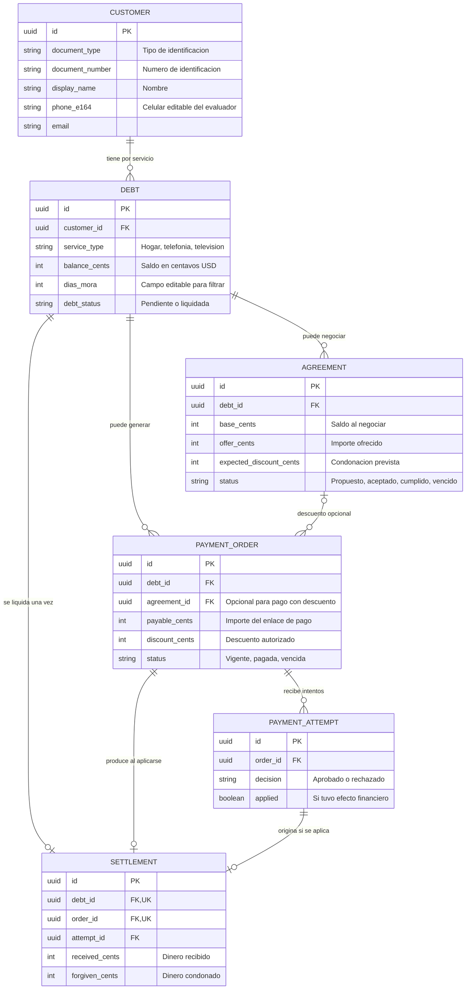
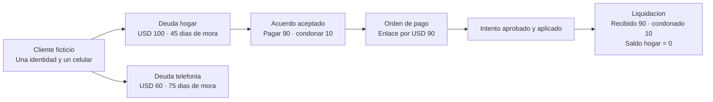
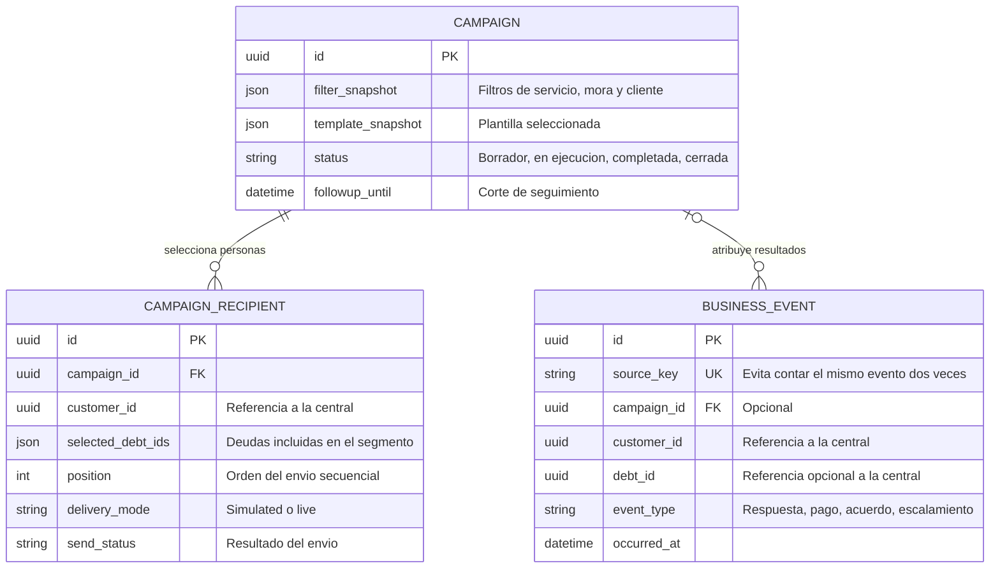
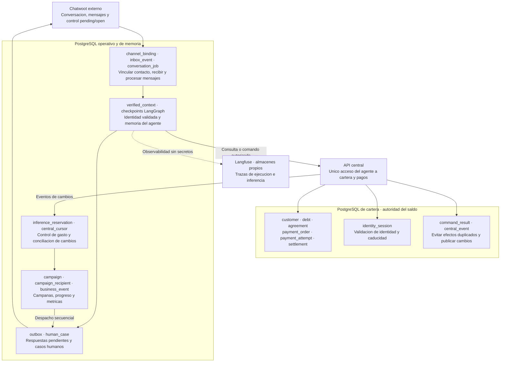
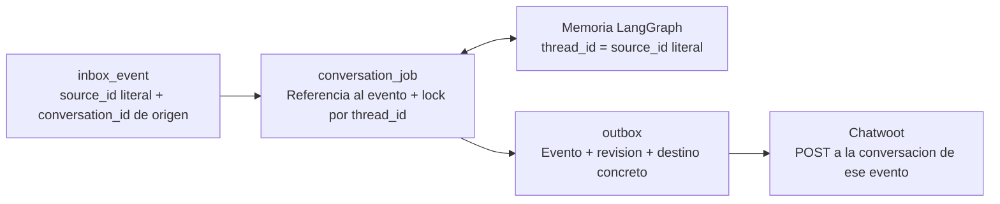
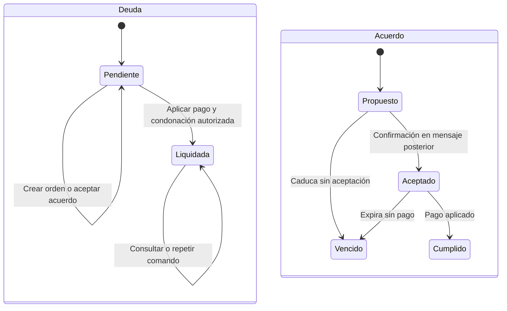

# Modelo de datos y estados

**Estado:** diseño; las tablas y migraciones se crean en implementación.
IDs propios UUID, IDs del canal opacos, timestamps UTC y presentación America/Bogota.
Importes en centavos enteros, currency=USD fijo; sin float ni conversión de moneda.

## Propiedad de datos

- PostgreSQL de cartera: clientes, deudas, identidad autorizada y todos los efectos
  financieros. Solo la API central escribe; backend sin conexión directa a esta base.
- PostgreSQL de memoria: tablas operativas del backend y checkpoints LangGraph
  separados. No es réplica autoritativa del saldo.
- Langfuse: almacenes propios, separados de ambas bases de aplicación.

## Cómo leer el modelo

La pantalla central muestra **una fila por deuda de un servicio de una persona**.
Eso no obliga a repetir los datos personales en la base: `customer` guarda la persona
y `debt` guarda cada deuda. La pantalla combina ambas tablas.

El recorrido principal es: **cliente → deuda → orden de pago → intento → liquidación**.
Si se negocia un descuento, también interviene un **acuerdo**. Crear una orden o aceptar
un acuerdo todavía no modifica el saldo; el pago aprobado y aplicado sí lo hace.

### 1. Cartera y pagos: relaciones principales

En este diagrama, la pata de tres puntas significa «varios» y el círculo significa
«opcional». Por ejemplo, un cliente puede tener varias deudas y una deuda puede no
tener todavía ninguna orden de pago. Se muestran solo los campos principales;
el catálogo posterior conserva el detalle completo.

- **Cliente (`customer`):** identidad y contacto compartidos por todas sus deudas.
  La combinación tipo/número de documento es única; el UUID es la llave interna.
- **Deuda (`debt`):** servicio, saldo y días de mora de esa fila. Tener varias deudas
  no implica enviar varios mensajes iniciales en una campaña.
- **Acuerdo (`agreement`):** registra la oferta y su aceptación. El descuento automático
  permite pagar desde el 80% hasta menos del 100% del saldo; una oferta inferior se escala.
- **Orden (`payment_order`):** contiene lo que se puede pagar mediante un enlace y hasta
  cuándo. El pago total tiene descuento cero y no necesita acuerdo.
- **Intento (`payment_attempt`):** registra cada aprobación o rechazo del simulador.
  Un rechazo no modifica la deuda; se puede volver a intentar mientras la orden siga vigente.
- **Liquidación (`settlement`):** registra el resultado financiero aplicado: recibido y
  condonado. Solo puede existir una por deuda y una por orden en este alcance, sin abonos.

Los campos `customer_id` que también aparecen en acuerdos y órdenes en el catálogo
sirven para validar pertenencia; siempre deben corresponder al dueño de la deuda.
La sesión de identidad y las tablas auxiliares de eventos y comandos se detallan más
abajo: no son nuevas deudas ni pagos.

### 2. Ejemplo: una persona, dos servicios

Ejemplo ficticio en USD: la persona tiene una deuda de hogar de 100 y otra de telefonía
de 60. Acepta pagar 90 por hogar. La condonación de 10 se aplica únicamente cuando se
aprueba y registra el pago. La deuda de telefonía sigue pendiente por 60.

Una captura del comprobante ayuda al agente a interpretar lo que dice el usuario.
Para confirmarlo debe consultar la orden y su liquidación en la central; la imagen
por sí sola no cambia ninguno de estos registros.

### 3. Campañas: una persona, un mensaje inicial

Estas tablas viven en la base operativa del backend. Los UUID de clientes y deudas
son referencias a la central mediante su API, **sin claves foráneas entre bases**.

Una campaña puede seleccionar varias deudas de una persona, pero crea **un solo
destinatario por persona**: la combinación `campaign_id + customer_id` es única.
`position` permite recorrerlos uno a uno y retomar el progreso. Los contactos ficticios
se simulan; el del evaluador, habilitado en modo `live`, usa el canal real. Los eventos
permiten calcular contactabilidad y resultados sin contar dos veces el mismo hecho.

### 4. Dónde viven los demás datos

Las flechas siguientes representan intercambios o procesamiento, no claves foráneas.
`thread_id` es el source_id literal del contacto y agrupa la memoria. Los campos
account_id, inbox_id y conversation_id identifican el destino concreto en Chatwoot;
se conservan por evento y salida, sin incorporarlos a la llave de memoria.

La separación evita que la memoria conversacional se convierta en otra versión del
saldo. El agente puede recordar que alguien dijo «ya pagué», pero solo la central
confirma el pago. Todos los componentes propios siguen en la única EC2 prevista;
la separación del dibujo es entre responsabilidades y bases de datos.

## Sistema central simulado

| Entidad | Campos esenciales | Restricciones y relación |
|---|---|---|
| customer | id, document_type, document_number, display_name, phone_e164, email, customer_type, pin_hash, delivery_mode, test_contact_enabled, contact_version | Documento ficticio único por tipo/número; PIN de fixture se almacena como hash y no se devuelve; delivery_mode simulated por defecto o live para el evaluador; editar teléfono/modo incrementa versión |
| debt | id, customer_id, contract_reference, service_type, original_cents, balance_cents, due_date, dias_mora, debt_status, service_status, version | Cliente con varias deudas; mora entero no negativo; balance >= 0; pendiente con saldo > 0 y liquidada con cero |
| identity_session | id, customer_id, binding_ref, token_hash, expires_at, failed_attempts, locked_until | binding_ref es UUID opaco del backend, sin IDs de Meta; sin grant válido no se revela cartera; PIN fuera de sesión/checkpoints; intentos vinculados al mensaje para no duplicar por retry |
| agreement | id, customer_id, debt_id, debt_version, base_cents, offer_cents, expected_discount_cents, quoted_at, source_message_id, accepted_at opcional, expires_at, status | Oferta positiva e inferior al saldo; oferta * 100 >= base * 80; descuento previsto no equivale a condonación aplicada |
| payment_order | id, customer_id, debt_id, agreement_id opcional, base_version, base_cents, payable_cents, discount_cents, token_nonce, expires_at, receipt_expires_at, status, idempotency_key | Importe y descuento server-side; status vigente/pagada/vencida; token opaco firmado, derivable al repetir creación, no guardado en logs |
| payment_attempt | id, order_id, decision, applied, created_at, idempotency_key | Aprobado o rechazado; applied indica efecto durable; mismo comando devuelve mismo resultado |
| settlement | id, debt_id, order_id, attempt_id, received_cents, forgiven_cents, applied_at | Único por deuda y orden; recibido + condonado = saldo base; se crea en la transacción que deja balance cero |
| central_event | id, sequence, event_type, customer_id, debt_id, order_id, payload mínimo, created_at | Secuencia creciente; efectos financieros y de contacto publicados durablemente para conciliación del backend |
| command_result | idempotency_key, command_type, request_digest, result_reference, created_at | Misma clave con cuerpo distinto = conflicto; resultado por referencia, sin PIN o secretos en claro |

La fila visible de central es una proyección customer + debt: al editar nombre o
contacto se cambia customer, mientras saldo, servicio y mora pertenecen a debt.
La edición financiera de fixtures solo se permite en modo demo y registra un ajuste
explícito; nunca se presenta como pago recibido ni acuerdo. No se permite tocar una
deuda con orden vigente sin invalidarla y aumentar su versión. Una deuda liquidada
se restaura únicamente mediante reset documentado del escenario.

### Aplicación financiera atómica

1. Recuperar resultado si idempotency_key existe y su digest coincide.
2. Bloquear deuda y orden en orden consistente; validar dueño, versión, vigencia y saldo.
3. Registrar intento y settlement aprobados, pago y condonación, actualizar debt y order,
   marcar agreement cumplido si existe, e insertar central_event en una transacción.
4. Confirmar commit antes de mostrar comprobante. Otro aprobador no puede crear un
   segundo settlement. Ante resultado incierto se consulta por referencia.
5. Un rechazo crea intento sin modificar saldo, orden vigente ni descuento; permite
   otro intento con otra clave mientras la orden no venza.

## Backend: operación y memoria

El esquema del estado del agente y la selección de historial se detallan en
[Estado, memoria y contexto](agent-state.md). Sus variables no crean tablas nuevas:
AsyncPostgresSaver administra los checkpoints; las tablas siguientes guardan
operación, permisos y efectos externos.

| Entidad | Campos esenciales | Restricciones y relación |
|---|---|---|
| campaign | id, filter_snapshot, template_snapshot, created_at, launched_at, closed_at, followup_until, status, launch_key | Draft/running/completed/closed; una campaña activa por persona; segmento conservado para métricas |
| campaign_recipient | id, campaign_id, customer_id, selected_debt_ids, contact_version, position, delivery_mode, destination_binding, account_id, inbox_id, conversation_id, thread_id, send_status | Único (campaign_id, customer_id); posición estable; simulated/sent/failed/uncertain/skipped separados; un mensaje inicial; no usar binding de otra versión del teléfono |
| channel_binding | customer_id, contact_version, account_id, inbox_id, contact_id, source_id, conversation_id | Source_id opaco del inbox correcto; editar contacto invalida vinculación; resolver antes de envío |
| inbox_event | id, account_id, inbox_id, message_id, conversation_id, thread_id, normalized_content, attachments, received_at, status | Unique (account_id, message_id); thread_id igual a source_id literal del contacto; sin PIN en claro ni credenciales; transporte auth temporal cifrado, fuera de historial/trazas; privados/salidas no generan turno |
| conversation_job | id, event_id, thread_id, state, attempts, next_attempt_at, last_error | Un trabajo por evento; orden por received_at e id; exclusión por thread, aun con varios conversation_id |
| verified_context | thread_id, identity_revision, candidate_reference opcional, challenge_state, auth_failures, binding_ref, customer_id opcional, central_grant opcional, expires_at opcional, selected_debt_id opcional | Una fila por thread; fallos locales de auth entre 0 y 3; candidato pendiente no equivale a cliente autenticado; grant privado solo para adaptador central, fuera del modelo y trazas |
| outbox | id, operation_key, source_event_id, thread_id, identity_revision, account_id, inbox_id, conversation_id, kind, payload_privado, state, channel_message_id, attempts | Destino copiado del evento o del binding validado de campaña; nunca una última conversación global; unique operation_key; queued/sent/uncertain/cancelled/failed; incierto sin reenvío ciego |
| human_case | id, thread_id, account_id, inbox_id, conversation_id, source_event_id, customer_id opcional, debt_id opcional, reason, origin, offer_cents, verification_summary, status | Clave única por evento/origen; bloqueo del thread mientras esté bajo control humano; nota/status se envían a la conversación del caso |
| business_event | id, source_key, event_type, campaign_id opcional, customer_id, debt_id opcional, thread_id, account_id, inbox_id, conversation_id, occurred_at | Unique source_key evita duplicar canal o central; atribuir al cliente efectivamente autorizado sin cambiar el destinatario original de campaña |
| inference_reservation | id, turn_id, modality, model, price_version, reserved_usd, actual_usd, state, provider_response_id | Decimal para USD de inferencia; reserved/settled/uncertain; reservas atómicas comunes a workers |
| central_cursor | consumer, last_sequence | Avanza al guardar eventos conciliados; no perder pago por respuesta HTTP perdida |
| LangGraph checkpoints | thread_id, checkpoints y writes administrados por AsyncPostgresSaver | thread_id = source_id literal del contacto; no normalizar ni concatenar; no duplicar schema manualmente; setup explícito |

Los mensajes públicos del asesor y del cliente durante atención humana reutilizan
inbox_event con status=human_context y un contenido JSON etiquetado con speaker y
texto. No crean conversation_job. La revisión de identidad, el scope exacto y la
fecha del último reset limitan su recuperación; no requieren una tabla nueva.

Los grants y la outbox son datos privados operativos del servidor, nunca archivos
versionados ni entradas del modelo. En awaiting_pin, el ingreso persiste transporte
temporal cifrado con Fernet y da acuse sin red de negocio; el worker verifica
formato y PIN después. No se persiste el PIN en claro ni se copia el sobre cifrado
a historial, checkpoints o Langfuse. El contexto operativo conserva el contador
local de hasta tres mensajes fallidos; el tercero termina auth sin autorización.
Ese límite no elude el bloqueo central de PIN de 15 minutos. Fuera de auth todos
los mensajes admitidos llegan al agente, sin regex global de números.

La central no guarda Business IDs de Meta. Los identificadores del canal son datos
operativos del backend. Al cambiar de cliente se invalida la sesión previa y
aumenta identity_revision; se limpia el estado activo y se cancelan salidas de la
revisión anterior. Se exige un nuevo PIN sin cambiar thread_id. La revisión sirve
para detectar un checkpoint que todavía contenga contexto del cliente previo.

El contexto enviado al LLM incluye `conversation_start`, calculado a partir de
si ya existe un turno completo en el checkpoint recuperado. El prompt usa ese dato
para generar la presentación y el contexto de cobranza una vez al iniciar; no se
concatena una respuesta estática desde el backend. Para la pista de esta demo,
central conserva el primer y último carácter del primer nombre y oculta el resto
con •; nombres de menos de tres caracteres se ocultan completos. El tipo y número
de documento se entregan completos al modelo y se muestran antes del PIN, por
decisión explícita del producto para la demo. El agente copia la pista literalmente.
Los permisos financieros y el PIN siguen bajo control del servidor; mostrar el
documento no autentica al interlocutor ni habilita consulta de cartera.

### Destino de respuesta independiente de la memoria

Cada salida conserva su propio destino. El LLM no elige account_id, inbox_id o
conversation_id. Se comprueba pending y la revisión antes de publicar; dos chats
con igual source_id no sobrescriben el destino de sus respuestas pendientes.

## Estados independientes

La conversación tiene control externo: pending permite bot, open implica humano;
fuera de pending no se negocia. No se deduce control a partir de una orden o deuda.
Sesiones, acuerdos y órdenes tienen caducidad propia.

## Métricas y atribución

- Progreso: destinatarios procesados/total, simulados y pendientes del lote.
- Simulados: destinatarios ficticios recorridos sin llamadas externas; no son enviados
  ni entregados reales y quedan fuera de cohortes de respuesta y resultado comercial.
- Enviados: mensajes iniciales reales aceptados por el canal; fallos y entrega van aparte.
- Contactados: personas destinatarias con primera respuesta posterior al envío de
  esa campaña y antes de su corte. Un mensaje de preparación anterior no cuenta.
- Contactabilidad: contactados / personas enviadas; sin denominador se muestra N/A.
- Pagó total: settlement con forgiven_cents=0. Acuerdo: descuento aceptado con
  desglose pendiente/cumplido/vencido; dinero condonado solo tras settlement.
- Solicitud humana: origin=cliente; política e incidencia se cuentan por separado.
- Resultado actual por persona/campaña/deuda: pago total, acuerdo cumplido, humano
  activo, acuerdo pendiente, sin resultado al cierre o en gestión, en ese orden.
- Diferentes servicios pueden ocupar distintas categorías; la suma de personas por
  categoría no se presenta como total de personas únicas de campaña.
- Importe recuperado suma received_cents; condonación suma forgiven_cents; nunca
  se suman ambos como efectivo recuperado. Pagos ajenos al segmento no se atribuyen
  a esa campaña aunque el cliente los consulte en la misma conversación.

## Retención y restauración de demo

Datos de aplicación se conservan hasta reset explícito. Adjuntos temporales se
eliminan al terminar su preprocesamiento o al limpiar fallos; no se suben al repo.
El reset restaura solo clientes/deudas de demo, sesiones, conversaciones locales,
órdenes y eventos del escenario, coordinando ambos servicios. No borra gasto, claves
ni trazas reales del proveedor ni modifica el historial de Chatwoot. Nueva campaña
y una fecha de corte local evitan que webhooks antiguos se apliquen al escenario
restaurado. El reset elimina checkpoints/writes y contextos locales; la llave
source_id literal permanece igual. epoch sigue como metadato, no como prefijo de memoria.
