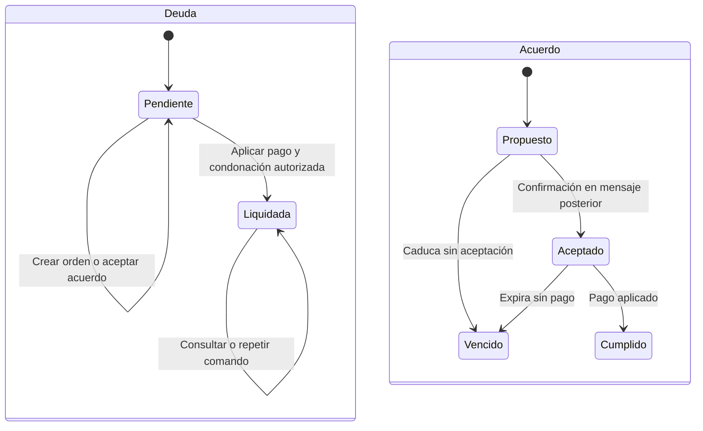

# Modelo de datos y estados

**Estado:** diseño; las tablas y migraciones se crean en implementación.
IDs propios UUID, IDs del canal opacos, timestamps UTC y presentación America/Bogota.
Importes en centavos enteros, currency=USD fijo; sin float ni conversión de moneda.

## Propiedad de datos

- PostgreSQL de cartera: clientes, deudas, identidad autorizada y todos los efectos
  financieros. Solo la API central escribe; backend sin conexión directa a esta base.
- PostgreSQL de memoria: tablas operativas del backend y checkpoints LangGraph
  separados. No es réplica autoritativa del saldo.
- Langfuse: almacenes propios, separados de ambas bases de aplicación.

## Sistema central simulado

| Entidad | Campos esenciales | Restricciones y relación |
|---|---|---|
| customer | id, document_type, document_number, display_name, phone_e164, email, customer_type, pin_hash, delivery_mode, test_contact_enabled, contact_version | Documento ficticio único por tipo/número; PIN de fixture se almacena como hash y no se devuelve; delivery_mode simulated por defecto o live para el evaluador; editar teléfono/modo incrementa versión |
| debt | id, customer_id, contract_reference, service_type, original_cents, balance_cents, due_date, dias_mora, debt_status, service_status, version | Cliente con varias deudas; mora entero no negativo; balance >= 0; pendiente con saldo > 0 y liquidada con cero |
| identity_session | id, customer_id, channel_key, token_hash, expires_at, failed_attempts, locked_until | Sin grant válido no se revela cartera; PIN no forma parte de la sesión ni de checkpoints; intentos vinculados también al mensaje para no duplicar por retry |
| agreement | id, customer_id, debt_id, debt_version, base_cents, offer_cents, expected_discount_cents, quoted_at, source_message_id, accepted_at opcional, expires_at, status | Oferta positiva e inferior al saldo; oferta * 100 >= base * 80; descuento previsto no equivale a condonación aplicada |
| payment_order | id, customer_id, debt_id, agreement_id opcional, base_version, base_cents, payable_cents, discount_cents, token_nonce, expires_at, receipt_expires_at, status, idempotency_key | Importe y descuento server-side; status vigente/pagada/vencida; token opaco firmado, derivable al repetir creación, no guardado en logs |
| payment_attempt | id, order_id, decision, applied, created_at, idempotency_key | Aprobado o rechazado; applied indica efecto durable; mismo comando devuelve mismo resultado |
| settlement | id, debt_id, order_id, attempt_id, received_cents, forgiven_cents, applied_at | Único por deuda y orden; recibido + condonado = saldo base; se crea en la transacción que deja balance cero |
| central_event | id, sequence, event_type, customer_id, debt_id, order_id, payload mínimo, created_at | Secuencia creciente; efectos financieros y de contacto publicados durablemente para conciliación del backend |
| command_result | idempotency_key, command_type, request_digest, result_reference, created_at | Misma clave con cuerpo distinto = conflicto; resultado por referencia, sin PIN o secretos en claro |

La fila visible de central es una proyección customer + debt: al editar nombre o
contacto se cambia customer, mientras saldo, servicio y mora pertenecen a debt.
La edición financiera de fixtures solo se permite en modo demo y registra un ajuste
explícito; nunca se presenta como pago recibido ni acuerdo. No se permite tocar una
deuda con orden vigente sin invalidarla y aumentar su versión. Una deuda liquidada
se restaura únicamente mediante reset documentado del escenario.

### Aplicación financiera atómica

1. Recuperar resultado si idempotency_key existe y su digest coincide.
2. Bloquear deuda y orden en orden consistente; validar dueño, versión, vigencia y saldo.
3. Registrar intento y settlement aprobados, pago y condonación, actualizar debt y order,
   marcar agreement cumplido si existe, e insertar central_event en una transacción.
4. Confirmar commit antes de mostrar comprobante. Otro aprobador no puede crear un
   segundo settlement. Ante resultado incierto se consulta por referencia.
5. Un rechazo crea intento sin modificar saldo, orden vigente ni descuento; permite
   otro intento con otra clave mientras la orden no venza.

## Backend: operación y memoria

| Entidad | Campos esenciales | Restricciones y relación |
|---|---|---|
| campaign | id, filter_snapshot, template_snapshot, created_at, launched_at, closed_at, followup_until, status, launch_key | Draft/running/completed/closed; una campaña activa por persona; segmento conservado para métricas |
| campaign_recipient | id, campaign_id, customer_id, selected_debt_ids, contact_version, position, delivery_mode, destination_binding, conversation_key, send_status | Único (campaign_id, customer_id); posición estable; simulated/sent/failed/uncertain/skipped separados; un mensaje inicial; no usar binding de otra versión del teléfono |
| channel_binding | customer_id, contact_version, account_id, inbox_id, contact_id, source_id, conversation_id | Source_id opaco del inbox correcto; editar contacto invalida vinculación; resolver antes de envío |
| inbox_event | id, account_id, inbox_id, message_id, conversation_id, sender_key, normalized_content, attachments, received_at, status | Unique (account_id, message_id); sin PIN ni payload de credenciales; tipos privados/salidas no generan turno |
| conversation_job | id, event_id, conversation_key, state, attempts, next_attempt_at, last_error | Un trabajo por evento; orden por received_at e id; ejecución bajo lock de conversación |
| verified_context | conversation_key, customer_id, central_grant, expires_at, selected_debt_id | Grant privado solo para adaptador central; no se serializa al modelo o trazas; independiente del checkpoint |
| outbox | id, operation_key, conversation_key, kind, payload_privado, state, channel_message_id, attempts | Unique operation_key; queued/sent/uncertain/cancelled/failed; uncertain no provoca reenvío ciego |
| human_case | id, conversation_key, source_event_id, customer_id, debt_id, reason, origin, offer_cents, verification_summary, status | Clave única por evento/origen; cliente/regla/incidencia; open/closed; nota y cambio Chatwoot reintentables por separado |
| business_event | id, source_key, event_type, campaign_id opcional, customer_id, debt_id opcional, conversation_key, occurred_at | Unique source_key evita duplicar canal o central; evento conserva su origen y significado |
| inference_reservation | id, turn_id, modality, model, price_version, reserved_usd, actual_usd, state, provider_response_id | Decimal para USD de inferencia; reserved/settled/uncertain; reservas atómicas comunes a workers |
| central_cursor | consumer, last_sequence | Avanza al guardar eventos conciliados; no perder pago por respuesta HTTP perdida |
| LangGraph checkpoints | thread_id, checkpoints y writes administrados por AsyncPostgresSaver | Thread = epoch/cuenta/inbox/conversación; no duplicar schema manualmente; setup explícito |

Los grants y la outbox son datos privados operativos del servidor, nunca archivos
versionados ni entradas del modelo. Los mensajes PIN se verifican antes de escribir
texto del evento; se conserva resultado de identidad, no el PIN original.

## Estados independientes

La conversación tiene control externo: pending permite bot, open implica humano;
fuera de pending no se negocia. No se deduce control a partir de una orden o deuda.
Sesiones, acuerdos y órdenes tienen caducidad propia.

## Métricas y atribución

- Progreso: destinatarios procesados/total, simulados y pendientes del lote.
- Simulados: destinatarios ficticios recorridos sin llamadas externas; no son enviados
  ni entregados reales y quedan fuera de cohortes de respuesta y resultado comercial.
- Enviados: mensajes iniciales reales aceptados por el canal; fallos y entrega van aparte.
- Contactados: personas destinatarias con primera respuesta posterior al envío de
  esa campaña y antes de su corte. Un mensaje de preparación anterior no cuenta.
- Contactabilidad: contactados / personas enviadas; sin denominador se muestra N/A.
- Pagó total: settlement con forgiven_cents=0. Acuerdo: descuento aceptado con
  desglose pendiente/cumplido/vencido; dinero condonado solo tras settlement.
- Solicitud humana: origin=cliente; política e incidencia se cuentan por separado.
- Resultado actual por persona/campaña/deuda: pago total, acuerdo cumplido, humano
  activo, acuerdo pendiente, sin resultado al cierre o en gestión, en ese orden.
- Diferentes servicios pueden ocupar distintas categorías; la suma de personas por
  categoría no se presenta como total de personas únicas de campaña.
- Importe recuperado suma received_cents; condonación suma forgiven_cents; nunca
  se suman ambos como efectivo recuperado. Pagos ajenos al segmento no se atribuyen
  a esa campaña aunque el cliente los consulte en la misma conversación.

## Retención y restauración de demo

Datos de aplicación se conservan hasta reset explícito. Adjuntos temporales se
eliminan al terminar su preprocesamiento o al limpiar fallos; no se suben al repo.
El reset restaura solo clientes/deudas de demo, sesiones, conversaciones locales,
órdenes y eventos del escenario, coordinando ambos servicios. No borra gasto, claves
ni trazas reales del proveedor ni modifica el historial de Chatwoot. Nueva campaña
y nuevo epoch local evitan que webhooks antiguos se apliquen al escenario restaurado.
