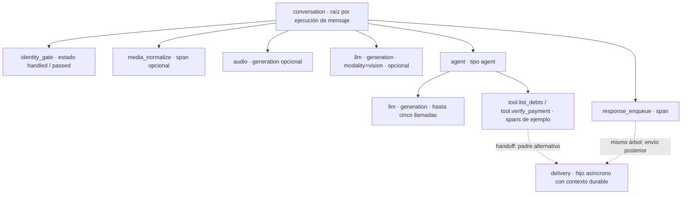

# Implementation Plan: Demo de cobranza por WhatsApp

**Branch**: `main` | **Feature**: `001-cobranza-whatsapp` | **Date**: 2026-10-31
**Spec**: [spec.md](spec.md) | **Hito interno**: lunes 2026-11-02.
**Entrega oficial**: martes 2026-11-03, 23:59 America/Bogota.
**Documento técnico de entrega**: [arquitectura](../../docs/arquitectura.md).
**Input**: Especificación funcional y arquitectura de una sola EC2.
**Estado**: Aplicación implementada y ejecutándose en EC2 emulada. El 2 de
noviembre se comprobaron integraciones, campaña, audio, imágenes, pagos, control
humano y persistencia; los límites de aceptación están en
[evaluación](../../docs/evaluacion.md).

## Summary

Monorepo Python con dos servicios propios: backend conversacional y central de
cartera simulada. El backend sirve las dos webs pequeñas y tiene un worker duradero
para campañas y mensajes. Un único nodo LangGraph encapsula el ciclo OpenAI y
herramientas; audio e imagen se preprocesan antes. Cartera, órdenes, acuerdos y
pagos pertenecen al sistema central; memoria y operación del backend usan otro
PostgreSQL. La página de pago aplica efectos a través del backend y de la API central.

Docker Compose ejecuta todo lo propio, incluido Langfuse completo, en local o en
una sola EC2. Chatwoot existente y OpenAI son externos. La entrega acordada el
2 de noviembre incorpora ejecución del stack en una instancia EC2 emulada por
Floci, además del perfil de smoke de APIs existente. Requiere Linux invitado con
su propio motor Docker, arranque reproducible, fixtures limpios y comprobación
de salud/persistencia; la evidencia distinguirá simulación de APIs y ejecución
real de contenedores en el invitado. El ensayo se aislará de la demo actual.
No aprovisiona AWS real. IaC y la separación en servicios especializados para
optimizar el coste medido siguen siendo planes futuros.

La entrada pública activa es `cobranza.agenx-dev-test.work`, bajo el dominio de
pruebas administrado en Cloudflare. Un conector opcional `cloudflared` en Compose
mantiene el hostname al cambiar de entorno, con un solo equipo activo y migración
de datos separada. El corte al invitado emulado ya está aplicado; el traslado a
otro PC físico debe verificarse en ese destino. El archivo privado de entrega se
aplica antes de inicializar las bases, con secretos internos nuevos.
[Configuración y verificaciones](../../docs/dominio-demo.md).

## Technical Context

**Language/Version**: Python 3.12 en contenedores; JavaScript nativo en las webs.
**Primary Dependencies**: FastAPI, Jinja2, Pydantic, HTTPX, SQLAlchemy 2, psycopg 3,
Alembic, OpenAI SDK, LangGraph, langgraph-checkpoint-postgres y Langfuse SDK.
Se fijan versiones compatibles en uv.lock y tags/digests de imágenes al implementar.
**Storage**: PostgreSQL 17 de cartera; otro PostgreSQL 17 para operación/memoria;
volúmenes distintos; almacenes propios de la versión elegida de Langfuse aislados.
**Testing**: pytest, HTTPX y bases PostgreSQL de prueba reales para transacciones,
concurrencia, contratos y aislamiento; guion de integración con servicios reales.
**Target Platform**: Linux amd64, Docker Compose, una EC2 y EBS. Local sin AWS real.
**Project Type**: Monorepo web con dos APIs, worker y dos interfaces server-rendered.
**Performance Goals**: ACK del webhook tras persistencia, sin esperar al LLM; medir
p50/p95 en texto/audio/imagen. El timeout de integración se valida en preflight;
no se promete capacidad comercial. Dos slots de trabajo y dos inferencias máximas
simultáneas, con una sola ejecución por thread_id/source_id literal.
**Constraints**: USD fijo; una deuda por contrato; 80% mínimo; presupuesto IA USD 10
con corte local 10.00; cinco llamadas del agente por turno; sin OTP,
dinero real, ERP completo, IaC o migración a otros servicios en esta entrega.
**Scale/Scope**: Fixtures pequeños, evaluador y número habilitado de prueba;
31 casos AC y seis recorridos. Se dimensiona la EC2 con observabilidad incluida.

## Constitution Check

Gates revisados antes de investigación y nuevamente con datos y contratos definidos.
Estas comprobaciones evalúan diseño, no ejecución del software.

| Principio | Decisión verificable en el diseño | Gate |
|---|---|---|
| I. Verdad financiera | Único escritor central, centavos, bloqueo y transacción, claves únicas | Cumple en diseño |
| II. Identidad y humano | PIN interceptado, grant por cliente, pending antes de enviar; nota y open | Cumple en diseño; carrera externa documentada |
| III. Agente real | START-agent-END, loop interno limitado y medios anteriores; checkpoints PostgreSQL | Cumple en diseño |
| IV. Entrega pequeña | Dos servicios y webs renderizadas, una EC2 y Compose; extras futuros fuera | Cumple en diseño |
| V. Evidencia y métricas | Eventos de negocio, trazas correlacionadas, reservas de consumo comunes | Cumple en diseño |
| VI. Privacidad | Entorno privado, fixtures ficticios, descargas restringidas y redacción | Cumple en diseño |
| VII. Verificación | AC-01–31 mapeados a tareas y evidencia; pruebas financieras y de aislamiento | Cumple en diseño |

No se identifican excepciones constitucionales. La comprobación de pending por HTTP
no es atómica con el envío externo; se verificará la protección existente de Chatwoot,
se cancelarán salidas cuando se conoce control humano y se documentará la carrera
residual. No se afirma una garantía distribuida sin evidencia.

## Project Structure

### Documentation (this feature)

```text
specs/001-cobranza-whatsapp/
├── spec.md
├── plan.md
├── research.md
├── data-model.md
├── agent-state.md
├── quickstart.md
├── contracts/
│   ├── application.md
│   ├── central.md
│   ├── chatwoot.md
│   └── agent-tools.md
├── checklists/requirements.md
└── tasks.md
```

### Source Code (repository root)

Estructura prevista; estos archivos de aplicación aún no existen.

```text
pyproject.toml
uv.lock
apps/
├── backend/
│   ├── pyproject.toml
│   └── src/backend/
│       ├── main.py
│       ├── worker.py
│       ├── config.py
│       ├── api/{operator,payments,webhooks,demo}.py
│       ├── agent/{graph,tools,prompts,media}.py
│       ├── services/{identity,campaigns,handoff,metrics,budget,events}.py
│       ├── integrations/{central,chatwoot,openai,observability}.py
│       ├── persistence/{models,queue,outbox,checkpoints}.py
│       ├── templates/{central,payment,login}.html
│       └── static/{app.css,central.js,payment.js}
├── central/
│   ├── pyproject.toml
│   ├── alembic/
│   └── src/central/{main,models,schemas,auth,identity,debts,orders,payments,seed}.py
packages/shared/src/agil_shared/{schemas,money,errors}.py
migrations/backend/
infra/{compose.yaml,compose.ec2.yaml,compose.floci.yaml,Caddyfile,Dockerfile.backend,Dockerfile.central}
scripts/{preflight,seed,reset_demo,smoke_floci}.py
scripts/demo_message.py
scripts/run_acceptance.py
tests/{unit,integration,contracts,fixtures}/
docs/{evaluacion,despliegue-ec2}.md
```

**Structure Decision**: Workspace uv; esquemas y tipos comunes, sin compartir acceso
a las bases. Las dos webs son distintas rutas y vistas, con el mismo backend y
proxy. No se crea otro frontend pesado. Los nombres con llaves representan archivos
individuales, no nombres de carpetas literales.

## Phase 0: Research

[research.md](research.md) resuelve stack, modelos, presupuesto, nodo único,
transacciones, cola, Chatwoot, medios, campaña, EC2 y Floci. Se consultaron fuentes
primarias y se separan decisiones técnicas de accesos externos todavía no aportados.
No quedan decisiones de diseño marcadas NEEDS CLARIFICATION.

## Phase 1: Design & Contracts

### Responsabilidad y secuencia

1. El webhook valida firma, cuenta/inbox y tipo de evento; prepara transporte y
   persiste inbox/trabajo durable local antes del HTTP 200, sin consultas de negocio.
   Durante awaiting_pin / waiting_auth cifra temporalmente el contenido con Fernet;
   el PIN en claro y su sobre cifrado no entran a prompts, checkpoints ni Langfuse.
2. El worker toma trabajo durable y obtiene exclusión de thread. Consulta pending,
   control humano y revisión; evita repetir mensajes. En awaiting_pin, IdentityService.consume_auth
   procesa TODOS los mensajes de forma estática: formato numérico de 4 a 8 dígitos
   y verificación de PIN con central. Formato incorrecto, medio o PIN rechazado suma
   un fallo local. Antes del tercero responde fijo; PIN correcto entrega
   identity_verified; tercer fallo sale de auth sin autorización y entrega
   auth_attempts_exhausted. Ambos eventos neutros pueden volver al agente. Tres
   fallos locales no eluden el bloqueo de PIN de 15 minutos aplicado por central.
3. Fuera de auth descarga medios con límites y transcribe o extrae contexto no
   verificado. Reserva gasto antes de cada inferencia. Durante auth no procesa medios.
4. El único nodo recupera contexto y ejecuta hasta cinco llamadas. Herramientas con
   esquemas estrictos, parallel_tool_calls=false y permisos derivados de la sesión;
   el modelo no suministra PIN, grant, cuenta, cliente ni claves de autorización.
   Fuera de awaiting_pin, todos los mensajes admitidos llegan al nodo, incluidos
   números aislados, sin regex global de PIN. El LLM decide confirmar, rechazar o
   cambiar mediante manage_identity. confirm_candidate activa awaiting_pin con
   contador cero y solicitud fija, sin inferencia posterior. Ninguna transición
   concede cartera: solo la verificación de PIN. Tras agotamiento, el agente orienta
   sin autorización y puede atender una petición de asesor, sin handoff automático.
   El backend aplica siempre permisos fuera del LLM.
5. El backend consulta central, crea orden/acuerdo allí y genera el enlace público.
   La web manda intención de aprobar/rechazar; no determina importe ni titularidad.
6. La central aplica pago y condonación de manera atómica; el siguiente comprobante
   causa una consulta autorizada. El cierre conversacional espera esa verificación
   para conservar el recorrido de captura solicitado.
7. Cada salida se guarda en outbox y revalida pending inmediatamente antes de
   enviarse. Un estado humano conocido cancela la salida; un envío incierto no se
   repite automáticamente. El caso humano se guarda antes de nota y cambio a open.

El thread_id es exactamente el source_id del contacto del evento. Se valida la
cuenta/inbox por separado; no se normaliza la llave ni se agregan prefijos. El
lock del worker abarca el thread, incluso si agrupa varios conversation_id. Cada
trabajo conserva el evento y cada outbox copia su destino: cuenta, inbox y
conversation_id. La respuesta se publica en esa conversación, no en una «última
conversación» global ni en un destino elegido por el modelo.

### Estado y ventana de contexto

[agent-state.md](agent-state.md) concreta el estado, sus referencias a
cartera y la ventana seleccionada antes de cada inferencia. Los checkpoints pueden
conservar más historial del que se envía al LLM. El valor inicial de 20 mensajes visibles
es configurable y está subordinado al límite total de 12 000 tokens de entrada.
No se crea una tabla propia de estados ni un nodo por fase conversacional.

### Identidad y acceso

Operador: login con credencial de demo privada, cookie HttpOnly y protección CSRF
para mutaciones; Secure bajo HTTPS, excepción local explícita. Pago público:
capability opaca firmada por central sobre una orden de ID aleatorio y expiración; sin
datos completos de identificación. API central: credencial interna de servicio y
grant temporal de cliente en consultas conversacionales. Operador y agente usan
permisos distintos. El modelo no puede consultar un cliente arbitrario.

El teléfono de cartera se normaliza en formato internacional. Cambiarlo incrementa una versión
de contacto e invalida la vinculación Chatwoot anterior; se resuelve de nuevo por
inbox al enviar. Esa normalización no se aplica al source_id de memoria.
El LLM recibe source_id literal en el contexto, sin clasificación previa, y usa
locate_customer por teléfono o pide documento si interpreta Business ID, formato
desconocido, no hay coincidencia o se rechaza al candidato. La herramienta devuelve
solo una pista enmascarada. El backend registra confirmación y PIN pendientes;
la verificación escrita queda fuera del modelo. La central guarda teléfonos y
documentos ficticios, sin IDs de Meta; recibe un binding_ref opaco para autorizar.

Se permite gestionar otro titular tras validar su PIN. Cambiar de cliente revoca
la sesión anterior, limpia el historial financiero activo y referencias, cancela
salidas anteriores e incrementa identity_revision sin cambiar thread_id. Antes de
cada inferencia se contrasta esa revisión con el estado recuperado. El caso humano
activo bloquea el thread hasta devolución explícita; pending se comprueba además
en el destino de cada respuesta. Sesión 30 minutos, tres intentos incorrectos y bloqueo 15 minutos;
son defaults de demo configurables y explícitos, no política productiva.

### Trabajo durable y efectos externos

El PostgreSQL operativo tiene inbox_events, conversation_jobs, outbox y business_events.
Una clave única evita recepción duplicada. Para una conversación se respeta el orden
de recepción persistida y se ejecuta el nodo bajo advisory lock por thread_id. Las
herramientas mutantes llevan clave estable por mensaje y acción; al reejecutar un
nodo después de caída recuperan el mismo resultado en lugar de crear otra orden.

Campañas reservan destinatario por persona y posición estable del lote. Un único
slot de despacho de campañas, compartido entre workers mediante lock durable,
recorre una persona a la vez; los dos slots conversacionales no paralelizan envíos
de campaña. Intervalo entre destinatarios configurable; no representa un límite
atribuido a Meta. El worker revalida saldo, mora, contacto,
habilitación y control humano antes de publicar. La cuenta de personas enviadas usa
IDs de mensajes aceptados; entregas se actualizan solo con evidencia del canal.
El vencimiento de ventana no borra eventos; el cierre del operador fija el corte.

Destinos con delivery_mode=simulated registran campaign_send_simulated sin llamar
a Chatwoot/Meta ni OpenAI. Solo el destino live del evaluador y habilitado recorre
el adaptador real. El modo se configura explícitamente al editar el contacto y
se revalida al despachar; una edición posterior invalida el binding previo.
Se persisten posición, intento y resultado por destinatario. Un fallo no aborta
el resto del lote; un resultado de red incierto queda visible sin reenvío ciego.
La central muestra procesados/total, pendientes, simulados, reales y errores.
Solo los reales aceptados entran en contactabilidad y resultados comerciales.

### Transacciones y eventos financieros

Todas las mutaciones financieras quedan en la base de cartera. Aprobación bloquea
la deuda, compara versión/saldo y estado de orden, inserta intento aprobado y ledger,
aplica condonación autorizada y deja saldo cero. Una única liquidación por deuda
y una idempotency key por comando protegen reintentos. Otro pago sobre saldo ya
liquidado devuelve el resultado existente o conflicto, sin un segundo efecto.

Un cursor de eventos del sistema central permite al backend reconstruir métricas
si la petición de pago se aplicó pero la respuesta se perdió. Se deduplica por event_id;
no existe una transacción distribuida entre ambas bases. La captura consulta central
independientemente de que ese evento ya esté reflejado en las métricas.

### Presupuesto, medios y observabilidad

El agente principal usa gpt-5.6-luna con reasoning.effort=high.
La extracción visual usa el mismo modelo con esfuerzo none. El límite
de salida del agente se fija inicialmente en 4096 tokens, incluyendo razonamiento
y texto visible; una respuesta incompleta no se interpreta como éxito. Se evalúan
calidad y latencia antes de ajustar estos límites.

Ledger operativo compartido entre workers y modalidades, con reserva antes de llamada,
settlement de uso y reservas conservadas ante timeout incierto. Dos inferencias globales,
12 000 tokens de entrada, 4096 de salida total del agente, 400 de extracción visual y reintentos
explícitos; todas las cifras son configurables. Los modelos sin tarifa configurada se
rechazan. Límite local de USD 10; no se promete factura exacta.

Audio e imágenes: hasta 5 MiB, audio 60 segundos, una imagen de hasta 2048 px por lado
como normalización de demo y mensaje acompañante conservado. Varias imágenes se
procesan en orden dentro del presupuesto o se pide reenviar una por una. URLs y
redirecciones solo a hosts permitidos; sin credenciales hacia terceros. Las trazas
registran correlación, tipo de medio, herramientas y uso, con el siguiente contrato.

#### Árbol de observabilidad por mensaje

**Estructura implementada y verificada con pruebas deterministas:** al abrir una ejecución
de mensaje, el árbol agrupa sus pasos desde una raíz `conversation`. Sigue pendiente
repetir el nuevo árbol completo en Langfuse con WhatsApp y medios reales.
La raíz corresponde a una ejecución del worker de ese mensaje, no a todo el chat;
un reintento puede producir otra ejecución con el mismo `event_id`. No se crea una
web de trazas: se utiliza la interfaz nativa de Langfuse.



Los hijos se muestran en orden de ejecución: puerta de identidad, normalización y
generaciones de medios si existen, agente y encolado. Las llamadas `llm` y
`tool.<nombre>` se intercalan dentro de `agent` según el ciclo real; no se añade
una llamada ficticia para llenar el árbol. `audio` y `llm` son observaciones de
tipo **generation**, con modelo, uso y coste; `agent` usa el tipo **agent**. El
nombre de herramienta es uno de los nueve permitidos: `tool.locate_customer`,
`tool.manage_identity`, `tool.list_debts`, `tool.select_debt`, `tool.create_full_payment`,
`tool.quote_agreement`, `tool.accept_agreement`, `tool.verify_payment` o
`tool.handoff_human`. Los nombres no se construyen con texto del usuario.

La raíz abarca todo el procesamiento protegido, incluso un turno resuelto sin
inferencias. Durante awaiting_pin, el ingreso prepara transporte Fernet temporal
y el worker ejecuta el filtro estático después del acuse; `identity_gate` registra
solo el resultado seguro, nunca el PIN en claro ni el sobre cifrado. Un turno
estático no debe mostrar generaciones de agente que no ocurrieron. Fuera de auth
no existe una intercepción global de números.

| Correlación | Contrato |
|---|---|
| `event_id` | Identificador interno del mensaje, común a sus observaciones; no contiene teléfono, documento ni cuerpo. |
| `session_id` de Langfuse | `opaque_id(source_id)` para agrupar ejecuciones del mismo chat en telemetría. Todos los hijos heredan esta sesión. |
| `thread_id` de LangGraph | Sigue siendo el `source_id` literal. La referencia opaca de Langfuse no cambia memoria, destino ni autorización. |
| `delivery` | Envío asíncrono por outbox, hijo del padre capturado al encolar, con la misma sesión opaca y `event_id`; filas antiguas sin contexto generan una raíz separada. |

El envío ocurre después del encolado y puede hacerlo otra ejecución del worker.
Outbox captura `_trace_context` con `trace_id` y `parent_span_id` del span activo
y lo conserva en su payload privado. El sender valida y recupera ese contexto
para abrir `delivery` en el mismo árbol, aunque la raíz ya haya terminado o se
haya reiniciado el worker. Un reintento idempotente de encolado conserva el primer
padre; el contexto no cambia la comparación del contenido del comando.

Para una respuesta normal, `delivery` es hijo asíncrono de `response_enqueue`; en
un handoff puede depender del `tool.handoff_human` que creó la salida. Las dos
flechas del diagrama muestran padres alternativos, no dos padres simultáneos.
Las filas antiguas sin contexto mantienen una raíz `delivery` separada, correlacionada
por sesión y evento. **La duración de la raíz mide procesamiento del turno: no
incluye la espera posterior del envío asíncrono.** Los estados de envío son `sent`,
`failed`, `uncertain`, `cancelled` o `deferred` (espera). `sent` acredita aceptación de la API de Chatwoot,
no entrega ni lectura en WhatsApp. Esos hitos requieren evidencia exacta del canal;
`response_enqueue` tampoco prueba un envío.

#### Captura privada de contenido y lectura visual

**Cambio de contrato por instrucción explícita del usuario:** se habilita captura
completa de contenido de ejecución para depuración privada mediante
`LANGFUSE_CAPTURE_CONTENT=true`. Esta instrucción reemplaza las restricciones
anteriores que limitaban Langfuse a metadatos y ocultaban datos personales o
financieros. `LANGFUSE_CAPTURE_CONTENT=false` conserva el modo de solo metadatos.
La estructura de observaciones y la autorización financiera no cambian.

| Observación | Contenido con captura activada |
|---|---|
| `conversation` / `identity_gate` | Mensaje protegido y evolución del turno; auth solo expone resultado seguro, sin PIN en claro ni sobre cifrado; fuera de auth no hay filtro global de números. |
| `media_normalize`, `audio`, visión | Contexto, transcripción, extracción visual e inputs/outputs de procesamiento; audio e imagen completos usados como assets privados `LangfuseMedia`. |
| `agent` | Prompt/contexto e historial usados, estado anterior y posterior, y respuesta generada. |
| `llm` | Input completo realmente enviado al modelo y output disponible, sin razonamiento interno ni `encrypted_content`. |
| `tool.<nombre>` | Argumentos y resultado completos, incluidos datos personales y financieros autorizados. |
| `response_enqueue` / `delivery` | Respuesta preparada/enviada y resultado operativo, con capabilities y tokens de enlaces eliminados. |

Se permite visualizar sin enmascarar mensajes, teléfono, documento, identidad y
datos financieros dentro de este Langfuse privado. La sesión sigue siendo
`opaque_id(source_id)` y LangGraph conserva `thread_id` literal; el hash del
identificador de sesión no anonimiza el prompt ni el historial capturados, que
pueden incluir el `source_id` recibido. Los nombres de spans, generaciones y
herramientas siguen un catálogo fijo; no se construyen con texto del usuario.

**Exclusiones en estructuras y texto:** se filtran los secretos conocidos de
infraestructura, API keys, cabeceras `Authorization`, grants, capabilities y tokens
de URL. Se conserva el resto del cuerpo de ejecución. Durante awaiting_pin el
contenido viaja a la cola cifrado temporalmente con Fernet y se procesa de forma
estática en el worker. Ni el PIN en claro ni su sobre cifrado se capturan. Fuera
de auth no hay protección automática de un código enviado espontáneamente. No
se captura razonamiento interno ni `encrypted_content`; los errores se sanean.
Los assets multimedia autorizados se almacenan completos en privado mediante
`LangfuseMedia`. **No se hace OCR ni redacción automática previa del contenido
visual o hablado del archivo**: la exclusión del PIN tecleado no garantiza eliminar
PIN u otros secretos incrustados en imágenes o audio. El acceso a una traza no
concede permisos de cliente ni sustituye la consulta autorizada a central.

La captura de texto se limita a 1 000 000 de caracteres por cadena, profundidad 40
y 20 000 elementos. Los límites generan marcadores explícitos
`[TRUNCATED:original_chars=…]`, `[TRUNCATED:max_depth]` o `[TRUNCATED:max_items]`,
en lugar de recortar silenciosamente. Los archivos se representan mediante assets;
no se usa ese límite de texto como sustituto del archivo multimedia completo.
Chatwoot externo conserva sus mensajes y puede registrar payloads al reintentar;
este ajuste no altera su almacenamiento o logging.

Con captura desactivada se mantienen correlación, estados permitidos, fase y
conteos operativos de herramientas, modelo/modalidad, latencias, tokens y costes
estimados. Las trazas anteriores siguen en su modo histórico, **sin backfill**.
Un nuevo turno puede capturar el historial que carga para esa ejecución, pero no
reescribe observaciones anteriores. Apagar la captura no elimina contenido ya
exportado. Las fuentes o evidencias públicas no deben incluir esas trazas privadas.

En la lista de Langfuse se filtran observaciones raíz
(`isRootObservation:true`) y nombre `conversation`. Con refresco **Off**, se pulsa
**Refresh** después de esperar la exportación. Se abre una fila y después
**agent → llm → Input / Output** para revisar el contexto realmente enviado y la
respuesta disponible; **tool.<nombre> → Input / Output** muestra argumentos y
resultado. Los pasos de medios muestran su contexto y el agente sus estados antes
y después. El coste vacío de una raíz span no implica consumo cero: se revisan sus
generaciones hijas. `response_enqueue → delivery` mantiene el envío en ese árbol;
para salidas antiguas sin contexto se usa la sesión/evento para localizar otra raíz.

**Evidencia determinista y validación real pendiente:** la suite Docker de **303
pruebas** del 1 de noviembre de 2026 a las **18:14:58 UTC** aprobó sin fallos ni
omitidas en 35,70 segundos, con limpieza posterior y Ruff aprobado. Incluye dos
turnos de worker con checkpoint e inputs/outputs; SDK con captura completa y
errores saneados; assets y formatos multimedia; continuidad ante fallos de
telemetría; y transporte S3 firmado. PostgreSQL y el SDK real con exportación en
memoria verifican captura, sesiones y parentesco durable. La lectura histórica de
tres observaciones y la traza `llm`/`tool`/`llm` de la UI corresponden al modo previo.
La nueva captura se leyó en el despliegue real: una llamada a Luna mostró prompt,
mensaje con documento y respuesta en API y UI; una imagen PNG y un audio WAV
ficticios se almacenaron y se visualizaron en el navegador, sin errores de carga.
Coste estimado USD 0,00059875, cero envíos al canal. Falta repetir el árbol completo
con WhatsApp/evaluador, medios y herramientas financieras. El diagnóstico no sustituye
la aceptación de ese recorrido.

Las cláusulas de redacción general en `agent-state.md` y `contracts/agent-tools.md`
y la evidencia histórica sin prompts de `tasks.md` deben leerse junto con esta
instrucción posterior: la captura privada permite contenido personal/financiero,
pero conserva el filtrado de secretos en JSON/texto y la interceptación del PIN
tecleado; los archivos completos tienen el límite de redacción descrito arriba.
Esos archivos no se modifican en
este encargo; la evidencia anterior mantiene su alcance temporal.

### Entrega, dimensionamiento y validación

Orden de trabajo hasta el lunes 2: base y primer recorrido; campaña, medios,
acuerdos, handoff y métricas; aceptación desde entorno limpio, guion y entrega.
Es orden orientativo, sin promesa de horas ni reducción de Must Have.

Preflight privado prueba acceso a modelos, Chatwoot y plantilla; no envía campañas
ni consume inferencia de forma silenciosa. Las pruebas pagadas y de mensajería se
activan explícitamente. Se registran resultados reales de AC-01–31 en docs/evaluacion.md.
El [quickstart](quickstart.md) es contrato de validación previsto, sin comandos que
se presenten como funcionales antes de implementarse.

El despliegue EC2 mantiene proxy HTTPS, redes internas y volúmenes EBS separados;
no expone bases ni el endpoint de Floci al público. El tamaño se decide midiendo
el stack de Langfuse y la aplicación. Se documentan backup/restore y punto único
de fallo. Provisionamiento declarativo, servicios especializados y costos de AWS
reales quedan fuera de esta fase de documentación.

### Entregables de diseño

[Datos](data-model.md), [API de aplicación](contracts/application.md),
[API central](contracts/central.md), [Chatwoot](contracts/chatwoot.md),
[herramientas del agente](contracts/agent-tools.md) y [validación](quickstart.md).

## Complexity Tracking

Sin excepciones a la constitución. Se justifica el worker durable por reintentos y
respuesta rápida del webhook; se usa el PostgreSQL ya requerido, sin añadir un
broker propio. Las dependencias múltiples de Langfuse pertenecen a su stack aislado.
