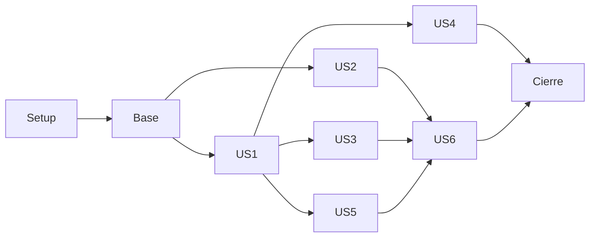

# Tasks: Demo de cobranza por WhatsApp

**Input**: [spec.md](spec.md), [plan.md](plan.md), [research.md](research.md),
[data-model.md](data-model.md), [contratos](contracts/) y [quickstart.md](quickstart.md).
**Estado**: revisión de código y evidencia al 2026-11-01: 47 tareas implementadas y verificadas; 9 pendientes o parciales. Una casilla completa no acredita el recorrido live ni la aceptación comercial del AC asociado.
**Entrega**: lunes 2026-11-02, America/Bogota; hora por confirmar. Todas las historias son obligatorias.
**Tests**: la especificación exige pruebas relevantes de finanzas, identidad, aislamiento y concurrencia.

## Format: `[ID] [P?] [Story] Description`

Los paths son relativos al repo. [P] permite trabajo independiente en archivos distintos
después de completar sus prerequisitos; no autoriza delegación ni ejecución simultánea
por sí solo. Los IDs FR y AC conservan la numeración del PRD. Escribir y comprobar
los fallos de las pruebas de riesgo antes de la implementación que validan.

## Phase 1: Setup (Shared Infrastructure)

**Goal**: Preparar dependencias reproducibles y ejecución base.

- [x] T001 Crear workspace uv y configuración pytest/ruff para apps/backend, apps/central y packages/shared en pyproject.toml y uv.lock (FR-20; AC-01).
- [x] T002 Definir variables públicas de ejemplo y configuración validada en .env.example y apps/backend/src/backend/config.py; ningún valor real (FR-19, FR-20; AC-01, AC-24).
- [x] T003 Crear imágenes Python 3.12 y Compose base con backend, worker, central y dos PostgreSQL en infra/Dockerfile.backend, infra/Dockerfile.central e infra/compose.yaml (FR-03, FR-12, FR-20; AC-01, AC-19).
- [x] T004 Integrar stack Langfuse compatible con imágenes fijadas y volúmenes aislados en infra/compose.yaml; verificar sus dependencias reales (FR-19, FR-20; AC-01, AC-24).
- [x] T005 Implementar importes USD en centavos y errores compartidos en packages/shared/src/agil_shared/money.py y errors.py (FR-13; AC-09, AC-29).

**Checkpoint**: verificar el incremento con evidencia antes de dar por terminada la fase.

## Phase 2: Foundational (Blocking Prerequisites)

**Goal**: Persistir trabajo, aislar permisos y limitar gasto antes de cualquier historia.

- [x] T006 Crear entidades y migraciones centrales con constraints de identidad, deuda, acuerdos, órdenes y settlement en apps/central/src/central/models.py y apps/central/alembic/ (FR-01, FR-02, FR-13, FR-16; AC-02, AC-14, AC-30).
- [x] T007 [P] Crear modelos/migraciones operativos, eventos, grants, outbox, gasto y cursor en apps/backend/src/backend/persistence/models.py y migrations/backend/ (FR-07, FR-12, FR-19, FR-22; AC-14, AC-19, AC-24, AC-27).
- [x] T008 Preparar checkpointer PostgreSQL con thread_id exactamente igual al source_id literal del contacto y revisión de identidad en apps/backend/src/backend/persistence/checkpoints.py (FR-09, FR-12; AC-19).
- [x] T009 Implementar recepción durable, dedupe, retry acotado y locks por thread_id que preservan el evento/destino en apps/backend/src/backend/persistence/queue.py y worker.py (FR-07, FR-12; AC-14, AC-19, AC-22).
- [x] T010 Implementar outbox con destino account/inbox/conversation copiado del evento o binding de campaña, pending y revisión revalidados, cancelación y envío incierto sin repetición ciega en apps/backend/src/backend/persistence/outbox.py (FR-06, FR-07, FR-12, FR-18; AC-18, AC-19, AC-21, AC-22).
- [x] T011 Implementar autenticación por rol de servicio, grants y cliente HTTP central sin acceso directo a cartera en apps/central/src/central/auth.py y apps/backend/src/backend/integrations/central.py (FR-03, FR-08, FR-09; AC-03, AC-13).
- [x] T012 [P] Escribir pruebas de reservas concurrentes, timeout y reset que conserva consumo en tests/integration/test_budget.py (FR-19, FR-20; AC-24).
- [x] T013 Implementar ledger/reservas de gasto, concurrencia global y corte 4.50 en apps/backend/src/backend/services/budget.py; no borrar al reset (FR-19; AC-24).
- [x] T014 Configurar cliente OpenAI con modelos del plan, tarifas, timeout y retries explícitos en apps/backend/src/backend/integrations/openai.py (FR-10, FR-11, FR-19; AC-22, AC-24).
- [x] T015 Implementar redacción de secretos, correlación, health y readiness en apps/backend/src/backend/integrations/observability.py y main.py; smoke básico en scripts/preflight.py (FR-19, FR-20; AC-01, AC-24).

**Checkpoint**: verificar el incremento con evidencia antes de dar por terminada la fase.

## Phase 3: User Story 1 - Consultar y pagar (Priority: P1)

**Goal**: Primer incremento: sesión, deuda, agente real, enlace y pago íntegro. Validar con cliente semilla sin depender de campaña.

**Independent Test**: escenarios de US1 en [spec.md](spec.md); fixtures aíslan el recorrido.

- [x] T016 [P] [US1] Escribir pruebas de localización enmascarada por teléfono/documento, confirmación, PIN, expiración y cambio de cliente que limpia contexto y revoca acceso anterior en tests/integration/test_identity.py y tests/contracts/test_central_identity.py (FR-08, FR-09, FR-12; AC-02, AC-03, AC-04, AC-13, AC-19).
- [x] T017 [P] [US1] Escribir pruebas de pago, duplicación, órdenes concurrentes y saldo actualizado con PostgreSQL real en tests/integration/test_payments.py (FR-13, FR-15, FR-16; AC-05, AC-10, AC-14, AC-30).
- [x] T018 [US1] Implementar localización por celular/documento con pista enmascarada, PIN hash/grant y binding_ref opaco sin IDs de Meta, límite de intentos y deudas autorizadas en apps/central/src/central/identity.py y debts.py (FR-01, FR-02, FR-03, FR-08, FR-09; AC-02, AC-03, AC-04, AC-13).
- [x] T019 [US1] Crear fixtures ficticios con dos servicios, aislamiento, estados y límites de mora en apps/central/src/central/seed.py y scripts/seed.py (FR-01, FR-02, FR-20, FR-21; AC-01, AC-02, AC-25, AC-26).
- [x] T020 [US1] Implementar candidato/confirmación pendientes, PIN escrito fuera de inferencia/persistencia/traza, sesión por source_id literal y cambio de cliente con revisión, limpieza y cancelación de salidas en apps/backend/src/backend/services/identity.py (FR-08, FR-09, FR-12; AC-03, AC-04, AC-13, AC-19, AC-24).
- [x] T021 [US1] Implementar órdenes por saldo vigente y capability opaca firmada en apps/central/src/central/orders.py (FR-13, FR-15; AC-05, AC-10, AC-30).
- [x] T022 [US1] Implementar intentos, settlement único, condonación cero y eventos centrales atómicos en apps/central/src/central/payments.py (FR-03, FR-16; AC-05, AC-10, AC-14, AC-30).
- [x] T023 [US1] Implementar web de pago/recibo y adaptador de intentos en apps/backend/src/backend/api/payments.py, templates/payment.html y static/payment.js (FR-15, FR-16; AC-05, AC-10).
- [x] T024 [US1] Implementar locate_customer previa al PIN y herramientas autorizadas de consulta, selección, pago íntegro y verificación en apps/backend/src/backend/agent/tools.py (FR-03, FR-08, FR-09, FR-13, FR-15, FR-17; AC-02, AC-04, AC-05, AC-11, AC-13).
- [x] T025 [US1] Construir único nodo con source_id literal en prompt sin clasificador previo, catálogo según autorización, loop de cinco llamadas, revisión, memoria persistente y ventana de historial con herramientas completas y límite total de tokens en apps/backend/src/backend/agent/graph.py y prompts.py (FR-08, FR-11, FR-12, FR-19; AC-04, AC-05, AC-19, AC-22, AC-23).
- [x] T026 [US1] Implementar adaptador Chatwoot, firma/relay, filtros, extracción literal de source_id del contacto, destino inmutable por evento, pending y ACK durable en apps/backend/src/backend/integrations/chatwoot.py y api/webhooks.py (FR-07, FR-08, FR-12, FR-18; AC-04, AC-14, AC-18, AC-19, AC-22).
- [x] T027 [US1] Crear entrada local simulada y recorrido por texto con inferencia opt-in, incluyendo reanudación, ventana, source_id literal, dos conversation_id bajo un thread con respuestas al destino correcto y cambio de cliente, en apps/backend/src/backend/api/demo.py y tests/integration/test_text_journey.py (FR-08, FR-11, FR-12, FR-16, FR-17, FR-20; AC-04, AC-05, AC-13, AC-14, AC-19).

**Checkpoint**: verificar el incremento con evidencia antes de dar por terminada la fase.

## Phase 4: User Story 2 - Preparar contacto y campaña (Priority: P1)

**Goal**: Editar el celular en la central y recibir una plantilla real. Independiente con filas y eventos semilla.

**Independent Test**: escenarios de US2 en [spec.md](spec.md); fixtures aíslan el recorrido.

- [x] T028 [P] [US2] Escribir pruebas de edición compartida, mora, filtros, bucle secuencial, ficticios sin llamadas y dedupe de persona en tests/integration/test_campaigns.py (FR-01, FR-02, FR-04, FR-05, FR-21; AC-20, AC-21, AC-25, AC-26, AC-28, AC-31).
- [x] T029 [US2] Implementar edición de fixtures y modo simulated/live, versiones y evento de contacto cambiado en apps/central/src/central/debts.py y schemas.py (FR-01, FR-02, FR-21; AC-25, AC-26, AC-28).
- [x] T030 [US2] Implementar login operador/CSRF y endpoints de tabla/edición en apps/backend/src/backend/api/operator.py y templates/login.html (FR-01, FR-04, FR-20; AC-01, AC-25, AC-28).
- [x] T031 [US2] Crear central pequeña editable con modo de contacto simulated/live, filtros de mora/servicio y previsualización en apps/backend/src/backend/templates/central.html, static/central.js y static/app.css (FR-01, FR-04, FR-21; AC-20, AC-25, AC-26, AC-28).
- [x] T032 [US2] Implementar snapshots, modo simulated/live, bucle de un solo despacho con posición/progreso persistente, elegibilidad, lanzamiento idempotente y cierre de campaña en apps/backend/src/backend/services/campaigns.py y api/operator.py (FR-04, FR-05, FR-06; AC-20, AC-21, AC-26, AC-31).
- [x] T033 [US2] Resolver contacto/inbox/source_id por versión del teléfono, invalidar binding antiguo y enviar template aprobado en apps/backend/src/backend/integrations/chatwoot.py (FR-05, FR-06, FR-08, FR-20; AC-20, AC-21, AC-28, AC-31).
- [ ] T034 [US2] Persistir simulados por separado, progreso del lote, estados reales de envío/entrega y primera respuesta atribuible sin contar mensaje de preparación en apps/backend/src/backend/services/events.py (FR-06, FR-07, FR-22; AC-20, AC-21, AC-27, AC-28, AC-31).

**Checkpoint**: verificar el incremento con evidencia antes de dar por terminada la fase.

## Phase 5: User Story 3 - Acuerdo y condonación (Priority: P1)

**Goal**: Añadir descuento autorizado con confirmación posterior. Probar deudas semilla sin necesitar envío de campaña.

**Independent Test**: escenarios de US3 en [spec.md](spec.md); fixtures aíslan el recorrido.

- [x] T035 [P] [US3] Escribir pruebas de 90%, 80%, 79.99%, USD, precisión y confirmación de quote en tests/unit/test_money_policy.py y tests/integration/test_agreements.py (FR-13, FR-14, FR-16; AC-06, AC-07, AC-08, AC-09, AC-29).
- [x] T036 [US3] Implementar quote, aceptación en mensaje posterior, vencimiento y orden con descuento en apps/central/src/central/orders.py y schemas.py (FR-13, FR-14, FR-15; AC-06, AC-07, AC-08, AC-10, AC-29).
- [x] T037 [US3] Aplicar condonación únicamente con settlement aprobado e invalidar ofertas de saldo anterior en apps/central/src/central/payments.py (FR-13, FR-14, FR-16; AC-06, AC-07, AC-14, AC-30).
- [x] T038 [US3] Añadir herramientas quote/accept y presentación de condiciones/recibo en apps/backend/src/backend/agent/tools.py, prompts.py y templates/payment.html (FR-11, FR-13, FR-14, FR-15; AC-06, AC-07, AC-09, AC-29).

**Checkpoint**: verificar el incremento con evidencia antes de dar por terminada la fase.

## Phase 6: User Story 4 - Audio, imagen y comprobante (Priority: P1)

**Goal**: Interpretar medios y consultar pago, sin dar por válida la imagen. Probar con archivos y pagos semilla.

**Independent Test**: escenarios de US4 en [spec.md](spec.md); fixtures aíslan el recorrido.

- [ ] T039 [P] [US4] Escribir pruebas de medio inválido, origen/redirect, texto acompañante, referencia ajena e inyección en tests/integration/test_media.py y tests/fixtures/ (FR-09, FR-10, FR-17; AC-11, AC-12, AC-13, AC-15, AC-16, AC-23).
- [x] T040 [US4] Implementar descargas limitadas, transcripción y extracción visual no verificada antes del nodo en apps/backend/src/backend/agent/media.py (FR-10, FR-11, FR-19; AC-11, AC-15, AC-16, AC-24).
- [ ] T041 [US4] Integrar contexto multimodal con verify_payment y limpieza de adjuntos en apps/backend/src/backend/worker.py y agent/prompts.py (FR-10, FR-11, FR-17; AC-11, AC-12, AC-13, AC-15, AC-16, AC-23).

**Checkpoint**: verificar el incremento con evidencia antes de dar por terminada la fase.

## Phase 7: User Story 5 - Atención humana (Priority: P1)

**Goal**: Excepciones con resumen privado y suspensión del bot. Validar con conversación/caso semilla.

**Independent Test**: escenarios de US5 en [spec.md](spec.md); fixtures aíslan el recorrido.

- [x] T042 [P] [US5] Escribir pruebas de petición, disputa, <80%, fallo y cambio humano durante inferencia en tests/integration/test_handoff.py (FR-13, FR-18; AC-08, AC-12, AC-17, AC-18, AC-22).
- [x] T043 [US5] Implementar caso por evento, nota privada y status open idempotentes en apps/backend/src/backend/services/handoff.py (FR-18, FR-22; AC-08, AC-17, AC-18).
- [ ] T044 [US5] Añadir herramienta y fallback de errores persistentes con verificación previa de pago en apps/backend/src/backend/agent/tools.py y worker.py (FR-11, FR-17, FR-18; AC-08, AC-12, AC-17, AC-22).
- [x] T045 [US5] Implementar cancelación de outbox al conocer control humano y devolución explícita con revalidación en apps/backend/src/backend/persistence/outbox.py y services/identity.py (FR-07, FR-09, FR-12, FR-18; AC-18, AC-19).

**Checkpoint**: verificar el incremento con evidencia antes de dar por terminada la fase.

## Phase 8: User Story 6 - Métricas y reproducción (Priority: P2, obligatoria)

**Goal**: Mostrar resultados verificables, trazas y restauración. Validar con eventos conocidos, sin gasto del proveedor.

**Independent Test**: escenarios de US6 en [spec.md](spec.md); fixtures aíslan el recorrido.

- [x] T046 [P] [US6] Escribir pruebas de embudo, cohortes y estados con pago total/acuerdo/humano en tests/integration/test_metrics.py (FR-06, FR-14, FR-16, FR-18, FR-22; AC-27).
- [x] T047 [US6] Implementar consumidor de eventos centrales y métricas reales separadas de simulaciones, deduplicadas por persona/deuda/campaña en apps/backend/src/backend/services/events.py y metrics.py (FR-06, FR-16, FR-19, FR-22; AC-14, AC-27, AC-31).
- [x] T048 [US6] Mostrar progreso procesados/total, simulados aparte, contadores reales, tasas, USD recibidos/condonados y casos al corte en apps/backend/src/backend/templates/central.html y static/central.js (FR-22; AC-27, AC-31).
- [x] T049 [US6] Completar spans Langfuse de preprocesamiento/LLM/tools y verificar lectura con scripts/preflight.py e integrations/observability.py (FR-19; AC-24).
- [x] T050 [US6] Implementar reset coordinado que elimina checkpoints/writes y contextos, fija corte de eventos y actualiza epoch solo como metadato, sin cambiar thread_id ni borrar gasto; documentar PIN/identidad en scripts/reset_demo.py, scripts/seed.py y README.md (FR-08, FR-12, FR-20; AC-01, AC-19, AC-28).

**Checkpoint**: verificar el incremento con evidencia antes de dar por terminada la fase.

## Phase 9: Polish & Cross-Cutting Concerns

**Goal**: Ensayar la entrega completa, documentar evidencia y límites reales.

- [x] T051 [P] Crear perfil Floci y smoke de APIs EC2/disco/red solo locales en infra/compose.floci.yaml y scripts/smoke_floci.py; registrar cobertura sin IaC obligatorio (FR-20; AC-01).
- [ ] T052 [P] Preparar entrada HTTPS fija con Cloudflare Tunnel para cobranza.agenx-dev-test.work, conector opcional en Compose y cambio secuencial de equipo según docs/dominio-demo.md; configurar PUBLIC_BASE_URL y verificar webhook y enlaces públicos. Preparar override de una EC2, instrucciones de EBS y restore en infra/compose.ec2.yaml y docs/despliegue-ec2.md; Caddy en infra/Caddyfile es alternativa de HTTPS directo. No desplegar AWS de forma implícita (FR-20; AC-01, AC-19).
- [x] T053 Implementar runner de aceptación y variantes de fallos/concurrencia en scripts/run_acceptance.py con reporte de AC-01–31 en docs/evaluacion.md (FR-03, FR-07, FR-09, FR-13, FR-16, FR-18, FR-20; AC-01–31).
- [ ] T054 Ejecutar preflight y recorridos reales opt-in de WhatsApp/OpenAI/audio/imagen con captura y registrar modelo, consumo, control humano y limitaciones en docs/evaluacion.md (FR-06, FR-10, FR-11, FR-17, FR-18, FR-19, FR-20; AC-05, AC-06, AC-08, AC-11, AC-15, AC-18, AC-24, AC-28).
- [ ] T055 Validar README.md desde entorno limpio y completar guion/diagramas de sustentación y grabación de respaldo en docs/evaluacion.md y docs/despliegue-ec2.md (FR-20; AC-01, AC-19, AC-28).
- [x] T056 Revisar secretos, datos públicos, dependencias fijadas y diff exacto final de README.md, .env.example y docs/evaluacion.md antes de publicar evidencia (FR-19, FR-20; AC-24).

**Checkpoint**: verificar el incremento con evidencia antes de dar por terminada la fase.

## Dependencies & Execution Order

Fase 1 prepara imágenes/configuración; fase 2 bloquea ejecución de historias.
US1 implementa las fronteras comunes. US2 puede adelantarse con contratos y fixtures,
pero la demostración completa campaña→pago requiere US1. US3/4/5 amplían el nodo
y herramientas de US1. US6 necesita los productores de eventos; sus pruebas con fixtures
sí son independientes. Los cambios sobre el mismo archivo se integran secuencialmente.
La fase final requiere todas las historias y accesos externos para evidencia real.

## Parallel Examples by Story

| Historia | Trabajo separable cuando estén listos los prerequisitos |
|---|---|
| US1 | Pruebas de identidad y de transacción financiera en archivos distintos |
| US2 | Pruebas de segmentación y maqueta de tabla usando respuestas fixture |
| US3 | Pruebas de umbral y vista del desglose, después de fijar el contrato |
| US4 | Fixtures/pruebas de medios y adaptación visual, sin modificar el mismo pipeline a la vez |
| US5 | Escenarios de excepción y resumen privado con contrato de caso fijado |
| US6 | Pruebas de métricas y configuración de spans en archivos distintos |

## Implementation Strategy

Obtener primero US1 por texto como incremento funcional. Integrar enseguida el
número editado/campaña de US2 y avanzar en las demás historias sin confundir el
primer incremento con la entrega completa. Medios, humano y métricas no se eliminan
por la etiqueta de prioridad. El último bloque se dedica a ejecución desde cero,
captura, evidencia y README, no a añadir extras. Si falla una integración externa,
se registra como bloqueada y se presenta su limitación; no se sustituye con un mock
silencioso. IaC, recordatorios, pasarela real y servicios AWS especializados quedan fuera.

## Cobertura de requisitos

| Requisito | Tareas previstas |
|---|---|
| FR-01 | T006, T018, T019, T028, T029, T030, T031 |
| FR-02 | T006, T018, T019, T028, T029 |
| FR-03 | T003, T011, T018, T022, T024, T053 |
| FR-04 | T028, T030, T031, T032 |
| FR-05 | T028, T032, T033 |
| FR-06 | T010, T032, T033, T034, T046, T047, T054 |
| FR-07 | T007, T009, T010, T026, T034, T045, T053 |
| FR-08 | T011, T016, T018, T020, T026, T033, T050 |
| FR-09 | T008, T011, T016, T018, T020, T024, T039, T045, T053 |
| FR-10 | T014, T039, T040, T041, T054 |
| FR-11 | T014, T025, T027, T038, T040, T041, T044, T054 |
| FR-12 | T003, T007, T008, T009, T020, T025, T045, T050 |
| FR-13 | T005, T006, T017, T021, T024, T035, T036, T037, T038, T042, T053 |
| FR-14 | T035, T036, T037, T038, T046 |
| FR-15 | T017, T021, T023, T024, T036, T038 |
| FR-16 | T006, T017, T022, T023, T027, T035, T037, T046, T047, T053 |
| FR-17 | T024, T027, T039, T041, T044, T054 |
| FR-18 | T010, T026, T042, T043, T044, T045, T046, T053, T054 |
| FR-19 | T002, T004, T007, T012, T013, T014, T015, T025, T040, T047, T049, T054, T056 |
| FR-20 | T001, T002, T003, T004, T012, T015, T019, T027, T030, T033, T050, T051, T052, T053, T054, T055, T056, T057, T058 |
| FR-21 | T019, T028, T029, T031 |
| FR-22 | T007, T034, T043, T046, T047, T048 |

## Evidencia y alcance de las casillas

La [evaluación](../../docs/evaluacion.md) registra una ejecución Docker aislada de
181 pruebas sin fallos ni omitidas y contiene la matriz AC-01–31. Las pruebas
usan PostgreSQL real y dobles explícitos de OpenAI/Chatwoot: no demuestran envíos,
interpretación del proveedor ni control humano en el canal real. Las regresiones
posteriores de identidad, campañas y mantenimiento también se ejecutaron localmente.

| Tareas marcadas | Evidencia principal |
|---|---|
| T001–T015 | Workspace/lock e imágenes fijadas; arranque y preflight de lectura; `test_budget`, `test_queue`, `test_inference_client` y migraciones reales. |
| T016–T023, T029, T035–T037 | `test_central_finance`, `test_backend_identity`, `test_money_policy` y `test_web_frontends`: identidad, aislamiento, edición, órdenes, settlement único y acuerdos. Las pruebas originalmente previstas como `test_identity`, `test_payments` y `test_agreements` se consolidaron en `test_central_finance`. |
| T024–T028, T030–T033, T038 | `test_text_journey`, `test_agent_context`, `test_webhook_worker`, `test_campaigns`, `test_chatwoot` y `test_channel_relay`: nodo real con SDK doble, checkpoints, permisos, destinos, secuencia, privacidad y webs. No se acredita entrega de plantilla. |
| T040, T042–T043, T045 | `test_media`, `test_handoff` y `test_webhook_worker`: límites de archivos, proveedores dobles, nota/open ordenados, cancelación y retorno explícito. |
| T046–T048, T050 | `test_metrics`, reset recuperable de dos bases en `test_central_finance`, `test_main_maintenance`, panel implementado y guías de PIN/reset. |
| T049 | Preflight real completo con autenticación de Langfuse; lectura API de tres generaciones reales de audio/visión y UI autenticada con trazas de conversación, herramienta y modelo. Evidencia visual privada revisada, sin prompts ni respuestas completas. No acredita el recorrido WhatsApp completo. |
| T056 | Revisión del índice final: archivos públicos ficticios, dependencias e imágenes fijadas; contraste con secretos privados y patrones de credenciales sin hallazgos; diff sin errores de whitespace. `.env` y `.local` excluidos. |
| T051, T053 | Perfil/smoke Floci y runner determinista existentes; [alcance Floci](../../docs/despliegue-ec2.md) con snapshot no soportado declarado. El runner `--live` permanece bloqueado explícitamente. |

El recorrido local con Luna real ya ejercitó identificación, listado, selección,
creación de enlace y pago simulado aplicado. No fue WhatsApp y no completa las
historias de audio, comprobante, campañas ni atención humana. El túnel y la
lectura acotada del relay tienen el estado descrito en
[dominio-demo.md](../../docs/dominio-demo.md). La privacidad del PIN fuera del
modelo/cola/trazas se limita al backend propio y Langfuse: Chatwoot conserva el
mensaje externo y su job instalado registra payload al reintentar. El webhook
usa 429 para backpressure compatible con sus reintentos; no se modificó ese
logging externo.

## Pendientes concretos

| Tarea | Lo que falta para cerrar la casilla |
|---|---|
| T034 | Recibos durables `message_updated` y atribución exacta `delivered`/`read`/`failed` implementados, con dedupe, conciliación temprana, métricas y reset probados. La respuesta de campaña real cuenta también bajo control humano, sin cola de contenido ni IA, y se deduplica entre ingreso/worker; las preparaciones y simulaciones quedan excluidas. El payload instalado puede omitir el estado del mensaje actualizado: esos recibos siguen pendientes (`status_missing`); falta resolver/verificar los casos reales sin estado exacto. |
| T039 | Completar prueba dirigida de inyección en contenido multimodal y comprobante/referencia ajena dentro del recorrido integrado; límites de descarga y aislamiento financiero ya tienen pruebas separadas. |
| T041 | Verificar el recorrido integrado adjunto + texto → worker → agente → `verify_payment`, con limpieza de datos privados y decisión basada en central; las piezas están implementadas y probadas por separado. |
| T044 | Verificar de forma integrada el fallback por fallo persistente y la consulta previa de pago antes de derivar un comprobante no confirmado. Herramientas, política del prompt y outbox humano ya existen. |
| T052 | Corte HTTPS/producción, URL del bot y relay acotado ya aplicados; login HTTP y Chrome/tabla, HMAC de prueba y rechazos verificados. Completar enlaces/evento WhatsApp auténtico y cambio de equipo. Túnel, Compose y guía EC2 preparados; no hay despliegue AWS ni Caddy configurado. |
| T054 | Recorridos WhatsApp de extremo a extremo, audio/visión, campaña entregada, comprobante y atención humana reales; registrar resultados y consumo sin secretos. La plantilla aprobada no acredita un envío. |
| T055 | Ensayo del evaluador desde checkout/volúmenes nuevos, guion/diagramas finales y grabación de respaldo. |

## Extensión de entrega: EC2 emulada ejecutable

- [x] T057 Implementar y comprobar la entrega ejecutable en EC2 emulada de Floci:
  instancia Linux creada por API, motor Docker del invitado y stack completo,
  arranque reproducible, configuración privada separada, fixtures limpios, puertos
  de prueba aislados y salud/persistencia tras reinicio. Conservar la demo actual
  y sus trazas. Documentar evidencia, límites de EC2/EBS emulados y evolución
  posterior; no crear AWS real ni dar por completada la tarea con el smoke de APIs
  de T051 (FR-20; AC-01, AC-19, AC-28).

  Evidencia: once servicios saludables en Docker del invitado; 4 CPU/16 GiB
  efectivos; PostgreSQL conservado tras EC2 Stop/Start; reanudación después de
  detener el engine exterior conservando instancia, entorno y datos; logins HTTP
  de central y Langfuse autenticados. [Alcance](../../docs/emulacion-ec2.md).

- [ ] T058 Habilitar el recorrido externo en el invitado emulado con un entorno
  privado de entrega: claves acotadas, continuidad del presupuesto de IA,
  OpenAI/relay/bandeja TEST y traslado secuencial del conector Cloudflare al mismo
  hostname. Conservar fixtures limpios y trazas de estudio en el entorno anterior.
  Verificar HTTPS, autenticación y lectura de proveedores antes de pedir al
  evaluador iniciar la campaña; no confundir salud del fixture local con una
  integración WhatsApp verificada (FR-20; AC-01, AC-24, AC-28).

## Resumen

**50 tareas completas; 8 pendientes o parciales**, de 58. No se declara completada
la aceptación AC-01–31: cada AC conserva sus límites de evidencia en la evaluación.
No hay hooks de extensión configurados. El puntero de feature es local y la rama
actual sigue siendo main.
