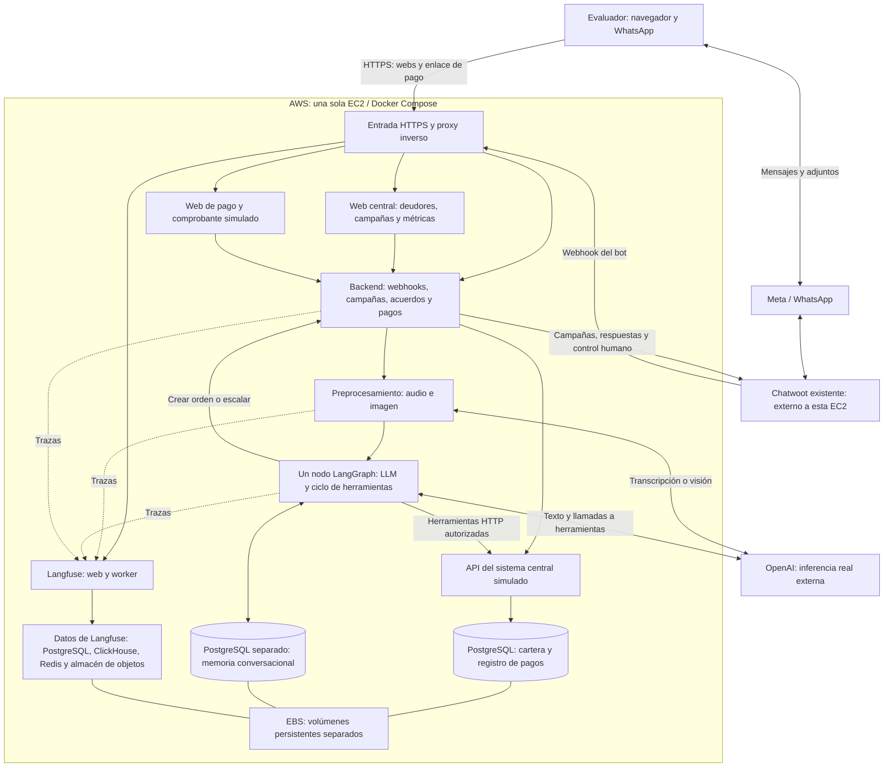
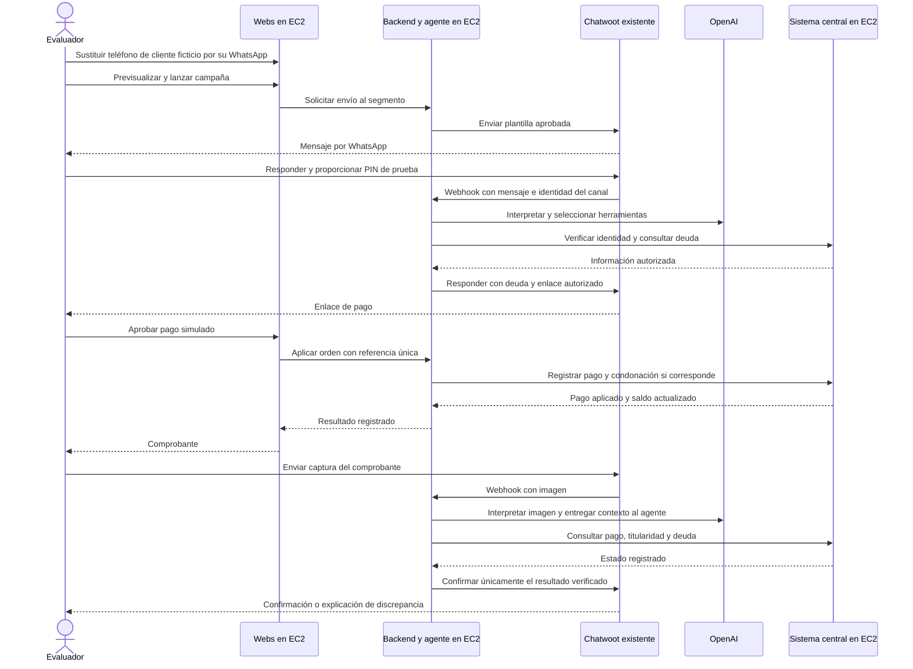

# Arquitectura inicial: una sola EC2

La base acordada es **una máquina EC2 con todos los componentes propios ejecutados mediante Docker Compose**. Las dos interfaces web, el backend con el agente, el sistema central simulado, las bases de datos y la observabilidad comparten la máquina. Los contenedores y los datos mantienen límites separados.

Se elige EC2 por la flexibilidad para arrancar e iterar rápido sobre el stack completo. La evolución prevista es evaluar servicios especializados que permitan reducir el costo total y la carga operativa según el uso medido. El ahorro es un objetivo por validar, sin una migración comprometida para esta entrega.

Este mapa establece la distribución inicial. Los contratos, imágenes, puertos internos, versiones y tareas se detallarán con Spec Kit a partir del [PRD](prd.md). Todavía no representa infraestructura desplegada.

## Componentes y ubicación

Backend, preprocesamiento y agente son responsabilidades lógicas; el dibujo no exige un proceso o contenedor por cada caja. El agente conserva un único nodo LangGraph, con el ciclo de herramientas dentro de él. La central sí mantiene una API propia que representa el sistema externo de cartera.

| Parte | Función | Ubicación inicial |
|---|---|---|
| Central web | Editar deudores, sustituir el celular por el del evaluador, segmentar campañas y consultar métricas | Contenedor web en EC2 |
| Web de pago | Mostrar orden, simular aprobación/rechazo y presentar comprobante | Web en EC2 |
| Backend y agente | Integrar Chatwoot, autenticar, negociar, generar enlaces y consultar herramientas | Contenedores en EC2 |
| Sistema central simulado | Consultar cartera y registrar pago, condonación y saldo de forma consistente | API y PostgreSQL de cartera en EC2 |
| Memoria | Conservar contexto por source_id literal del contacto; destino Chatwoot por evento, separado de la cartera | Otro contenedor PostgreSQL en EC2 |
| Langfuse | Consultar trazas, herramientas, errores, latencias y consumo | Stack autoalojado completo en EC2 |
| Persistencia | Conservar bases, archivos y datos de observabilidad fuera de las imágenes | Volúmenes Docker sobre EBS |
| Entrada pública | Dirigir HTTPS del dominio de prueba hacia las webs y el webhook | Proxy en EC2; DNS en el proveedor del dominio |
| Canal y atención humana | Mensajería y control pending/open | Chatwoot ya desplegado y Meta; integraciones externas |
| Inferencia | Agente principal, transcripción y contexto visual | API externa de OpenAI con clave privada |

EC2 proporciona la máquina; EBS aporta el disco persistente. Los grupos de seguridad controlan las conexiones de red. PostgreSQL instalado en un contenedor sigue siendo PostgreSQL autoalojado: esta primera versión no utiliza RDS. [Documentación de EC2](https://docs.aws.amazon.com/AWSEC2/latest/UserGuide/concepts.html).

Langfuse y sus almacenes se alojan también en esa EC2, con datos aislados de cartera y memoria. Se fijará una versión compatible y su composición antes de implementar. La guía oficial ofrece despliegue con Docker Compose en una VM; esta modalidad concentra los componentes y no aporta alta disponibilidad. [Guía de Langfuse](https://langfuse.com/self-hosting/deployment/docker-compose), [composición oficial](https://github.com/langfuse/langfuse/blob/main/docker-compose.yml).

## Recorrido principal

El estado pending de Chatwoot determina el control del bot. Al salir de pending se detienen las respuestas automáticas. El handoff conserva motivo, oferta y verificaciones en una nota privada; el mecanismo de control existente se reutiliza.

## Ejecución local y Floci

El evaluador podrá ejecutar los contenedores de aplicación, las bases y Langfuse en su equipo. Un endpoint HTTPS accesible permite conectar ese backend con el Chatwoot existente. En AWS, los mismos componentes se alojarán en la única EC2; la exposición pública y la configuración se ajustarán al entorno.

Floci queda reservado al perfil de emulación de infraestructura local. Los scripts que ejerciten APIs compatibles apuntarán a su endpoint y usarán credenciales ficticias. Ejecutar los contenedores con Compose no demuestra por sí solo que se haya emulado el aprovisionamiento de EC2: las operaciones cubiertas y sus resultados se documentarán explícitamente. La inferencia sigue siendo real mediante OpenAI. [Integración local de Floci](https://floci.io/floci/getting-started/terraform/).

En un despliegue sobre EC2 real, Floci no es necesario para ejecutar la aplicación. La decisión de una sola máquina no implica contratar o aprovisionar AWS en esta fase de documentación.

## Preparación para una separación posterior

- Mantener la lógica financiera y las herramientas separadas de la configuración del servidor.
- Configurar URLs, conexiones y secretos por entorno, sin direcciones locales fijas en el código.
- Mantener los datos fuera de las imágenes, con volúmenes identificables y procedimientos de copia y restauración.
- Conservar la API de cartera como frontera del sistema central y la memoria en una base separada.
- Hacer que reintentos y pagos repetidos no dupliquen efectos, incluso cuando cambie el número de procesos.

Mover los contenedores a ejecución administrada puede conservar gran parte del código. Separar PostgreSQL, almacenamiento o procesamiento exige además migrar datos, ajustar red y permisos, y verificar concurrencia y recuperación. Es una evolución prevista, sin compromiso de migración automática ni inclusión de esos servicios en el alcance inicial.

La gestión mediante infraestructura como código (IaC) queda como plan futuro, fuera de los requisitos de esta entrega. La herramienta y el momento de adopción se definirán al retomar esa evolución; Terraform no se da por elegido.

## Pendientes concretos del diseño

Región, sistema operativo, CPU/RAM/disco medidos con todo el stack, nombres de dominio y TLS, política de copias y límites de medios y trazas. La EC2 es un punto único de fallo y todos los componentes comparten recursos. Su tamaño y costo se determinarán con mediciones; no se asume que una instancia mínima baste para Langfuse y la aplicación.
